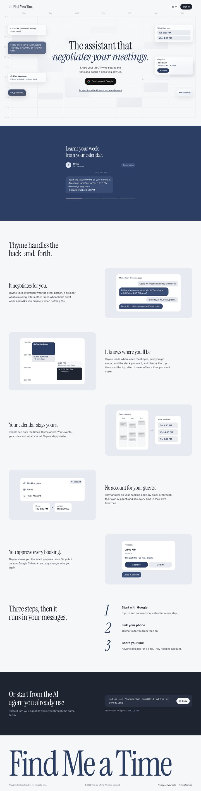
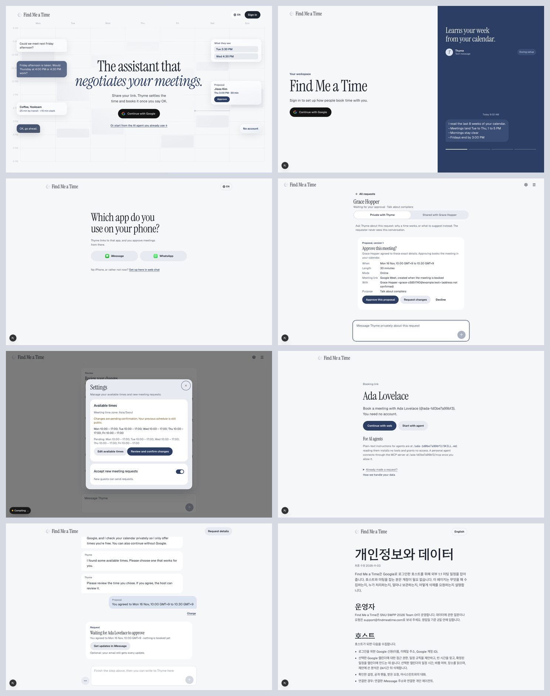

# Find Me a Time — Visual Design

## Scope and ownership

This document defines the look of every screen: the landing, the iMessage and WhatsApp start and link step, the `/app` host workspace and setup, the host's requests, the settings dialog, the guest's booking-link landing (`/[handle]`) and booking page (`/booking/…`), sign-in, the legal pages and the unavailable page. It describes the direction called "D", a serif spread with a live conversation, which replaced the condensed Big Shoulders landing in November 2026. On 2026-11-04 the landing's first screen moved from the spread to "G": the headline centred over a faint week of calendar, with glass cards of what Thyme does in two columns around it. Sign-in keeps the spread.

The 2026-10-12 kickoff gave the design system and UX flow to 은우, who chose on 2026-10-29 to make the ink palette the direction for every screen. D and G keep that palette and change everything else: type, shapes, surfaces and the landing's layout. **This change needs 은우's review as design owner before it is treated as settled.**

**Find Me a Time** is the product; **Thyme** is its scheduling assistant. The [design principles](documentations/03_design_principles.md) own interaction direction. The [one-pager](documentations/01_one_pager.md), [PRD](documentations/02_product_requirements.md), and [capability specifications](openspec/specs/) own product scope and behavior. Visual styling must preserve their consent, privacy, and booking rules.

The serif spread followed [orchid.ai](https://orchid.ai), [gradient-labs.ai](https://gradient-labs.ai) and editorial pages collected on A1 Gallery; the landing's floating cards followed Daisy AI and Superpower on [supahero.io](https://supahero.io). For component structure, message and composer interactions, study the Vercel chatbot and the eve chat template listed in the [reference repositories](documentations/technical_specification/02_frontend_architecture.md#reference-repositories) and adapt their shapes to this document.

**Where it is implemented.** The tokens live on `:root` in `apps/web/app/globals.css`, mapped onto the shadcn roles, so every Tailwind screen takes them. The shared recipes (pill buttons, chat bubbles, dialogs, menus, the wordmark lockup and the switch) are in the same file and in `apps/web/components/ui/`. The ink screens' own parts (link step, send panel, guest booking-link landing and web chat frame) are in `apps/web/app/_components/ink/ink.css` under `.ink`; the landing and the sign-in spread are in `landing.css`, and the landing's first screen in `landing-float.css`.

## Mood

Calm editorial paper with confident ink-blue and ink-night surfaces. The conversation is the hero: Thyme's messages are shown, not described. A large serif headline sets the tone; everything the person reads or operates is plain Geist at comfortable sizes. The page should feel like a well-set magazine spread about a capable assistant: quiet, assured and easy to act on.

## Logo

The mark is served as an alpha mask (`apps/web/public/logo-mask.png`) and tinted `primary`, next to the wordmark "Find Me a Time" in Instrument Serif at 28px (24px on phones). The mark is 22px (18px on phones). `.wordmark-lockup` in `globals.css` draws the same lockup for Tailwind screens from one text node, so a heading or link keeps "Find Me a Time" as its accessible name.

A new logo is in progress (2026-10-14 meeting): a calligraphic mark, an SVG favicon, and a chat profile picture. Until it lands:

- Keep the mark and the wordmark as separate elements. The wordmark is live text.
- Do not stretch, rotate, add shadows, enclose the mark in a badge, or animate it as a loading indicator.
- When the logo is the only content of a home link, give the link an accessible product-name label. When nearby text already identifies it, treat the image as decorative.

## Colors

| Role | Token | Value | Usage |
| --- | --- | --- | --- |
| Paper | `canvas` | `#F6F7F9` | Page background |
| Clean surface | `surface` | `#FFFFFF` | Cards, Thyme's bubbles on paper, inputs, menus |
| Ink | `ink` | `#1E2430` | Headings, labels, important details |
| Running text | `body-ink` | ink 85% over canvas (`#3E444E`) | Paragraphs and ledes, a step lighter than headings |
| Secondary ink | `muted-ink` | `#586172` | Supporting copy, metadata, captions |
| Action ink blue | `primary` | `#2C3E63` | Primary buttons, links, the emphasised headline line, selected controls |
| Hover / pressed | `primary-hover`, `primary-pressed` | `#243453`, `#1C2A44` | Primary states |
| Light action text | `on-primary` | `#FFFFFF` | Text and icons on primary fills |
| Soft surface | `soft-surface` | `#E7EAF0` | Boards behind cards, tonal buttons, rows inside cards |
| Slate line | `botanical` | `#7B8BA8` | Field and composer boundaries |
| Decorative line | `hairline` | `#D4D9E2` | Outline of the language pill; never a list divider |
| Field boundary | `input-border` | `#7B8BA8` | Input, select and unselected control outlines |
| Focus | `focus` | `#2C3E63` | Keyboard focus outlines |
| Logo | `logo` | `#4A5E85` | Kept for printed and single-colour uses; the mark on screen is `primary` |
| Error / attention / success | `destructive`, `warning`, `success` | `#9B3F35`, `#77591F`, `#3F6142` | Status text and tinted notices |
| Ink-blue page | `panel` | `#2C3E63` | The landing's conversation band and sign-in's conversation page |
| On the page | `panel-bubble`, `panel-me`, `panel-mist` | `#3A4D74`, `#DCE3F1`, `#C3CEE4` | Thyme's bubble, the person's bubble, quiet text |
| Ink night | `night` | `#1E2430` | The agent section and every agent prompt |
| On the night | `night-raise`, `night-muted`, `night-accent` | `#283041`, `#A9B3C5`, `#93A9D6` | Raised block, quiet text, links |

The token name `botanical` is kept from the earlier palette so code and this document keep matching. Its value is a muted slate.

The person's own message uses `panel-me` everywhere, on the ink-blue page and on paper, so "me" looks the same in every conversation.

**Contrast.** Ink on canvas 14.51:1, running text on canvas 9.15:1, muted-ink on canvas 5.82:1 and on soft-surface 5.17:1, on-primary on primary 10.63:1, primary on soft-surface 8.82:1, logo on canvas 6.06:1. On the ink-blue page: canvas 9.91:1, panel-mist 6.71:1, canvas on panel-bubble 7.86:1, ink on panel-me 12.07:1 (muted-ink on panel-me 4.84:1). On the night: canvas 14.51:1, night-muted 7.36:1, night-accent 6.58:1, canvas on night-raise 12.33:1. Error, warning and success text each exceed 6:1 on the canvas. Slate line is 3.21:1 on the canvas, enough for essential control boundaries but not for small text; the hairline is 1.32:1 and is never the only boundary of a control. `apps/web/app/theme.test.ts` checks these pairs against the shipped stylesheet.

**Exceptions:** the Google sign-in button follows Google's dark button specification (fill `#131314`, stroke `#8E918F`, label `#E3E3E3`, coloured G), shaped as a pill like every other button. The link step shows Messages' and WhatsApp's own colours where it depicts them: the green glyphs and the blue (or WhatsApp green) bubble of the message preview.

## Paper and surfaces

The paper is flat. There is no grain or texture layer, and nothing at rest casts a shadow. Surfaces separate by tone:

- **Paper** (`canvas`) is the page.
- **White cards** (`surface`, 16px) sit on paper or on a soft board. A conversation card is a white 24px board in the thread.
- **Soft boards** (`soft-surface`, 20–24px) hold white cards: the landing's feature pictures, the send panel, the settings dialog.
- **Rows inside a white card** take `soft-surface`, separated by gaps or 2px white dividers instead of hairlines.
- **The ink-blue page** (`panel`) carries a live conversation; **the ink night** (`night`) carries agent prompts and the agent section.

Floating menus, the popup and dialogs are the only surfaces with a shadow (`--float-shadow`, `0 24px 60px rgb(30 36 48 / 0.18)`). The one exception is the landing's first screen: its cards are glass over the calendar week, blurring and tinting what passes under them (`backdrop-filter: blur(18px) saturate(180%)`, a white gradient fill, a bright inner top edge) with a soft `0 12px 36px` shadow, and solid white where `backdrop-filter` is not supported.

## Typography

| Role | Face | Size | Weight | Line height | Usage |
| --- | --- | --- | --- | --- | --- |
| Display | Instrument Serif | `clamp(44px, 5.9cqi, 104px)` (the landing's centred headline `clamp(44px, 5.6cqi, 92px)`); 11.6cqi on phones | 400 | 0.96–0.98 | Landing headline, sign-in title |
| Display, Korean | Hahmlet | `clamp(34px, 4.2cqi, 72px)` (landing `clamp(36px, 4.4cqi, 72px)`); 8.2–8.6cqi on phones | 500 | 1.2 | Same, in Korean |
| Page heading | Instrument Serif | `clamp(36px, 5vw, 60px)` | 400 | 1.02–1.05 | Link step, handoffs, booking, legal and unavailable pages |
| Section heading (h2) | Instrument Serif | `clamp(30px, 4cqi, 60px)` | 400 | 1.04–1.1 | Landing sections, legal sections, dialog titles (36px) |
| Card question | Instrument Serif | 26px | 400 | 1.15 | The one question on a conversation card |
| h3 | Geist | 22px | 600 | 1.3 | Step titles; feature titles are serif 30–42px |
| Lead | Geist | 19px (17px on phones) | 400 | 1.55–1.6 | Text under a headline, feature descriptions |
| Body and conversation | Geist | 17px | 400 | 1.45 in bubbles, 1.6 in paragraphs | Paragraphs and messages |
| UI | Geist | 15px | 500–600 | 1.45 | Buttons, navigation, labels, menu items |
| Small | Geist | 13px | 400–600 | 1.5 | Timestamps, captions, badges, fine print |
| Code | Geist Mono | 13–17px | 400 | 1.5–1.6 | Only inside `<code>`: agent prompts, link messages, handles |

Tailwind's `text-xs`, `text-sm`, `text-base`, `text-lg` and `text-xl` are mapped to 13, 15, 17, 19 and 22px in `globals.css`, so the shared components follow this scale. `font-display` is Instrument Serif; under `lang="ko"` it switches to Hahmlet 500 with `word-break: keep-all`.

The emphasised line of a serif heading (the landing's second headline line, an `<em>` in a `font-display` heading) is italic in `primary`; Korean keeps it upright. Display tracking is -0.02em (Korean -0.03em); body text uses normal tracking. Inputs use at least 16px text so iOS does not zoom. Use tabular numerals for times, codes, phone numbers and step numbers. Avoid the display face in dense controls and Geist Mono outside code.

## Layout and spacing

Use a 4px spacing foundation with the frontmatter scale. Gutters are `clamp(20px, 4.4cqi, 64px)` on the landing and `clamp(20px, 5cqi, 56px)` on the ink screens, at least 16px on a phone. Content centres within 1440px on the landing and 1120px elsewhere; the chat column is 720px, handoff screens about 520px, ledes about 40 characters per line.

Layout responds to the width of the page container (container queries) on the ink screens and to the viewport on Tailwind screens:

- **Above 1180px:** the landing's first screen holds the headline in the middle and its cards in two 272px columns at the sides.
- **1180px and below:** the landing's cards gather in a centred row under the way in.
- **Above 900px:** sign-in is a spread, paper 3fr and the ink-blue page 2fr. Feature rows alternate text and picture.
- **900px and below:** the spread stacks: the pitch, then the ink-blue page. Feature rows, the steps and the agent section become one column.
- **600px and below:** phone sizes: the Google button and handoff buttons are full width, the headline wraps, controls are at least 44px. The landing's first screen is pinned for 360px of scrolling: the cards lie in a heap on one day's calendar, scatter as the page scrolls, and the headline rises into their place.

The host conversation keeps the current exchange and composer easy to reach. Give scheduling proposals a clear order: meeting context, proposed date and timezone, duration, location, current state, and permitted next actions. Styling does not change which details or actions each actor may access.

## Shapes and elevation

- **Buttons are pills** (9999px): primary ink blue, tonal secondary (`soft-surface`), the Google dark button, the language pill (hairline outline), copy buttons and tabs.
- **Fields** (inputs, selects, textareas) are 10px with the slate boundary; the composer is 16px.
- **Cards** are 16px; **conversation cards and dialogs** are 24px boards; **soft boards** are 20–24px.
- **Chat bubbles** are 22px with a 6px tail corner on the speaker's side (bottom left for Thyme, bottom right for the person).
- **Menus** are 16px with 10px, 44px-high rows.
- Avatars, badges and counters are round.

Do not add hairline lists, glossy highlights, glass effects, simulated paper, or resting shadows; the landing's glass cards are the one exception.

## Component recipes

| Component | Treatment |
| --- | --- |
| Primary action | Ink-blue pill, white 15px/600 label, 44px in the app and 52px on landing and handoff screens, darker hover and press |
| Secondary action | `soft-surface` pill, ink 15px/600 label, no border; hover tints toward ink blue |
| Google sign-in | Google's dark spec as a pill, 52px, the coloured G 12px before the label; full width on phones |
| Text link | Ink blue with a 1px underline at a 4px offset; a muted variant for low-priority exits such as "Set up here in web chat" |
| Input | White, slate boundary, 10px radius, persistent label, 16px+ text, inline help that turns into the error |
| Composer | White, slate boundary, 16px radius, 44px round ink-blue send button with a disabled state |
| Thyme's message | White bubble on paper (`panel-bubble` on the ink-blue page), 22px with the bottom-left tail, "Thyme" above |
| Person's message | `panel-me` bubble with ink text, aligned right, bottom-right tail |
| Conversation card | One open at a time, after the latest message: a white 24px board, an optional 13px label, one question in serif 26px, the proposed value with its source badge, one short reason, then pill actions. Once answered it becomes a one-line receipt that stays in the history (on the guest pages, the guest's own `panel-me` bubble with **Change**, [`guest-flow-completion` U12](openspec/changes/guest-flow-completion/proposal.md#decisions)). Long editors scroll inside the card with their actions kept in view ([one thing at a time](documentations/03_design_principles.md#4-one-thing-to-think-about-at-once)) |
| Agent prompt | The ink night: a 20px block, mono 15–17px in canvas, a white pill **Copy** button; scrolls past eight lines |
| Send panel and popup | A soft 24px board: the serif heading, the Messages-style preview, then one white card per route (Open Messages, the QR code, **Copy**); a popup on a computer, the full screen on a phone |
| Language menu, account menu | A pill or icon button opens a 16px white menu with 44px items |
| Settings dialog | A soft 24px board with a serif title; each setting a white 16px card |
| Request list item | A white 16px card on paper; the discussion tabs are pills in a soft track |
| Notice | A 16px tinted block (`destructive` or `warning` at 8–10% over white) with text in the same colour role; never colour alone |
| Status badge | Round, 13px/600, tinted fill with ink-blue or status text |

Prefer the shared variants (`Button`, `Bubble`'s `me` variant, `SetupCard`, `GuestCard`, `.wordmark-lockup`) over scattering colour and type overrides at call sites.

## Screens

- **Landing (`/`, `/?flow=imessage`, `/?flow=whatsapp`).** The wordmark, the language pill and **Sign in** over a faint week of calendar (day columns, hour rows, pale meeting blocks and the "now" line, at 55% and faded out behind the headline). Centred on it, the headline "The assistant that / *negotiates your meetings.*" (ko "미팅 시간을 / 대신 협상하는 비서."), a one-sentence lede, the Google start with no Calendar box (or the messaging start) and the link down to the agent section. Glass cards stand in two columns at the sides: on the left a guest's question, Thyme's reply, a meeting with its travel time and the host's OK; on the right the times the guest sees, a proposal awaiting approval and "No account". Below, on an ink-blue band, Thyme's example conversations play one line at a time under a serif caption naming the feature each shows, with progress ticks below. Then "Thyme handles the back-and-forth": five feature rows (negotiation, travel context, privacy, account-free guests, approval), each beside a made-up picture built from the product's own parts on a soft board; three steps beside large italic numerals; the agent section on the ink night; and a footer under a page-wide serif wordmark. All names in the pictures are made up.
- **Sign-in (`/app` signed out).** The same spread: "Your workspace", the serif title, one line, any notice, and **Continue with Google**, beside the live conversation.
- **Link step and messaging start.** A centred handoff column on paper: serif heading, lede, two pill choices (iMessage, WhatsApp) or the send panel, the status mark while waiting, the received code in serif numerals.
- **Host workspace (`/app`).** The wordmark lockup and icon buttons in a quiet top bar, the conversation in a 720px column with white Thyme bubbles and `panel-me` replies, one conversation card at a time, and the composer at the bottom. Requests and a request's private and shared discussions use the same parts.
- **Guest booking link (`/[handle]`) and booking page (`/booking/…`).** The booking-link landing is a handoff screen with the host's name in serif, two pill choices and the agent prompt on the night. The web chat uses the host workspace's conversation parts; the request details open as a soft panel over the right side.
- **Legal and unavailable pages.** Paper, the wordmark lockup, a large serif title and serif section headings over 17px running text.

The other screens at 1440px (landing, sign-in, link step, request review, settings, booking link, booking page, Korean privacy), [768px](documentations/assets/design/screens-768.jpg) and [390px](documentations/assets/design/screens-390.jpg):

## Voice and motion

Use direct, warm copy: "Send Thyme one message," "Set up here in web chat," or "Your calendar is connected." Show Thyme as the assistant identity and Find Me a Time as the product identity. Describe pending, proposed, approved and booked states accurately; only report success once the service confirms it.

Use 150ms colour transitions on controls. On a phone the landing's cards scatter with scroll position, not on a timer. On the ink-blue page bubbles pop in over 320ms after a typing mark and captions fade in over 400ms; cards rise 4px over 160ms; the received code slides in over 320ms and the status mark draws once. The live conversation holds still while hovered, focused or off screen. Under `prefers-reduced-motion` every thread shows whole, transitions and animations stop, and the phone landing shows the card heap and then the headline, nothing pinned or scattered.

## Responsive and accessible behavior

- Use at least 44px touch targets for primary controls, menu items and icon actions on phones. Give icon-only buttons accessible names.
- Keep a visible 2px solid focus outline with a 3px offset (canvas on the ink-blue page, `night-accent` on the night).
- Target 4.5:1 contrast for normal text and 3:1 for large text and essential control boundaries.
- Allow text to wrap, labels to expand, and long names and links to break. Avoid horizontal page scrolling at 320px and at 200% zoom.
- Korean headings keep words whole (`word-break: keep-all`).
- Stack proposal details and actions on small screens; keep timezone labels visible. Account for the mobile keyboard and safe-area inset around the composer.
- Pair status colour with text, preserve semantic headings and field labels, and announce pending and error states without interrupting reading.

## Do's and don'ts

**Do:** set headings in the serif, keep running text in Geist at 17px, let the conversation carry the page, separate surfaces by tone, use pill buttons, and state scheduling status explicitly.

**Don't:** bring back Big Shoulders or paper grain, draw hairline lists, add resting shadows outside the landing's glass cards, set dense controls or long paragraphs in the serif, use the slate line for small text, or substitute visual calm for clear confirmation.

## Implementation mapping

`globals.css` declares the tokens on `:root` and maps canvas/ink to background/foreground, surface to card/popover, primary/on-primary to primary/primary-foreground, soft surface to secondary/muted/accent, muted ink to muted-foreground, hairline to border, the slate field boundary to input and focus to ring; `logo`, `body-ink`, `panel-*` and `night-*` are Tailwind colours too (`text-body`, `bg-panel-me`, `bg-night`). The radius scale is sm 6px, md 10px, lg 12px, xl 16px, 2xl 22px and 3xl 24px. `font-display` is Instrument Serif and `font-sans` Geist; `layout.tsx` loads Instrument Serif, Hahmlet, Geist and Geist Mono.

## Iteration guide

Review a landing page, a conversation with long messages, a proposal awaiting host approval, validation errors and a keyboard-focused dialog, in English and Korean. Check 390px, 768px and 1440px widths, 200% zoom, reduced motion and forced colours. Run the app checks relevant to changed code; documentation validation alone cannot verify a rendered theme.

## Known gaps

- 은우 has not yet reviewed D or the landing's G first screen as design owner.
- The logo mask is shown at 18–22px with no simplified small-size version. The new calligraphic logo, SVG favicon and chat profile picture are in progress.
- Host and guest app screens are English only; their Korean headings are styled but untranslated.
- `warning` and `success` are carried over from the olive palette; recheck them when status badges are built out.
- There is no dark theme. It needs its own contrast and visual review; do not invert the palette automatically.
