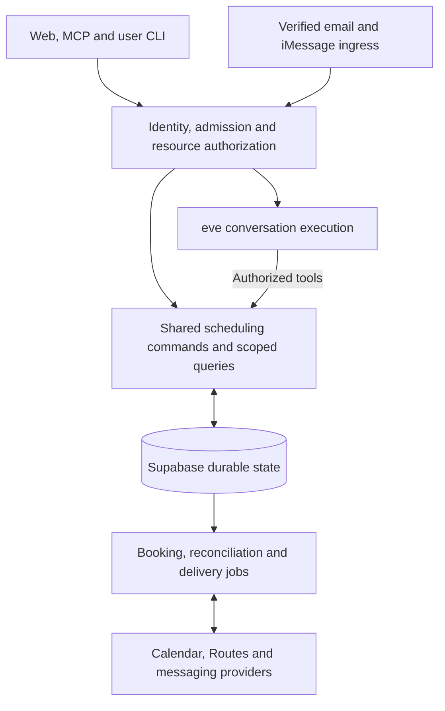

# Find Me a Time — Technical Specification

Status: proposed replacement architecture; no implementation

Date: 2026-10-13

The replacement coordinates one host and one external requester across web, email and personal-agent clients, with optional linked host iMessage. Every channel invokes one authorized scheduling boundary. The [PRD](02_product_requirements.md) owns scope and the [capability specs](../openspec/specs/) retain agreed behavior.

## Scope and foundation

| Concern | Retained direction | Fresh decision or evidence needed |
|---|---|---|
| Web | Next.js, React, TypeScript, npm; conversation-first UI | Dependency pins, separate builds, mobile/accessibility verification |
| Conversation runtime | eve with application-owned authorization | Persistence, deployment composition, protected streams, replay and terminal recovery spike |
| Identity/data | Supabase Auth and PostgreSQL; Google-only host login | Admission, current grants, isolated database baseline and reviewed migrations |
| Agent access | Remote MCP plus a thin user CLI | Resource-bound OAuth, revocation, requester bootstrap and each named client's acceptance |
| Calendar/travel | Google Calendar and Google Routes | Separate host/requester consent, travel policy, event reconciliation and controlled provider cases |
| Transactional email | Cloudflare Email Service, `no-reply@findmeatime.com` | Invitations, contact proof, recovery and booking delivery |
| Conversational email | AgentMail | Authenticated sender/thread binding, durable replies and uncertain-send recovery |
| Host iMessage | Photon Spectrum | Verified private binding, native/adapter compatibility, attribution and real-device delivery |
| Hosting | Recorded Vercel release origin | Runtime placement, consumer ownership and fresh deployment checks |

The selected Supabase project is linked and its empty application baseline is verified in [provider setup](technical_specification/03_provider_setup.md#clean-project-recheck--2026-10-13). Managed identity/configuration/extensions remain; the release origin and provider/client readiness are still verification targets. Model ID, provider entitlement, dependency versions and runtime hosting must be freshly recorded before they are used.

### Backend decision

Keep Supabase as identity and durable domain storage. Use eve as the intended conversation engine, with a bounded proof before expansion. Application code owns actor/resource/audience bindings, proposal versions, human decisions and external-effect recovery. A runtime session, tool approval or OAuth grant cannot establish meeting approval. Any runtime replacement requires an explicit design decision.

## Architecture

The diagram shows logical responsibilities. Final process/worker placement is a foundation exit decision, not a reason to create extra services now.

## User surfaces and trust boundaries

Hosts use `/app` for access, setup, request selection, private review and settings. Requesters start at `/{handle}` and continue through request-scoped access at `/booking/[bookingId]`. Public `/SKILL.md` and `/{handle}/SKILL.md` describe connection steps without granting access. Provider consent returns to the same authorized context.

Keep host setup, host-private request discussion and requester-facing history distinct. Resolve actor, resource and audience on the server for every read, stream and action. Provider secrets remain server-side. See the [page list](user_experience/04_page_list.md).

## Scheduling guarantees

Deterministic calendar, rule and travel checks filter candidates before AI ranking. Booking requires requester agreement and attributable host approval for the current version, followed by fresh feasibility checks. Persist stable event identity before dispatch; reconcile uncertain writes before another create. Failed delivery does not change confirmed booking status. Initial release excludes automated post-booking rescheduling/cancellation and private host email.

## Detailed design owners

[Backend architecture](technical_specification/01_backend_architecture.md) owns domain and effect design. [Frontend architecture](technical_specification/02_frontend_architecture.md) owns source organization, UI state and streaming. [Provider setup](technical_specification/03_provider_setup.md) owns environment prerequisites. [Implementation plan](technical_specification/04_implementation_plan.md) owns delivery gates; the [acceptance inventory](technical_specification/07_acceptance_inventory.md) maps AC-01–AC-28.
