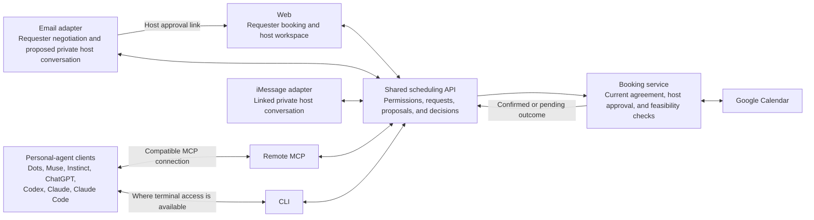

# Find Me a Time — Interfaces

Status: Draft for team review\
Date: 2026-10-19\
Basis: [Product requirements](../02_product_requirements.md)\
Companion: [User journeys and flows](01_user_journeys.md)

This document explains which interfaces people and personal agents use, what each interface is for, and how they connect to the same scheduling workflow. It describes intended product design, not implemented integrations. The PRD owns release requirements and acceptance criteria.

Design basis: the [page list](04_page_list.md) defines the proposed web routes and contextual actions. The [frontend architecture](../technical_specification/02_frontend_architecture.md) proposes Next.js/eve over the scheduling backend. The host-sent link code direction for iMessage linking, with the service-sent code as fallback, remains a proposed delta; the browser card, proof backend, live delivery and linked conversation must be implemented and verified.

## Channel direction

Make the personal agent the primary entry point for agent users: paste `Let me use findmeatime.com for my scheduling` to become a host, or `Let me schedule a meeting with findmeatime.com/dodo` to request a meeting. The pages lead the agent to `/SKILL.md` or `/{host}/SKILL.md`; those paths can be pasted directly when a client cannot find the instructions from the page. The agent guides the workflow and asks only for missing information, required consent, and decisions. The application serves both paths on `https://release.findmeatime.com`; the root-domain URLs remain the intended launch entry points.

Anyone with a Google account can become a host; completing Google sign-in creates an active host account, and a public booking profile requires completed setup. The public root skill explains this and directs users without an account to web Google sign-in. Existing active hosts resume setup normally. Requesters using an active host's link remain account-free. They can optionally share Google Calendar availability on the **Continue with Google** screen or through a later browser consent; this does not enroll them as hosts.

Build one responsive web application for mobile and desktop. Website chat and linked private iMessage guide host setup through the same durable draft and explicit settings review. In the inline linking flow, tapping **Connect iMessage** on the authenticated website gets a one-time link code and at once opens the Messages app with the line's number and the link message already in the input; where Messages cannot open, the card shows the number, the code, **Copy** and a QR code of the same deep link. The host sends the message from their own iMessage, then confirms the masked sender on the website; the fallback has the host enter an E.164 number, receive a six-digit code in iMessage and type it back, and the website never displays a code it sent. Connect/Maybe later, the link code, phone/code entry, expiry, retry, number changes and confirmed unlink stay inside `/app`; reload restores only masked server state. Make the host and requester web workspaces conversation-first: show current settings, candidate times, proposals and decisions as reviewable artifacts with labeled action buttons in context. Keep structured setup controls in clearly labeled in-chat sections for precise edits. The private booking link itself grants request-scoped browser access without credential-paste controls. When the link is lost or expired, the public host page and the booking destination offer labeled, keyboard-operable link resend to the previously verified current contact, with generic feedback and no protected details. The [requester booking destination](04_page_list.md#requester-booking-destination) describes this resend flow. Sign-in and Google consent continue in the browser. Web also handles full request management and connection settings, while the public booking page lets requesters coordinate without an account. A native mobile app is outside the initial release.

The host chats with the agent at `/app`, the single host page for sign-in state, setup, request review and settings. A compact menu opens contextual controls and sign-out; request cards or a picker select the discussion within the same page. The guest's conversation starts on the public host route and continues in the same thread on the protected booking route. These workspaces use centered chat with no persistent sidebar or dashboard metrics. Host request review switches between shared and private discussions, showing one at a time. Status and decisions appear in the transcript, while exact setup settings stay in expandable review and edit sections. On phones, the transcript scrolls independently so the composer remains reachable.

For hosts who use iMessage, make the linked private conversation their main day-to-day channel for request summaries, discussion, and decisions, and for any remaining or later setup step short of sign-in, consent and the exact settings confirmation. Hosts can instead use web or a supported personal agent. Channel choice should not require repeating a conversation or maintaining a second request.

Also offer a private host–assistant email conversation, with final approval through authenticated web review. This is a proposed extension from the latest product discussion: the current PRD and numbered journeys cover requester email, but do not yet specify host email requirements or acceptance scenarios. The email design below should be incorporated there before implementation.

Active hosts see a compact workspace heading above the conversation. Saved Calendar choices collapse to a count and named booking destination, with **Change calendar choices** to reopen the current selections. Missing or invalid saved selections stay open for correction. **Close without saving** and **Cancel calendar edits** discard only unsubmitted selection changes. Saving refreshes the next setup question automatically. **Manage Google connection** exposes reconnect/disconnect separately from preference editing.

After calendar choices are saved, Thyme analyzes the selected conflict calendars over the past and next four weeks automatically and reports preferred times, weekly meeting load (internal and external), note-like entries and frequent places as questions with evidence, as defined in the [analysis dimensions](../02_product_requirements.md#calendar-analysis-dimensions). There is no suggestions-versus-manual question or repeated calendar picker. Suggestions remain reviewable drafts. Failed analysis offers retry or manual preferences; existing, dismissed or expired results do not trigger repeated scans on reload.

Preference details and completed analysis evidence collapse after use while their review/edit actions remain available. The exact preference review opens automatically before final confirmation, including weekly windows and applicable physical-meeting choices. Collapsing a card never confirms settings or changes the server draft. Compact progress expands to show completed steps.

Host preference editors focus their title when opened from guidance or an **Edit** action. **Cancel edit** returns focus to the opening control; saving a draft focuses its result without claiming settings confirmation. Calendar consent returns focus to the verified connection result (or its recovery error), with the current server draft and completed preference choices preserved. The return URL alone cannot establish consent.

## Interface inventory

| Interface | Who uses it | Main responsibility | Access and approval |
|---|---|---|---|
| Sign-in and host setup web flow | Prospective host | Sign in with Google, get an active host account immediately, and start or resume setup. | Sign-in creates the active host account; public booking profiles additionally require completed setup. Operators use the administrator CLI for host suspension and restoration, private diagnostics and audited recovery; abuse controls are sign-up and handle-change rate limits, reserved handles and suspension. |
| Public skill documents | Host or requester through a personal agent | The landing page and each host page expose an agent section that links to `/SKILL.md` and `/{host}/SKILL.md`, which guide onboarding and requesting that host. | Public instructions only; tools still enforce role-specific access, consent, and approval. |
| Public booking entry | Requester | `/{handle}` introduces the host and starts the guest's conversation as a draft request; once the guest gives a name and email, the same thread continues at `/booking/[bookingId]`. | No account required; public entry exposes no existing request history. |
| Private booking conversation and receipt | Requester | `/booking/[bookingId]` supports clarification, optional Calendar availability, candidate selection, agreement and status; after booking, shows the permitted final receipt. | The random booking link is the requester's credential; nothing else is required. Cannot approve for the host. |
| Host web workspace (`/app`) | Host | Calendar and rule setup, contextual request selection, private discussion, proposal review, connection management, and recovery within one agent chat page. | Authenticated, active host account; explicit approval of the displayed current proposal. |
| Requester email | Requester | Submit details, exchange alternatives, agree to shared details, and receive status notifications and outcomes. | Verified request continuation; sender claims do not grant host access. |
| Host email — proposed extension | Host | Receive summaries, discuss privately, request revisions or decline, and receive outcomes. | Verified host conversation; final meeting approval uses an authenticated web link. |
| iMessage | Host | Opt-in private summaries, questions, revisions, approval, decline, and outcomes. | Linked host identity and exact proposal context; use web when these cannot be established. |
| Personal-agent client | Requester or host | Let users coordinate through an agent they already use. | Role-specific MCP or CLI access; host decisions require explicit human confirmation. |
| Remote MCP server | Compatible personal-agent clients | Discover and invoke scheduling operations. | OAuth for protected host access; account-free, request-scoped requester access. |
| CLI | Terminal-based agents and scripts | Perform the same scheduling operations with structured JSON results. | Equivalent role permissions; CLI login design remains open. |
| Shared scheduling API | Our web application, channel adapters, MCP server, and CLI | Enforce permissions, proposal versions, workflow transitions, and booking rules. | One authority boundary and request state across interfaces. A general public REST API is not an additional release commitment. |

MCP and CLI are connection options for personal-agent clients, not additional chat applications we need to build. The CLI and MCP server both use the shared scheduling API; the CLI does not need to route through MCP.

Requester calendar consent is requested together with **Continue with Google**, or later in a browser from web, email continuation or a personal-agent response, and returns to the same protected request. It does not require creating a product account. Provide a visible skip/disconnect path and manual or authorized agent availability as alternatives. The host and personal agents receive appropriate proposed times, not the requester's private events or tokens.

## Onboarding message presentation

Authored onboarding messages reveal progressively, one message at a time: greeting, connection prompt or verified congratulations, then calendar selection. Actions appear after their preceding message completes. Avoid a duplicate “Google connection saved.” status; consent-return focus moves to the verified congratulations. Reduced-motion users receive complete messages immediately. Actual assistant replies continue to render from the server stream.

Once an authored message finishes, revisits and refreshes show it immediately. Completion fingerprints are retained in this browser per authorized conversation, without storing message text; a new conversation after an onboarding reset starts fresh. Unfinished messages can stream again.

## Booking confirmation email and calendar invitation

Use the Cal.com guest confirmation email reviewed on 2026-10-19 (a confirmed coffee meeting between a host and a guest) as the presentation reference: a readable confirmation email and a calendar-native event are complementary views of the same confirmed booking. Reuse the pattern, not the sample's personal details, meeting credentials or management tokens. These are meeting invitations sent for confirmed bookings.

| Element | Reference pattern | Find Me a Time |
|---|---|---|
| Sender and replies | From shows the host's display name on the product's sender address; Reply-To is the host's own email, so a reply reaches the host directly. | From `{host display name} <no-reply@findmeatime.com>`. Reply-To is the other party's email: the host's verified Google email on the requester's copy and the requester's verified email on the host's copy. Never a shared or provider mailbox. |
| Subject | `{title} between {host} and {guest}`, rendered in the recipient's language (the Korean sample reads `{host} 와 {guest} 사이의 {title}`). | Same pattern. The HTML `<title>` and preheader read `Confirmed: {start}–{end}, {weekday}, {date}, {title} with {other party}`. |
| Body | A **Confirmed** badge and one sentence (“Your event has been scheduled. Emails with this info were sent to all attendees.”), then four labeled blocks: **What** (title), **When** (weekday, date, start–end with the timezone name), **Who** (each person with a role label such as Organizer or Guest and their email), **Where** (place or join link). | The same four blocks, generated from the confirmed event details, with duration and timezone name explicit. |
| Actions | Reschedule, Cancel, Report booking and Support links below the blocks. | **View booking** and, for online meetings, **Join meeting**, plus a support contact line. No in-product Reschedule or Cancel in the first release. |
| Localization | Subject, labels, weekday and time formats follow the recipient's language; times use the invitee's timezone, which the text also names. | Render each recipient's copy in that recipient's language (English or Korean) and timezone. |
| Plain text | A `text/plain` alternative repeats the blocks and the booking link. | Required. |
| Calendar parts | An inline `text/calendar; method=REQUEST` part plus an `application/ics` attachment with one `VEVENT`: `UID`, `SUMMARY`, UTC `DTSTART`/`DTEND`, `LOCATION`, `STATUS:CONFIRMED`, `ORGANIZER;CN=` the host with the host's email, `ATTENDEE;RSVP=TRUE;PARTSTAT=ACCEPTED` for the guest, and a `DESCRIPTION` repeating the blocks and the booking link. | Attach the same parts only when `UID` equals the created Google Calendar event's `iCalUID`, so the guest's calendar merges the invitation with the event instead of showing two. Verify this during implementation; if the UID cannot be matched, send no calendar part and rely on the calendar-native invitation. |

| Surface | Content | Actions |
|---|---|---|
| Confirmation email | Confirmed status; meeting title/purpose; date, start/end time, duration and explicit timezone; organizer and participants; physical location or online meeting link. Provide readable HTML and a plain-text equivalent. | **Join meeting** when an online URL exists; **View booking** opens the requester receipt at `/booking/[bookingId]`; the host opens the selected request in `/app?request=[requestId]`, which never carries the requester's booking link ([`host-review-and-booking`](../../openspec/changes/host-review-and-booking/proposal.md#decisions) D12). |
| Calendar invitation | Structured title, start/end instants, timezone, organizer, attendees and location/join URL. A concise description contains shared purpose, practical joining details and the booking-page link. | Calendar-native response controls; **View booking** in the description. |
| Booking page | Current authoritative status and, once confirmed, the final event details and joining information permitted for that viewer. | Continue negotiation while active; view the terminal receipt after closure within the credential's lifetime. |

The service may send confirmation email while the host's selected calendar supplies event organizer identity. Do not replace the organizer with the email delivery provider or assume every selected calendar has the host's primary email. Calendar RSVP/accepted flags, delivery receipts and email opening do not establish our requester agreement or host approval; those remain recorded application decisions.

Generate all views from the same confirmed event details. An uncertain write must not produce a “Confirmed” email or receipt. Keep delivery outcome separate: failure or retry does not recreate the calendar event. Calendar description links contain no host-private notes, rules, exception reasons or credential granting transcript access; opening them still requires appropriate authorization. The requester's confirmation email carries the booking link; after booking that link shows only this receipt and grants no conversation history, scheduling mutation or Calendar access. An expired booking link denies access. Hosts use their authenticated workspace session.

The first release offers **View booking** rather than in-product **Reschedule** or **Cancel** actions. Users manage post-booking changes through their existing calendar; pre-booking withdrawal remains a separate permitted action. Exact new rendering and delivery behavior must be captured and tested in the owning OpenSpec change before implementation; this design does not claim invitation delivery is already built.

## How the interfaces connect

The diagram shows logical responsibilities, not a deployment plan or verified compatibility. Calendar access and event creation belong to the scheduling service. Requesters and their agents do not receive the host's Google Calendar credentials or private calendar data.

## Host email experience — proposed extension

The host should be able to email the scheduling assistant as part of managing a request. Keep this conversation separate from the requester-facing thread, even when both refer to the same request.

1. The host links and verifies an email address through their authenticated account and chooses email notifications.
2. The assistant sends a private request summary. The host can ask a question or request a change, such as “Try Thursday and make it 45 minutes.”
3. After verifying the sender's authority and request context, the assistant evaluates the change. Changed shared details return to the requester for agreement; private host discussion is not copied into that negotiation.
4. The assistant sends the resulting proposal with a link to authenticated web review. The host sees the current details and explicitly approves there. Opening the link alone is not approval, and an old link cannot approve a superseded proposal.
5. The host receives the confirmed booking or an accurate pending or failure status. They can continue in the web workspace if email delivery fails.

For the proposed initial email experience, a reply such as “Approve” directs the host to web review rather than recording approval. Inline email approval can be considered later after identity and proposal binding are designed and tested. A typed sender address, forwarded thread, quoted approval, or newly added recipient is not sufficient authority for private access or host actions. When verification or context is uncertain, move the action to authenticated web review.

AgentMail is the provider for managed conversational inboxes, threads, and replies. Cloudflare Email Service separately sends fixed transactional verification, recovery, and booking messages, including Supabase Auth mail through custom SMTP. For requesters, the address scheme, reply verification, thread linking, unlinking and recovery are designed in the [`requester-email-channel` change](../../openspec/changes/requester-email-channel/design.md): one product inbox with the host's `@handle` in a new thread's subject, DMARC or aligned DKIM before anything binds, and a thread bound to one request. This is request-specific scheduling assistance; it does not require general access to the host's inbox.

## Personal agents and authorization

Dots, Muse, Instinct, ChatGPT, Codex, Claude, and Claude Code are required compatibility targets in the PRD. Test each separately for discovery, connection, role permissions, request continuation, human confirmation, and recovery. Support for ChatGPT does not establish Codex support; likewise, Claude and Claude Code need separate verification. Do not assume every client offers both MCP and terminal access.

The requester normally pastes the host-specific skill prompt; the ordinary public booking link is also supported. The agent submits details, negotiates, expresses requester agreement within its delegated authority, and tracks the result. Missing information or decisions outside that authority return to the requester. Sharing the link does not automatically configure an MCP connection or install a CLI; missing setup needs a clear next step or web continuation.

The root skill document guides host onboarding and supported tool connection. For protected host MCP access, the host signs in through a browser, reviews OAuth permissions, and grants or denies access. The agent resumes setup after consent and returns shareable links only when host eligibility, calendar connection, and minimum settings are ready. A valid OAuth connection does not restore a suspended host. They can inspect and revoke connections in web settings. The CLI follows the same permission boundaries; its login mechanism remains open. See [agent connection and authorization](../02_product_requirements.md#agent-connection-and-authorization) for the product requirements.

Three permissions remain distinct: Google Calendar authorization lets our service use the consenting host's calendars or the requester's selected availability; an MCP OAuth grant lets a client perform permitted service operations; explicit host approval authorizes booking one current proposal, subject to requester agreement and revalidation. Neither an agent credential nor a standing instruction to manage scheduling replaces that last decision.

## Integration choices and scope

- **Email:** Use Cloudflare Email Service for transactional verification, recovery, booking, and Supabase Auth custom SMTP. Use AgentMail for managed inboxes and multi-turn conversations, mapping its inbox/thread/message IDs to application-owned conversations. Keep private host threads separate from requester threads. See the [email provider design](../technical_specification/01_backend_architecture.md#email-provider-direction).
- **iMessage:** Use Photon Spectrum as the transport direction. Do not assume a native eve Photon adapter is compatible with Spectrum credentials without verification. Transport or runtime approval mechanisms must still enforce the product's explicit host-confirmation rule.
- **Mobile:** Use responsive web for the initial release. Consider a native app later if post-launch evidence shows recurring needs that existing channels cannot meet.
- **Agent-to-agent coordination:** The application coordinates requester and host agents through shared scheduling state. A separate agent-to-agent protocol endpoint is not currently a release requirement.
- **Delivery order:** Web is the setup and recovery foundation; MCP is the primary personal-agent interface and CLI complements it. Channel delivery order and client support details still need agreement, without silently dropping the PRD's required integrations. Host email remains the scope extension identified above.

All channels inherit the PRD's privacy and lifecycle rules. Changed proposals require fresh approval; stale messages and retries cannot duplicate bookings. A delivered message, read receipt, requester agreement, or unconfirmed calendar write must never be reported as a confirmed meeting.

## Verification scope

The [chat workspace specification](../../openspec/specs/chat-workspaces/spec.md) owns the agreed contextual-artifact and explicit-decision behavior. The [page list](04_page_list.md) describes the proposed host and requester workspaces.

The implementation must verify website setup, requester conversation, email, MCP, CLI, and full iMessage journeys independently. Unconfirmed web chat text has no agreement or approval authority; channel decisions require the verified, current-proposal confirmation mechanism described above.

### Proposed web confirmation receipt

Once provider evidence confirms booking, the host's selected request and the requester's protected booking page display the same frozen title/purpose, start/end, duration, timezone, participant emails and location. Online HTTPS locations offer **Join meeting**; an allowlisted saved Calendar URL offers **Open in Google Calendar**. **Check booking status** refreshes confirmation and the viewer's own email status. Pending or failed email does not change the confirmed meeting. An uncertain Calendar write remains “Booking in progress” without a join action or confirmed receipt. Expired or rotated requester access removes the receipt on refresh and does not reveal the prior conversation. The receipt displays the actual Calendar organizer from provider evidence. Confirmation email, receipt-only access, local fault/browser checks and controlled inbox acceptance must be implemented and verified together.

### Withdrawal before Calendar dispatch

An approved request can still show **Withdraw request** to its requester and **Decline request** to its host while its saved Calendar attempt is prepared and has no dispatch evidence. The card explains that Calendar creation has not started and the server will check again on confirmation. The existing explicit confirmation and same-decision retry remain usable in that state. Once dispatch may have begun, both actions disappear and the card explains that the outcome is pending; it never claims to cancel an existing event.

## Protected requester email linking

The private booking conversation offers **Continue by email** below contact verification. A requester with a verified current contact can create a private linking message and send it exactly as shown in a new thread from that address to the displayed inbox. The page remains pending until the authenticated message binds successfully. The linking text stays outside chat and browser storage, disappears after binding, unlinking or expiry, and is recoverable after reloading the protected page while still pending.

**Check email link** refreshes status; **Unlink email** revokes the old thread even during a receiver outage. An uncertain command offers **Retry same linking action**, preserving its operation identity. Unavailable email always offers continuation in the private web conversation. The linking message is a one-time `FMAT-` code valid for 30 minutes; it binds only as the first message of a new thread from the confirmed address, and a forwarded or late copy voids it ([design 4 and 5](../../openspec/changes/requester-email-channel/design.md#4-continue-by-email)). The controls alone do not establish live channel readiness: the product inbox, its webhook and controlled end-to-end acceptance remain open.

## Optional iMessage contact card

After verified linking, **Add to contacts** is an optional action in the connected card; the conversation already exists because the host sent the link message, so the card arrives as a reply. Explain before the action that it requests a card in the linked conversation and the recipient chooses whether to save it. Setup and web chat remain available without this choice.

Show queued, provider-accepted, failed, revoked or uncertain status. For acceptance, ask the host to check iMessage and choose whether to save; never report delivery or saving as confirmed. For uncertainty, ask them to check the existing conversation and offer **Check contact status**, without a resend button. A failed status read hides **Add to contacts** until status can be verified. Reload restores the persisted request, and a new verified link starts with its own status. Unlinking does not recall a card already sent. Live device appearance and profile-name behavior remain subject to [provider acceptance](../technical_specification/03_provider_setup.md#display-name-contact-cards-and-profile-sync).
