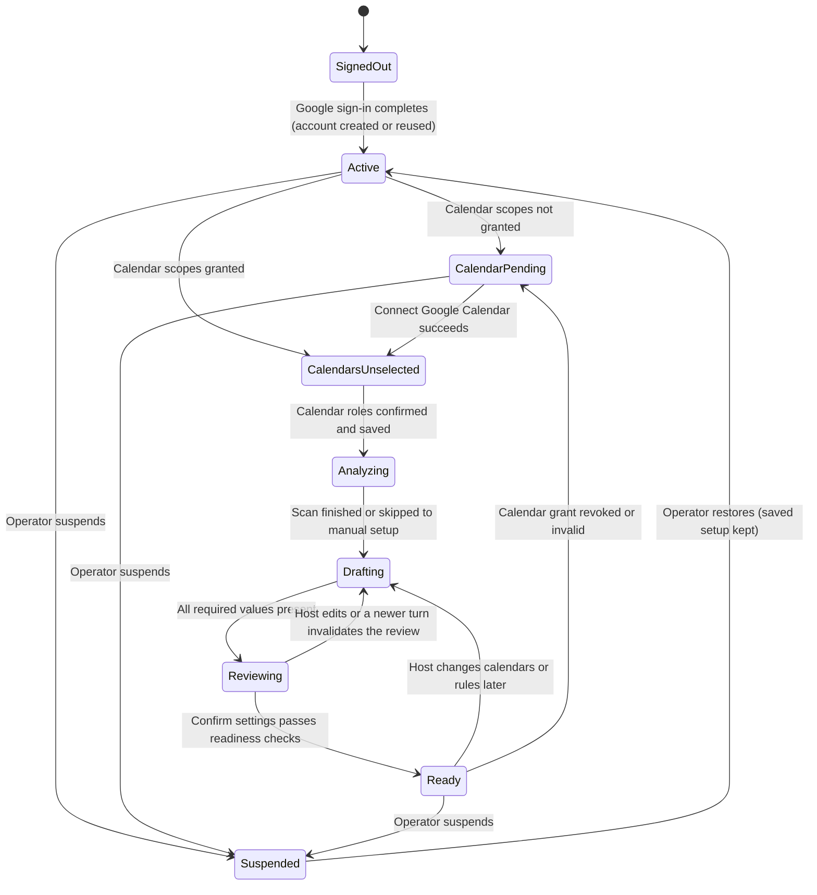
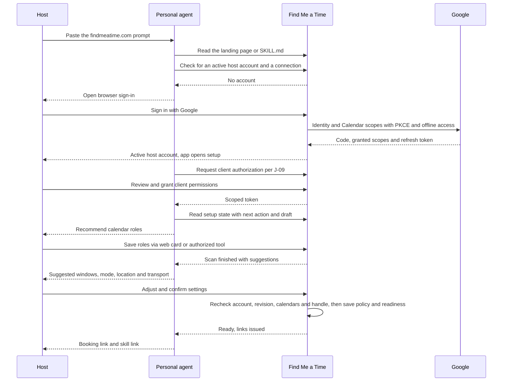

# Host Onboarding Flow

Status: proposed flow design; implementation pending\
Date: 2026-10-19\
Basis: [J-01 host setup](01_user_journeys.md#j-01--host-setup), [PRD section 5](../02_product_requirements.md#5-main-user-journey), [host account contract](../../openspec/specs/host-admission/spec.md), [chat workspace contract](../../openspec/specs/chat-workspaces/spec.md), [analysis retention contract](../../openspec/specs/calendar-analysis-retention/spec.md)\
Companions: [Guest booking flow](06_guest_booking_flow.md), [Agent configuration](../technical_specification/04_agent_configuration.md)

This document breaks host onboarding into states, steps, server checks and recorded data. The journey explains the experience; this flow explains what must be true at each transition. It introduces no new behavior: where a step depends on a contract, the contract wins.

## Scope

Covered: from the first visit or pasted prompt to a **ready** host with a public booking link, including the optional personal-agent connection and the optional iMessage link. Not covered: request handling after a requester arrives (see the [guest booking flow](06_guest_booking_flow.md)), proposal review (J-04 to J-06) and operator suspension (administrator CLI).

Two entry paths share every server check:

| Path | Entry | Who leads | Differences |
|---|---|---|---|
| Agent-led | Host pastes `Let me use findmeatime.com for my scheduling` into a personal agent | The agent reads `/SKILL.md`, checks capabilities, opens browser steps and resumes | Adds the personal-agent authorization (J-09); returns links in the agent chat |
| Direct web | Host opens `/` and chooses **Sign in with Google** | The in-app agent conversation at `/app` | Skips client authorization; share links appear in the workspace |

## Setup states

The server derives the state from durable records on every load; the browser never carries it. **Ready** is the only state with a public profile and `/{handle}/SKILL.md`. Every state before it resumes at `/app` with the next action first, as the [workspace contract](../../openspec/specs/chat-workspaces/spec.md#requirement-conversation-first-entry) requires.

## Steps

| Step | Surface | Host sees and does | Server check and record | Leaves the step when | If it fails or stops |
|---|---|---|---|---|---|
| H0 Entry | Agent chat, or `/` | Pastes the prompt, or chooses **Sign in with Google** | Agent path: the public page or `/SKILL.md` names the entry; the agent asks the service whether an active host account and a connection exist. No private state before sign-in | The host is sent to browser sign-in, or an existing active host resumes | A client that cannot read the document or connect is given the smallest supported step or the web URL; nothing is claimed as done |
| H1 Sign-in and Calendar consent | Google consent screen, `/auth/callback` | One Google screen asks for identity and Calendar access (read selected calendars, create events). The host may uncheck the Calendar part | PKCE bound to this browser; offline access requested. The callback records the Google identity, the scopes actually granted and the refresh token, then creates one active host account per Google identity or returns the existing one. Redirect only to an allowlisted relative destination | `/app` opens in **Active** | Cancelled, replayed or wrong-browser returns establish no session; the host restarts at `/app`. Unchecked Calendar scopes still create the account and lead to **CalendarPending** |
| H2 Agent authorization (agent path) | `/connect/authorize` | Reviews the client's requested application permissions and grants or denies | Resource-bound OAuth with PKCE and an exact registered callback; the grant is tied to this host and the listed operations. It grants no Calendar access and no meeting approval | The client holds a scoped token, or the host declined | Denial leaves direct web setup available; the agent must not claim a connection |
| H3 Workspace resume | `/app` | The setup conversation opens with the server-derived next action; authored messages reveal one at a time (greeting, connection prompt or verified congratulations, then calendar selection) | Active host account required for any private state. The saved draft, if any, is restored | The next incomplete step is shown | A suspended host sees a neutral unavailable state with only sign-out and grant revocation |
| H4 Calendar roles | Calendar selection card | Sees the host's actual calendars with account and access labels and short reasons; the agent recommends conflict calendars and one writable booking destination; the host edits and saves | Requires granted Calendar scopes; otherwise **Connect Google Calendar** appears first. Validates that the destination accepts writes. Saving stores the confirmed roles and starts the first disclosed scan | Roles saved | Unreadable calendars produce a question or recovery action, never an assumption; **CalendarPending** returns here when the grant is missing |
| H5 Analysis | Analysis card | Sees which calendars and which range (past and next four weeks) are read, then evidence in four dimensions (preferred times, weekly meeting load split internal/external, note-like entries, frequent area and venue) or a bounded failure | Reads saved conflict calendars only and counts attendee email domains, never message bodies or contacts. Temporary evidence has an expiry under the [retention contract](../../openspec/specs/calendar-analysis-retention/spec.md); it is never policy | Suggestions available, or the host chooses **Set up manually** | **Analyze again** is the explicit refresh; reload, dismissal or expiry does not trigger a new scan |
| H6 Preference suggestions | Suggestion cards and weekly preview | Timezone, weekly meeting windows ordered by observed frequency, a weekly meeting limit, note-like entries to exclude, default duration and buffers, each labeled stated, inferred or starter default with its sample size, with **Use this**, **Adjust** or **Choose my own** | Writes draft values with a revision; a typed correction updates the draft and invalidates older reviews. Nothing is confirmed policy yet | Required values present | Model failure leaves structured editors and existing saved rules usable |
| H7 Mode, location and transport | Explicit question cards | Answers **Online**, **In person** or **Either**; for in-person or either, preferred areas or venues with the most frequent observed area and venue offered first, **Enter a place** or **Decide per meeting**; then usual travel mode or **Depends on the trip**, and the extra travel buffer | Explicit answers are required; a suggestion or preselection is not an answer. Online-only skips location and transport. Home or work addresses are never inferred | Mode recorded and, where applicable, location and transport policy recorded | Unsupported regional routing stays unresolved or uses an explicit manual allowance |
| H8 Handle | Handle field in the review | Sees a proposed handle and can change it | Unique, not reserved, change rate bounded, and never reassigned from another host | Handle accepted | Collision or reserved name is rejected without changing either identity |
| H9 Final review and confirmation | Setup review card | Reads the exact proposed settings, including windows, mode, location and transport, then chooses **Confirm and save proposed settings** | Rechecks inside one transaction: active account, current draft revision, valid calendar metadata, writable destination, unique handle, required values. Saves confirmed policy and sets readiness | **Ready**: public profile, `/{handle}` and `/{handle}/SKILL.md` exist | A newer web or iMessage turn invalidates the review; the host reviews the latest draft again |
| H10 Links | Agent chat or share-links card | Receives `findmeatime.com/{handle}` and the skill document link | Links are issued only from server-confirmed readiness | Done | Before readiness, no booking link is shown or returned |
| H11 Optional iMessage link | Inline channel card | **Connect iMessage** or **Maybe later**; sees the line number and a one-time link code with **Copy**, taps **Open Messages** to land in the Messages app with the code already in the input and sends it from their own iMessage (or pastes the copied text), then **Confirm and link** on the masked sender; or **Send me a code instead** to receive a six-digit code and type it in the same browser | The channel consumes the inbound link message before any model turn and matches it to the pending link request bound to this session; the fallback code field posts directly to the server. Neither code enters the transcript or model context. The binding is created only after browser confirmation and can be unlinked later | Linked, skipped or deferred | Wrong, expired or foreign-sender codes and delivery failures leave web setup available; the fallback consumes one of the line's daily new conversations; this delta is proposed and unverified on real devices |

Steps H4 to H9 run inside one conversation, one small card at a time: the workspace shows only the current step's card, labeled with its step number and a way back, and the review gathers every answer at the end ([one thing to think about at once](../03_design_principles.md#4-one-thing-to-think-about-at-once)). The agent leads with a suggested answer where it safely can and asks one focused question only for an unresolved detail. Precise edits open labeled in-chat editors that restore focus when closed.

## What is recorded

| Record | Created at | Authoritative for | Notes |
|---|---|---|---|
| Host account | H1 | Identity, status (active or suspended), creation time | One per Google identity; repeated sign-in returns it |
| Google grant | H1 or H4 | Granted scopes and the encrypted refresh token | Recorded separately from identity even though one screen requested both; revocation returns the host to **CalendarPending** |
| Agent grant | H2 | Which client may call which host operations | Revocable in settings; separate from Google and from meeting approval |
| Calendar roles | H4 | Conflict calendars and the writable booking destination | Metadata is rechecked at H9 |
| Analysis evidence | H5 | Suggestions and their disclosed scope | Temporary and expiring; never policy |
| Settings draft | H6 to H8 | In-progress values with a revision | Replaced by edits; never used for scheduling |
| Confirmed policy | H9 | Rules, timezone, windows, duration, buffers, weekly meeting limit, note-like exclusions, mode, preferred area and default venue, and transport policy | The only source for feasibility checks |
| Handle | H8, fixed at H9 | Public identity | Stable; changes are rate-bounded |
| Readiness | H9 | Whether the public profile exists | Derived from the shared eligibility-and-readiness guard, never set by the client |
| Channel binding | H11 | The verified iMessage sender for this host | Optional; unlinking revokes future access |

Any memory slot the conversation runtime keeps holds non-authoritative context only; scheduling policy is written through confirmed settings commands alone (see [agent configuration](../technical_specification/04_agent_configuration.md)).

## Agent-led sequence

The diagram shows authority, not transport details. Browser steps (sign-in, client consent, the iMessage code) never pass through the agent chat.

## Setup over iMessage

A host who has linked iMessage (H11) can run or resume every conversational step there. The channel maps the verified sender to the host principal and to the same setup session that `/app` uses, so progress, the draft and the next action are shared: a question answered in iMessage is not asked again on web, and the reverse. The `setup` command enters or returns to onboarding; `review` shows the current settings review.

| Step | In iMessage | Why |
|---|---|---|
| H1 sign-in, H2 client consent, H4 Calendar grant | A link opens the browser; the conversation resumes with the verified result | Google consent and OAuth are browser actions, and tokens never travel through chat |
| H4 calendar roles | The agent lists the host's calendars with recommended roles; the host answers in text (“check personal and class, book on personal”); the agent echoes the parsed selection and saves it on the host's confirmation | The same calendar metadata checks as the web card |
| H5 analysis, H6 suggestions, H7 mode, location and transport | Each question arrives as one message with its evidence and a suggested answer; a plain reply (“yes”, “1 pm is fine”, “in person, Yeoksam”) updates the draft after the agent echoes what it understood | Draft changes are reversible; an ambiguous reply gets one clarifying question |
| H8 handle | Offered as a suggestion; the reply is validated like the web field | Reserved, taken or rate-limited handles are explained in the reply |
| H9 final review and confirmation | The agent sends the complete authored review with a review reference; the host confirms with the exact authored command for that reference, or opens the web review link | A confirmation must name the exact review; a shortened summary or “ok” cannot save policy, and a review that does not fit one message goes to the browser |
| H10 links | Returned in the conversation once the server confirms readiness | The same readiness check |

Answers given in iMessage are draft changes, never confirmed policy, until the H9 confirmation. Later changes work the same way: the host writes what to change, the agent echoes the resulting draft, and the exact command confirms it. The iMessage settings confirmation belongs to the proposed iMessage delta and needs its own reviewed change before implementation.

## Interruption, resume and failure

| Situation | Behavior |
|---|---|
| The host closes the browser or the agent session mid-setup | The next visit to `/app`, or the next agent turn, resumes from the saved draft and the server-derived next action without repeating answered questions |
| The host runs the onboarding prompt again | The existing account and draft are reused; no second host is created |
| Calendar scopes were unchecked at sign-in | The account exists; setup shows **Connect Google Calendar** before calendar roles and keeps unrelated settings editable |
| The Google grant is revoked or expires after setup | The host returns to **CalendarPending** for calendar-dependent actions; the public profile stays only while the destination is still writable, otherwise the host is not available for new requests until reconnected |
| A calendar read fails during analysis | The failure is disclosed; the host retries or sets preferences manually; free time is never assumed |
| The model is unavailable | Unsent text stays visible; structured editors, saved roles and confirmed rules remain usable; recovery of a stopped conversation is an explicit action |
| A stale review is confirmed | The confirmation is rejected and the current draft is shown; nothing is saved |
| The operator suspends the account | Hosting operations and the public profile stop; sign-out and grant revocation remain; restoration brings back the saved setup |
| Client consent is denied or the client lacks a capability | The agent explains the smallest next step or hands over to the web URL; it never reports setup as complete |

## Checks before calling the flow done

- First sign-in creates exactly one active account; repeated sign-in and a second onboarding run create none (AC-26).
- Setup resumes after interruption without duplicate host creation and without repeating supplied information (AC-25).
- Calendar recommendations come from actual calendars with reasons; the host can change them; failed reads become questions (AC-28).
- Links are returned only after server-confirmed readiness, and a suspended host sees a neutral unavailable result (FR-35, AC-26).
- Mode, location and transport answers are explicit; online-only skips transport; defaults are never described as observed patterns (FR-04).
- The iMessage code never appears in the transcript or model context (AC-17, proposed delta).

PRD references: FR-01 to FR-04, FR-18, FR-26, FR-31, FR-33, FR-35; AC-09, AC-17, AC-19, AC-23, AC-25, AC-26, AC-28.

## Open decisions

Settled on 2026-10-19 in the [`host-onboarding` design](../../openspec/changes/host-onboarding/design.md): handle assignment rules, the reserved list and the numeric sign-up and handle-change limits; starter default values for windows, duration and buffers; supported travel modes; a 24-hour retention period for analysis evidence.

Still open: the host-sent link code delta, with the service-sent code fallback, and its device acceptance (Phase 6); CLI login for terminal-based agents (Phase 5).
