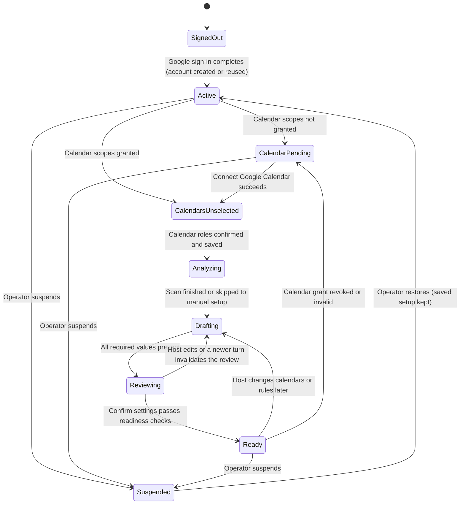
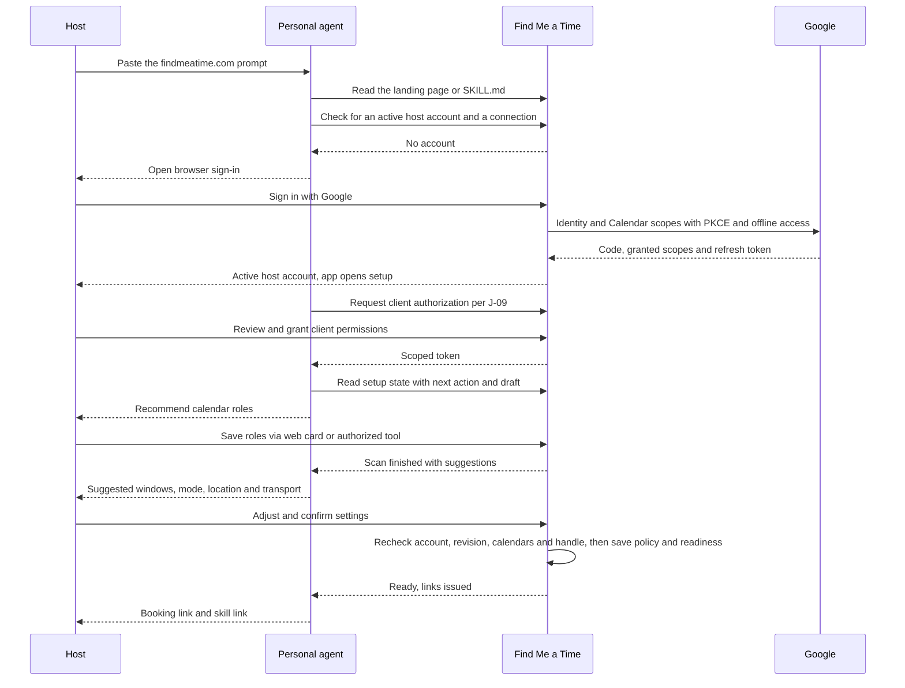

# Host Onboarding Flow

Status: direct web path (H0, H1, H3–H10) implemented in Phase 2; agent-led path with H2 implemented in Phase 5; H11 and setup over iMessage implemented in Phase 6 against a Photon stand-in, with device acceptance pending; setup that ends in iMessage or WhatsApp with two questions and the slot image in progress in [`host-onboarding-in-chat`](../../openspec/changes/host-onboarding-in-chat/proposal.md); the note review and the weekly note check in progress in [`calendar-note-review`](../../openspec/changes/calendar-note-review/proposal.md)\
Date: 2026-10-19\
Basis: [J-01 host setup](01_user_journeys.md#j-01--host-setup), [PRD section 5](../02_product_requirements.md#5-main-user-journey), [host account contract](../../openspec/specs/host-admission/spec.md), [chat workspace contract](../../openspec/specs/chat-workspaces/spec.md), [analysis retention contract](../../openspec/specs/calendar-analysis-retention/spec.md)\
Companions: [Guest booking flow](06_guest_booking_flow.md), [Agent configuration](../technical_specification/04_agent_configuration.md)

This document breaks host onboarding into states, steps, server checks and recorded data. The journey explains the experience; this flow explains what must be true at each transition. It introduces no new behavior: where a step depends on a contract, the contract wins.

## Scope

Covered: from the first visit or pasted prompt to a **ready** host with a public booking link, including the optional personal-agent connection and the optional iMessage link. Not covered: request handling after a requester arrives (see the [guest booking flow](06_guest_booking_flow.md)), proposal review (J-04 to J-06) and operator suspension (administrator CLI).

Three entry paths share every server check:

| Path | Entry | Who leads | Differences |
|---|---|---|---|
| Agent-led | Host pastes `Let me use findmeatime.com for my scheduling` into a personal agent | The agent reads `/SKILL.md`, checks capabilities, opens browser steps and resumes | Adds the personal-agent authorization (J-09); returns links in the agent chat |
| Direct web | Host opens `/` and chooses **Sign in with Google** | The in-app agent conversation at `/app` | Skips client authorization; share links appear in the workspace |
| Chat | Host opens the landing's iMessage or WhatsApp start (`/?flow=imessage`, `/?flow=whatsapp`) | Thyme in the linked conversation | The web only links the phone and signs in with Google; setup ends in the chat with two questions and the slot image ([setup over iMessage](#setup-over-imessage)) |

## Setup states

The server derives the state from durable records on every load; the browser never carries it. **Ready** is the only state with a public profile and `/{handle}/SKILL.md`. Every state before it resumes at `/app` with the next action first, as the [workspace contract](../../openspec/specs/chat-workspaces/spec.md#requirement-conversation-first-entry) requires.

In `/app`, the upper-right gear opens settings above the current conversation. Weekly availability edits update the setup draft; the previously confirmed windows stay public until the host confirms the review. The intake switch controls whether a ready host accepts new requests and is independent of setup readiness and operator suspension. It defaults on, can be paused and resumed, and leaves existing requests in place. Settings also offers sign-out.

## Steps

| Step | Surface | Host sees and does | Server check and record | Leaves the step when | If it fails or stops |
|---|---|---|---|---|---|
| H0 Entry | Agent chat, or `/` | Pastes the prompt, or chooses **Sign in with Google** | Agent path: the public page or `/SKILL.md` names the entry; the agent asks the service whether an active host account and a connection exist. No private state before sign-in | The host is sent to browser sign-in, or an existing active host resumes | A client that cannot read the document or connect is given the smallest supported step or the web URL; nothing is claimed as done |
| H1 Sign-in and Calendar consent | Google consent screen, `/auth/callback` | One Google screen asks for identity and Calendar access (read selected calendars, create events). The host may uncheck the Calendar part | PKCE bound to this browser; offline access requested. The callback records the Google identity, the scopes actually granted and the refresh token, then creates one active host account per Google identity or returns the existing one. Redirect only to an allowlisted relative destination | `/app` opens in **Active** | Cancelled, replayed or wrong-browser returns establish no session; the host restarts at `/app`. Unchecked Calendar scopes still create the account and lead to **CalendarPending** |
| H2 Agent authorization (agent path) | `/connect/authorize` | Reviews the client's requested application permissions and grants or denies | Resource-bound OAuth with PKCE and an exact registered callback; the grant is tied to this host and the listed operations. It grants no Calendar access and no meeting approval | The client holds a scoped token, or the host declined | Denial leaves direct web setup available; the agent must not claim a connection |
| H3 Workspace resume | `/app` | The setup conversation opens with the server-derived next action; authored messages reveal one at a time (greeting, connection prompt or verified congratulations, then calendar selection) | Active host account required for any private state. The saved draft, if any, is restored | The next incomplete step is shown | A suspended host sees a neutral unavailable state with only sign-out and grant revocation |
| H4 Calendar roles | Calendar selection card | Sees the host's actual calendars with account and access labels and short reasons; the agent recommends conflict calendars and one writable booking destination; the host edits and saves | Requires granted Calendar scopes; otherwise **Connect Google Calendar** appears first. Validates that the destination accepts writes. Saving stores the confirmed roles and starts the first disclosed scan | Roles saved | Unreadable calendars produce a question or recovery action, never an assumption; **CalendarPending** returns here when the grant is missing |
| H5 Analysis | Analysis card | Sees which calendars and which range (past and next four weeks) are read, then evidence in four dimensions (preferred times, weekly meeting load split internal/external, note-like entries, frequent area and venue) or a bounded failure | Reads saved conflict calendars only and counts attendee email domains, never message bodies or contacts. Busy entries with no other attendee that have not ended, all-day included, go to a separate note classifier with no tools; its verdicts are recommendations only ([`calendar-note-review` design 3](../../openspec/changes/calendar-note-review/design.md#3-recommendations-and-decisions)). Temporary evidence has an expiry under the [retention contract](../../openspec/specs/calendar-analysis-retention/spec.md); it is never policy | Suggestions available, or the host chooses **Set up manually** | **Analyze again** is the explicit refresh; reload, dismissal or expiry does not trigger a new scan |
| H6 Preference suggestions | Suggestion cards and weekly preview | Timezone, weekly meeting windows ordered by observed frequency, a weekly meeting limit only if the host sets one (it is never suggested from the calendar and stays off by default), with what counts toward it (Find Me a Time bookings by default, or every meeting with guests), note-like entries on a week view like Google Calendar with the likely notes pre-ticked (the host confirms them, and each confirmed note is written back to Google Calendar as free), default duration and buffers, each labeled stated, inferred or starter default with its sample size, with **Use this**, **Adjust** or **Choose my own** | Writes draft values with a revision; a typed correction updates the draft and invalidates older reviews. Nothing is confirmed policy yet | Required values present | Model failure leaves structured editors and existing saved rules usable |
| H7 Mode, location and transport | Explicit question cards | Answers **Online**, **In person** or **Either**; for in-person or either, preferred areas or venues with the most frequent observed area and venue offered first, **Enter a place** or **Decide per meeting**; then usual travel mode or **Depends on the trip**, and the extra travel buffer | Explicit answers are required; a suggestion or preselection is not an answer. Online-only skips location and transport. Home or work addresses are never inferred | Mode recorded and, where applicable, location and transport policy recorded | Unsupported regional routing stays unresolved or uses an explicit manual allowance |
| H8 Handle | Handle field in the review | Sees a proposed handle and can change it | Unique, not reserved, change rate bounded, and never reassigned from another host | Handle accepted | Collision or reserved name is rejected without changing either identity |
| H9 Final review and confirmation | Setup review card | Reads the exact proposed settings, including windows, mode, location and transport, then chooses **Confirm and save proposed settings** | Rechecks inside one transaction: active account, current draft revision, valid calendar metadata, writable destination, unique handle, required values. Saves confirmed policy and sets readiness | **Ready**: public profile, `/{handle}` and `/{handle}/SKILL.md` exist | A newer web or iMessage turn invalidates the review; the host reviews the latest draft again |
| H10 Links | Agent chat or share-links card | Receives `findmeatime.com/{handle}` and the skill document link; the card shows one row with the booking link, Copy and, on touch devices, Share, and the skill document stays on the booking page's agent section | Links are issued only from server-confirmed readiness | Done | Before readiness, no booking link is shown or returned |
| H11 Optional iMessage link | The full-screen link step right after sign-in (D16), or the inline channel card from the menu | The step opens with a code made: on a phone **Open Messages**, then the waiting screen; on a computer the message, a QR code, **Copy** and on a Mac **Open Messages on this Mac** (D17); **Set up here in web chat** skips it. An attempt started from the landing's iMessage start (D15), in this browser or through the sign-in link in Thyme's reply (D19), shows here as **Is this you?**; after it, Thyme welcomes the host into setup in iMessage, with a Google Calendar link that returns there when Calendar is missing (D19). In the card: **Connect iMessage** or **Maybe later**; tapping **Connect iMessage** gets a one-time link code and at once opens the Messages app with the line number as recipient and the link message in the input, and the host sends it from their own iMessage (where Messages cannot open, the card shows the number, the code, **Copy** and a QR code that opens the same deep link on a phone), then **Confirm and link** on the sender, shown in full. **Send me a code instead** is not offered while the line cannot text first (D16) | The channel consumes the inbound link message before any model turn and matches it to the pending link request bound to this session; the fallback code field posts directly to the server. Neither code enters the transcript or model context. Opening Messages changes nothing on the server. The binding is created only after browser confirmation and can be unlinked later | Linked, skipped or deferred | Wrong, expired or foreign-sender codes and delivery failures leave web setup available; specified in [`host-imessage-channel`](../../openspec/changes/host-imessage-channel/proposal.md) and unverified on real devices |
| H11 Optional WhatsApp link | The same step and card, for Android or by **Use WhatsApp instead** | First "Which number do you use for WhatsApp?", registered with Photon as for iMessage ([`guest-whatsapp-link`](../../openspec/changes/guest-whatsapp-link/proposal.md#decisions) D3); then **Connect WhatsApp** opens WhatsApp with the message written (`wa.me`); on a computer, a QR code of the same link, **Copy** and the number; then the number in full and **Confirm and link**, with the sentence that Thyme sends a short notice after a day without messages | Same as H11 for iMessage ([`host-whatsapp-channel`](../../openspec/changes/host-whatsapp-channel/proposal.md#decisions)); linking it replaces an iMessage link |
| H11 Optional Telegram link | The same step and card, on any device ([`host-telegram-channel`](../../openspec/changes/host-telegram-channel/proposal.md#decisions)) | **Connect Telegram** opens the bot with `t.me/findmeatime_bot?start=<code>` and the host taps **Start**; on a computer, **Open Telegram**, a QR code of the same link and **Copy**; then the Telegram name and **Confirm and link**, after the sentence that Telegram keeps bot chats on its servers. After linking, Thyme's welcome is the bot's first message, and setup can continue in Telegram, where the settings review carries **Confirm settings** | Same as H11 for iMessage: `/start <code>` or the code arrives from the host's own Telegram account, and the binding exists only after browser confirmation. A button tap runs the exact command its data names and only for the linked account | Linked, skipped or deferred | Linking it replaces another channel's link; `stop`, `/stop` or blocking the bot unlinks |

On the web, steps H4 to H9 run inside one conversation, one small card at a time: only the current step's card is open, after the latest message; each answered card stays in the conversation as a one-line receipt with **Edit**, which asks that question again at the bottom; and the review gathers every answer at the end ([one thing to think about at once](../03_design_principles.md#4-one-thing-to-think-about-at-once)). The agent leads with a suggested answer where it safely can and asks one focused question only for an unresolved detail. Precise edits open labeled in-chat editors that restore focus when closed.

## What is recorded

| Record | Created at | Authoritative for | Notes |
|---|---|---|---|
| Host account | H1 | Identity, status (active or suspended), creation time | One per Google identity; repeated sign-in returns it |
| Google grant | H1 or H4 | Granted scopes and the encrypted refresh token | Recorded separately from identity even though one screen requested both; revocation returns the host to **CalendarPending** |
| Agent grant | H2 | Which client may call which host operations | Revocable in settings; separate from Google and from meeting approval |
| Calendar roles | H4 | Conflict calendars and the writable booking destination | Metadata is rechecked at H9 |
| Analysis evidence | H5 | Suggestions and their disclosed scope | Temporary and expiring; never policy |
| Settings draft | H6 to H8 | In-progress values with a revision | Replaced by edits; never used for scheduling |
| Confirmed policy | H9 | Rules, timezone, windows, duration, buffers, weekly meeting limit, note-like exclusions, mode, preferred area and default venue, and transport policy | The only source for feasibility checks |
| Note decisions | H6, the chat note step and the weekly check | The host's free or keep-busy answer per entry (series or one occurrence) and its Google writeback state | No titles; a free answer becomes `transparency: "transparent"` in Google, or a note exclusion for a calendar the host cannot change |
| Handle | H8, fixed at H9 | Public identity | Stable; changes are rate-bounded |
| Readiness | H9 | Whether the public profile exists | Derived from the shared eligibility-and-readiness guard, never set by the client |
| Channel binding | H11 | The verified iMessage, WhatsApp or Telegram sender for this host, one at a time | Optional; unlinking or `stop` revokes future access |

Any memory slot the conversation runtime keeps holds non-authoritative context only; scheduling policy is written through confirmed settings commands alone (see [agent configuration](../technical_specification/04_agent_configuration.md)).

## Agent-led sequence

The diagram shows authority, not transport details. Browser steps (sign-in, client consent, the iMessage code) never pass through the agent chat.

## Setup over iMessage

A host who has linked iMessage or WhatsApp (H11) finishes setup there: the web only links the phone, and Google sign-in comes from Thyme's link ([`host-onboarding-in-chat`](../../openspec/changes/host-onboarding-in-chat/proposal.md#decisions) D1). The channel maps the verified sender to the host principal and to the same setup session that `/app` uses, so progress, the draft and the next action are shared: a question answered in the chat is not asked again on web, and the reverse. In the chat Thyme asks the minimum and lets the host answer in their own words (D2): two questions, hours and place, each with a suggestion drawn from the host's calendar. Every other setting keeps its inferred value or starter default without a question. Replies follow the host's language, English or Korean ([`channel-actions-in-words`](../../openspec/changes/channel-actions-in-words/proposal.md#decisions)). A linked Telegram chat runs the same flow, with the slot preview sent as text.

| Step | In the chat | Why |
|---|---|---|
| H1 sign-in, H2 client consent, H4 Calendar grant | A link opens the browser; the conversation resumes with the verified result | Google consent and OAuth are browser actions, and tokens never travel through chat |
| H4 calendar roles | With a usable grant and no saved roles, the service saves the primary calendar as the only conflict calendar and as the booking destination, starts the analysis and says so in one message. The host adds or changes calendars in words ("회사 캘린더도 같이 봐줘"), and the agent saves them with `set_calendar_roles` (D6) | The same checks as the web card: every calendar is in the live list and the destination is writable. A host whose primary calendar is read-only gets no default and is asked in words |
| H5 analysis, H6 hours | When the analysis settles, done or failed, the service sends the hours question once, for example "캘린더를 보니 평일엔 9시부터 저녁 10시까지 보통 약속이 있으시네요. 미팅 가능 시간을 평일 9시~22시로 잡아둘까요?". A plain reply ("응", "8시까지만") is the answer | The suggestion follows the hours rule ([design 3](../../openspec/changes/host-onboarding-in-chat/design.md#3-the-hours-suggestion), D3): meetings with guests and located appointments count, the weekday range runs from the second-earliest start to the second-latest end, and a weekend day joins with two events. Fewer than five events give weekdays 10:00–20:00, and the question says so |
| H7 mode, location and transport | One message suggests areas from the host's calendar locations at the level of a neighborhood or a station ("역삼동", "강남역 근처"), says the host can answer that loosely, and asks whether online also works and how the host travels: "주로 어떻게 이동하시는지도 말해주시면 미팅 시간 잡는 데 참고할게요". Only a missing answer is asked again, once (D4, D5) | Locations reach the model only as quoted data, and a candidate becomes a value only when the host names or accepts it. The travel buffer is not asked |
| Note review | When the scan found entries that may be notes, the service sends the review page link after the place answer instead of the slot image: "메모처럼 보이는 일정이 3개 있어요. 비워도 되는 일정을 골라주세요. 고르시면 가능한 시간을 보내드릴게요". After **확인** on that page the slot image follows by itself, with the freed notes no longer busy. No candidates: the image comes at once. "나중에 할게", or no answer within 24 hours (23 on WhatsApp): the image comes with the notes still busy ([`calendar-note-review` design 8](../../openspec/changes/calendar-note-review/design.md#8-the-note-step-in-chat-onboarding)) | Several candidates with the AI's marks are easier to compare on a page; the image then shows time that notes no longer block |
| H6 other settings, H8 handle | Not asked: duration, buffers, limits and the handle keep their inferred values or starter defaults; a handle that is taken is asked about | Ask the minimum; the same validation as the web field |
| H9 slot image and saving | Thyme sends next week's open slots and their place as one timetable image, with a one-line caption of the open times, and asks whether to open them. The host's yes ("좋아요, 열어주세요") saves the review and accepts the meeting mode, location and travel mode the image shows. A change after the image needs a new image before saving. The exact `confirm <ref>` command and Telegram's **Confirm settings** still work (D7) | The image replaces the full settings read-back. The save names the current review and runs the web confirmation's checks; a question, a condition or a change saves nothing |
| H10 links | The booking link to share comes back in the conversation once the server confirms readiness | The same readiness check |

Answers given in the chat are draft changes, never confirmed policy, until the host's yes to the slot image. Later changes work the same way: the host writes what to change, the agent records it, and the host's words save it. The flow is specified in the [`host-onboarding-in-chat` design](../../openspec/changes/host-onboarding-in-chat/design.md); the earlier settings confirmation in words is in [`channel-actions-in-words` design 1](../../openspec/changes/channel-actions-in-words/design.md#1-tools-for-the-remaining-actions).

### Notes after setup

Entries added after setup stay busy until the weekly check, every Monday at 09:00 KST, asks about them ([`calendar-note-review` design 9 to 11](../../openspec/changes/calendar-note-review/design.md#9-the-weekly-check)). It lists new, changed or still unanswered candidates of the next four weeks: a numbered list of up to ten with the review link on iMessage and Telegram, and on WhatsApp inside its 24-hour window; outside the window, a template notice with no event content and the link, and the list once the host writes. The host can answer by number ("1, 3번 비워줘"): Thyme reads the choice back ("1번 "엄마 생일", 3번 "과제 마감"을 비울까요?") and frees them only on a yes in a later message. "Keep busy" answers are stored and not asked again.

## Interruption, resume and failure

| Situation | Behavior |
|---|---|
| The host closes the browser or the agent session mid-setup | The next visit to `/app`, or the next agent turn, resumes from the saved draft and the server-derived next action without repeating answered questions |
| The host runs the onboarding prompt again | The existing account and draft are reused; no second host is created |
| Calendar scopes were unchecked at sign-in | The account exists; setup shows **Connect Google Calendar** before calendar roles and keeps unrelated settings editable |
| The Google grant is revoked or expires after setup | The host returns to **CalendarPending** for calendar-dependent actions; the public profile stays only while the destination is still writable, otherwise the host is not available for new requests until reconnected |
| A calendar read fails during analysis | The failure is disclosed; the host retries or sets preferences manually; free time is never assumed |
| The model is unavailable | Unsent text stays visible; structured editors, saved roles and confirmed rules remain usable; recovery of a stopped conversation is an explicit action |
| A stale review is confirmed | The confirmation is rejected and the current draft is shown; nothing is saved |
| The operator suspends the account | Hosting operations and the public profile stop; sign-out and grant revocation remain; restoration brings back the saved setup |
| Client consent is denied or the client lacks a capability | The agent explains the smallest next step or hands over to the web URL; it never reports setup as complete |

## Checks before calling the flow done

- First sign-in creates exactly one active account; repeated sign-in and a second onboarding run create none (AC-26).
- Setup resumes after interruption without duplicate host creation and without repeating supplied information (AC-25).
- Calendar recommendations come from actual calendars with reasons; the host can change them; failed reads become questions (AC-28).
- Links are returned only after server-confirmed readiness, and a suspended host sees a neutral unavailable result (FR-35, AC-26).
- Mode, location and transport answers are explicit; online-only skips transport; defaults are never described as observed patterns (FR-04).
- The iMessage code never appears in the transcript or model context (AC-17, proposed delta).

PRD references: FR-01 to FR-04, FR-18, FR-26, FR-31, FR-33, FR-35; AC-09, AC-17, AC-19, AC-23, AC-25, AC-26, AC-28.

## Open decisions

Settled on 2026-10-19 in the [`host-onboarding` design](../../openspec/changes/host-onboarding/design.md): handle assignment rules, the reserved list and the numeric sign-up and handle-change limits; starter default values for windows, duration and buffers; supported travel modes; a 24-hour retention period for analysis evidence.

Specified on 2026-10-23 in the [`host-imessage-channel` change](../../openspec/changes/host-imessage-channel/proposal.md#decisions): the host-sent link code with the one-tap deep link, the service-sent code fallback and setup over iMessage. Still open: their device acceptance on a controlled iPhone (Phase 6); CLI login for terminal-based agents (Phase 5).
