# Guest Booking Flow

Status: proposed flow design; implementation pending\
Date: 2026-10-19\
Basis: [J-02](01_user_journeys.md#j-02--request-through-a-booking-link-or-email), [J-03](01_user_journeys.md#j-03--hand-the-booking-link-to-a-personal-agent), [J-07](01_user_journeys.md#j-07--revise-a-proposal-or-resolve-a-lack-of-suitable-times), [J-08](01_user_journeys.md#j-08--booking-recovery-and-closed-requests), [meeting-request contract](../../openspec/specs/meeting-requests/spec.md), [feasibility contract](../../openspec/specs/meeting-feasibility/spec.md), [public entry contract](../../openspec/specs/public-agent-entry/spec.md), [email delivery contract](../../openspec/specs/email-delivery/spec.md)\
Companions: [Host onboarding flow](05_host_onboarding_flow.md), [Page list](04_page_list.md), [Confirmation email design](03_interfaces.md#booking-confirmation-email-and-calendar-invitation)

This document follows one requester (the guest) from a host's link to a confirmed meeting or a closed request. It records the request states, the steps, what the server checks and stores, and how the flow recovers. Host review appears only as the waiting state; the host's own steps live in J-04 to J-06.

## Scope

Covered: public entry and the draft request, identity and timezone, the booking link, meeting details, availability, candidates, agreement, the wait for host approval, booking, confirmation, and everything that can go wrong on the way. Three entry paths share the same request record:

| Path | Entry | Who leads | Differences |
|---|---|---|---|
| Web | Opens `findmeatime.com/{handle}` | One conversation with the assistant, started at `/{handle}` and continued in the same thread at `/booking/[bookingId]` | None; this is the reference path |
| Agent-led | Pastes `Let me schedule a meeting with findmeatime.com/dodo` into a personal agent | The requester's agent, through MCP or the CLI, within delegated authority | Account-free and request-scoped; the agent asks the requester only for missing details or decisions beyond its delegation |
| Email | Writes to the product inbox with the host's `@handle` in the subject | The assistant over AgentMail | Verified continuation returns to the booking link; a sender claim grants nothing |

## Request states

```mermaid
stateDiagram-v2
    [*] --> Gathering: Request created (bookingId issued)
    Gathering --> Negotiating: Required details present; candidates evaluated
    Negotiating --> Gathering: Details change or a candidate needs clarification
    Negotiating --> AwaitingHostApproval: Requester agrees to the exact current proposal
    AwaitingHostApproval --> Negotiating: Host requests changes (new proposal version)
    AwaitingHostApproval --> Booking: Host approves the current version
    Booking --> Booked: Event creation confirmed
    Booking --> Negotiating: Final feasibility check fails
    Booking --> Booking: Uncertain write; reconciliation pending
    AwaitingHostApproval --> Declined: Host declines
    Gathering --> Withdrawn: Requester withdraws
    Negotiating --> Withdrawn: Requester withdraws
    AwaitingHostApproval --> Withdrawn: Requester withdraws
    Gathering --> Expired: Seven days or requested-window end
    Negotiating --> Expired: Seven days or requested-window end
    AwaitingHostApproval --> Expired: Seven days or requested-window end
    Booked --> [*]
    Declined --> [*]
    Withdrawn --> [*]
    Expired --> [*]
```



States follow the [lifecycle contract](../../openspec/specs/meeting-requests/spec.md#requirement-persisted-lifecycle-and-closure-guards). Before the guest gives a name and email the request is a **Draft** ([D13](../../openspec/changes/requester-intake-and-feasibility/proposal.md#decisions)): hidden from the host, at most 30 messages, and deleted with its conversation 24 hours after creation unless the guest is identified. **Booking** with an uncertain write stays pending until reconciliation; a timeout never means that no event was created. Terminal states never reopen through replay.

## Steps

| Step | Surface | Requester sees and does | Server check and record | Leaves the step when | If it fails or stops |
|---|---|---|---|---|---|
| G0 Entry and the draft | `/{handle}`, or the agent reads `/{handle}/SKILL.md` | The host's public identity, the timezone chip and the composer; the collapsed agent section links to the instruction document. The first message starts the conversation, in which the assistant asks for the purpose first | The host must be active and ready; otherwise a neutral unavailable page with no reason. The first message creates a **Draft** request (`request.start`) with a server-generated random UUID as `bookingId`, stored as a hash and sealed; the tab keeps it in session storage, not in the address bar. Drafts are bounded to 5 per source address an hour, 20 a day and 500 across the service a day. Public pages expose no existing requests | The purpose is known | An unknown or suspended handle is indistinguishable from a missing one; past a draft bound the page shows a temporary-limit message and creates nothing; a client that cannot connect is offered the web URL |
| G1 Identity and timezone | Identity card in the thread; the timezone chip at its start | When the assistant asks for a name and email (or once the purpose is applied, or when they ask for times), the identity card appears after the assistant's message as the one open card: **Continue with Google**, which requests identity and read-only Calendar access on one screen, or **Continue without Google** with name and email. The timezone chip shows the detected zone with **Change time zone** | Google identity fills in name and email automatically even when the Calendar part is unchecked, and a Google-verified address counts as confirmed, so G5 is skipped unless the requester changes the address; the Calendar grant is recorded separately and bound to this request. The explicit timezone choice is kept across reloads and the Google return. Finding, choosing or agreeing to times answers that identity is needed until then | Name, email and timezone known | Cancelled consent returns to the same thread on `/{handle}`; an unvouched address gets a confirmation email |
| G2 Identification | The same thread | Nothing else to do: the conversation continues | `request.identify` or the Google return moves the draft to **Gathering**, sets the expiry to the earlier of creation plus seven days and the latest window end, and sends the creation email with the booking link. The page replaces the address with `/booking/[bookingId]` in place, without a reload; the assistant keeps the whole conversation. A reload or a Google return loads the same thread there | **Gathering** with a stable booking link | Nothing changes for an unavailable host; an agent-led creation uses a one-future-request grant that cannot create a second request on retry (proposed delta) |
| G3 Meeting details | Review and meeting details cards in the thread (also while a draft) | Describes dates, duration, mode, place or meeting link in English or Korean; reviews the extracted changes before applying them | Extraction is advisory: it declares details, availability, question or unknown intent, uses authored clarification questions, and never applies itself. Applying requires the expected revision. Windows must start in the future and fit the known duration; an omitted duration is never invented | Purpose, identity and contact, windows, timezone, duration, mode and location or link are present | Ambiguous dates or offsets produce a clarification with no actionable window; stale reviews are rejected without overwriting newer details |
| G4 Availability | Calendar connection card, or manual windows | Availability already shared at G1 is used; otherwise **Connect Google Calendar** (availability only), **Skip for now** with manual windows, or the agent supplies authorized availability | Busy intervals are read from the selected calendars only; private event details and tokens never reach the host or any agent. Denied, revoked or failed access pauses dependent evaluation | A usable availability source exists | Unavailable calendar data is never treated as free time; the requester is asked to reconnect or supply availability |
| G5 Contact confirmation (optional) | The creation email and the contact card | Opens **Confirm this address** in the email that carried the booking link; **Send the email again** on the card | Optional; nothing waits on it ([D3](../../openspec/changes/requester-intake-and-feasibility/proposal.md#decisions)). The email goes out on creation and on each address change; its single-use link opens a page whose **Confirm this address** button confirms the address while it is still the contact, and a new email, a change or closure voids older links. A Google-verified address counts as confirmed. The host sees the status; only a confirmed address receives link resend. Creation emails, from creation, an address change or sending again: 60 seconds apart, 5 per request and 10 per address per hour, 1,000 per day service-wide; an address change past a bound is refused | Scheduling continues either way | Uncertain delivery is not resent automatically; confirmation grants no login, agreement or booking |
| G6 Candidates | Candidate times card | Receives feasible options with date, time, named timezone, duration and mode; can ask for alternatives | Deterministic checks run first: host rules, buffers, the host's weekly meeting limit as a preference, busy intervals of both parties, date-specific offsets, overnight windows and both travel legs for physical meetings; unknown routes never count as zero travel. Model ranking orders valid candidates only and cannot relax a hard constraint. Evaluation has a shared deadline | **Negotiating** with at least one candidate, or a no-match outcome | No match goes to J-07: the requester widens the window or the host privately revises a preference or declines; the requester never sees private rules or exception reasons |
| G7 Selection and agreement | Candidate and proposal review cards | **Choose this time**, reads the exact proposal, then **Agree to this proposal** | Selection creates an immutable proposal version; agreement is recorded against that version only. A message such as “yes” or “book it” records nothing. An agent may select and agree within its delegation | **AwaitingHostApproval** | A superseded version rejects the action and shows the current proposal |
| G8 Host review | Decision and booking status card | Sees that approval is pending, not a booking; can withdraw; is emailed when the host requests changes, approves or declines | The host approves, requests changes or declines through web, an agent or iMessage (J-04 to J-06). Changed details create a new version that needs fresh agreement | Host approval, a new version, or decline | Approval of a changed proposal is impossible; stale decisions cannot authorize booking |
| G9 Booking | Booking status card | Sees booking in progress and that an event may already exist | Rechecks agreement, approval and feasibility immediately before dispatch; persists booking identity, destination, frozen payload and reservation first; creates the event in the host's booking destination with the requester as attendee | **Booked** on confirmed creation | A conflict returns to J-07; a definitively rejected write offers the host a retry that revalidates everything; an uncertain write stays pending until reconciliation |
| G10 Confirmation | Confirmation email, calendar invitation, receipt at the booking link | Receives the email in their language and timezone (From: host name on the product sender, Reply-To the host, “{title} between {host} and {guest}”, what/when/who/where, **View booking**, **Join meeting** when online) and the calendar invitation | All views come from the same confirmed event data; a calendar part is attached only when its `UID` matches the event's `iCalUID`; the calendar description carries no booking link | Done | Delivery failure never recreates the event and is reported separately from booking status |
| G11 After booking | `/booking/[bookingId]` | Opens the link later and sees only the receipt | After closure the link allows a minimal receipt read until thirty days from creation; mutation and new OAuth are rejected | — | Post-booking changes are made in the calendar; automated rescheduling and cancellation are outside the initial release |

## Agent-led differences

- **Discovery**: the agent fetches the plain URL and finds the instruction document through the in-page agent section, the alternate-link header, `llms.txt` or `Accept: text/markdown`; the explicit `/{handle}/SKILL.md` path is the fallback. Reading the document installs nothing and grants nothing.
- **Connection**: MCP is the primary interface and the CLI serves terminal-based agents; both call the shared scheduling API with request-scoped, account-free access. Missing setup produces the smallest next step or the web URL, never a claim that a connection exists.
- **Creation**: the requester grants the client one future request for the displayed host; exact retries recover that request and cannot create another (proposed delta, pending implementation and named-client acceptance).
- **Delegation**: the agent may supply details, select a candidate and agree within its delegated authority; it asks the requester for missing information or decisions beyond it. It never supplies host approval.
- **Reporting**: the agent reports a confirmed meeting only after booking succeeds; otherwise it reports the actual status or the action needed.

## Email differences

A requester who writes to the product inbox, `findmeatime@agentmail.to`, with the host's `@handle` in the subject (the public host page offers the link) gets an AgentMail-backed assistant reply in the same thread. Authenticated receipts are recorded durably before processing, deduplicated and never treated as verified contact or request authority. The first authenticated message creates the request with the sender's address as an unconfirmed contact, and the creation email sends the booking link and **Confirm this address** there, as on the web. Browser steps (Calendar consent, candidate selection, agreement) continue at that booking link; the thread itself never carries it. A requester who started on the web can link a thread with **Continue by email**. See the [`requester-email-channel` change](../../openspec/changes/requester-email-channel/design.md). The host's own email channel is a proposed extension and is not part of this flow.

## What the requester can and cannot see

| Visible to the requester | Host-only |
|---|---|
| Their submitted details, the shared proposal versions, candidate times, permitted conversation and current status | Host notes, rules, preference exceptions and their reasons, private discussion, calendar contents and travel estimates |
| The confirmed receipt: title, time with timezone, participants, location or join link | Provider identifiers, booking attempts and reconciliation state |

Audience filtering happens on the server before serialization and before model context is built. Structured contact fields reach the model as presence indicators, not values; recognized credentials are removed from conversation input before persistence. The requester session also has no host tool registered at all; the [permission layers](../technical_specification/04_agent_configuration.md#permission-layers) explain which boundaries are hard and which are only instructions.

## Requester notifications

Email is the requester's notification channel in the first release: the requester has no account and no phone number on file, while their contact email is verified. Every notification carries the current status and the booking link, is generated from domain records and uses the same durable Cloudflare delivery as the confirmation. A notification is never a decision and never changes request state. iMessage or SMS for requesters is deferred (see the open decisions).

| Event | Email | Also visible |
|---|---|---|
| A new proposal version awaits the requester's agreement because the host requested changes | “Action needed” with the changed details and the booking link | The booking page; the requester's agent through MCP or the CLI |
| The host approved and the event is confirmed | The confirmation email and calendar invitation (G10) | The receipt at the booking link; the agent reports the confirmed meeting |
| The host declined, or the request expired | A status email with the closed state and no further action | The booking page shows the terminal state |
| Booking stays pending or uncertain beyond the reconciliation window | A status email saying the outcome is being checked | The booking page |
| Delivery of any notification fails | Retried by the delivery job; booking status is unaffected | The booking page remains authoritative |

A requester who entered through email receives the same notices in their existing AgentMail thread. Reminders before the meeting remain an open decision.

## Recovery and closure

| Situation | Behavior |
|---|---|
| The booking link is lost | **Resend my booking link** on the public host page or the unavailable view sends the current link to the verified contact only, with generic feedback and bounded issuance; no new credential is created |
| The link is unknown, malformed or expired | The generic unavailable view with the resend control; nothing reveals whether a request exists |
| The requester withdraws before booking | **Withdrawn**; late agreement or approval cannot create an event. During an uncertain write the pending outcome is reported instead |
| The request reaches seven days or the requested window ends | **Expired**; later decisions are rejected and a new or explicitly refreshed request is needed |
| The host declines | **Declined**; old messages cannot reopen booking |
| A decision is repeated across channels | The current result is shown; retries reuse one identity and never create another event |
| The calendar write is uncertain | Both parties see booking pending until reconciliation establishes whether the event exists |
| Confirmation delivery fails after a confirmed event | The booking stays confirmed; delivery is retried without recreating the event |
| Conversation throttling | A retryable error keeps the unsent message and structured controls; messaging receipts wait in order |
| Model failure | Unsent text and committed messages stay; structured controls work; recovery of a stopped conversation is explicit |

## Web sequence

```mermaid
sequenceDiagram
    participant R as Requester
    participant W as Booking pages
    participant S as Find Me a Time
    participant G as Google
    participant H as Host
    R->>W: Open the host link
    W->>S: Host active and ready
    S-->>W: Public page and composer
    R->>W: First message: the purpose
    S->>S: Create a draft request and its random bookingId
    S-->>R: Extracted details for review, in the thread
    R->>S: Apply reviewed details with expected revision
    S-->>R: Identity card in the thread
    R->>W: Continue with Google
    W->>G: Identity and availability scopes
    G-->>S: Identity and granted scopes
    S->>S: Draft becomes gathering; creation email
    W-->>R: Same thread at the booking link
    S->>S: Deterministic feasibility, then ranking
    S-->>R: Candidate times
    R->>S: Choose this time, then Agree to this proposal
    S-->>H: Proposal version awaits approval
    H->>S: Approve the current proposal
    S->>S: Recheck agreement, approval and feasibility, then reserve
    S->>G: Create event in the booking destination
    G-->>S: Event confirmed
    S-->>R: Confirmation email, invitation and receipt
```

## Checks before calling the flow done

- A requester completes an account-free request from entry to a confirmed event, and a missing field never becomes an assumption (AC-01).
- Both travel legs, failed routes and manual allowances are respected before a physical candidate is offered (AC-02).
- Private host rules and exception reasons never appear in requester views or model context for the requester (AC-03, AC-10).
- A changed proposal invalidates old decisions; stale agreement is rejected (AC-04).
- Repeated decisions and uncertain writes produce one consistent outcome and one event at most (AC-06, AC-08).
- Confirmation shows consistent details across email, invitation and receipt, and delivery failure is distinguishable from booking failure (AC-09, FR-23).
- Withdrawal, decline and expiry close the request and resist revival (AC-13).
- Calendar consent is optional and its event details stay private to evaluation; declined or failed access pauses evaluation instead of assuming free time (AC-27).
- Each named agent client completes the pasted-prompt path or receives an honest next step (AC-24, AC-25).

PRD references: FR-05 to FR-15, FR-19 to FR-25, FR-29, FR-30, FR-32, FR-34, FR-36; AC-01 to AC-08, AC-10 to AC-15, AC-21, AC-22, AC-24, AC-25, AC-27.

## Open decisions

The one-future-request grant for agent-led creation; requester notifications over iMessage or SMS; reminder and follow-up policy after agreement; link rotation after a suspected leak; mixed-language acceptance beyond English and Korean intake.

The [`requester-intake-and-feasibility` change](../../openspec/changes/requester-intake-and-feasibility/proposal.md#decisions) decided on 2026-10-21 who creates an online meeting link, supported geography and route freshness, manual travel allowances, optional contact confirmation, request creation bounds, the public page's conversation and the requester Google consent. On 2026-10-22, D13 made that conversation one thread from the first message to agreement, with a draft request instead of a separate anonymous intake. Travel modes were settled in Phase 2.
