# Guest Booking Flow

Status: implemented through [`guest-flow-completion`](../../openspec/changes/guest-flow-completion/proposal.md) (U6–U19, 2026-11-01), not yet merged\
Date: 2026-10-19, revised 2026-11-02\
Basis: [J-02](01_user_journeys.md#j-02--request-through-a-booking-link-or-email), [J-03](01_user_journeys.md#j-03--hand-the-booking-link-to-a-personal-agent), [J-07](01_user_journeys.md#j-07--revise-a-proposal-or-resolve-a-lack-of-suitable-times), [J-08](01_user_journeys.md#j-08--booking-recovery-and-closed-requests), [meeting-request contract](../../openspec/specs/meeting-requests/spec.md), [feasibility contract](../../openspec/specs/meeting-feasibility/spec.md), [public entry contract](../../openspec/specs/public-agent-entry/spec.md), [email delivery contract](../../openspec/specs/email-delivery/spec.md)\
Companions: [Host onboarding flow](05_host_onboarding_flow.md), [Page list](04_page_list.md), [Confirmation email design](03_interfaces.md#booking-confirmation-email-and-calendar-invitation)

This document follows one requester (the guest) from a host's link to a confirmed meeting or a closed request. It records the request states, the steps, what the server checks and stores, and how the flow recovers. Host review appears only as the waiting state; the host's own steps live in J-04 to J-06.

## Scope

Covered: public entry and the draft request, identity and timezone, the booking link, meeting details, availability, candidates, agreement, the wait for host approval, booking, confirmation, and everything that can go wrong on the way. Three entry paths share the same request record:

| Path | Entry | Who leads | Differences |
|---|---|---|---|
| Web | Opens `findmeatime.com/{handle}` | One conversation with the assistant, started at `/{handle}` and continued in the same thread at `/booking/[bookingId]` | None; this is the reference path |
| Agent-led | Pastes `Let me schedule a meeting with findmeatime.com/dodo` into a personal agent | The requester's agent, through MCP or the CLI, within delegated authority | Account-free and request-scoped; the agent asks the requester only for missing details or decisions beyond its delegation |
| Email | Writes to the product inbox with the host's `@handle` in the subject | The assistant over AgentMail | Verified continuation returns to the booking link; a sender claim grants nothing |

## Request states

```mermaid
stateDiagram-v2
    [*] --> Gathering: Request created (bookingId issued)
    Gathering --> Negotiating: Required details present; candidates evaluated
    Negotiating --> Gathering: Details change or a candidate needs clarification
    Negotiating --> AwaitingHostApproval: Requester agrees to the exact current proposal
    AwaitingHostApproval --> Negotiating: Host requests changes (new proposal version)
    AwaitingHostApproval --> Booking: Host approves the current version
    Booking --> Booked: Event creation confirmed
    Booking --> Negotiating: Final feasibility check fails
    Booking --> Booking: Uncertain write; reconciliation pending
    AwaitingHostApproval --> Declined: Host declines
    Gathering --> Withdrawn: Requester withdraws
    Negotiating --> Withdrawn: Requester withdraws
    AwaitingHostApproval --> Withdrawn: Requester withdraws
    Gathering --> Expired: Seven days or requested-window end
    Negotiating --> Expired: Seven days or requested-window end
    AwaitingHostApproval --> Expired: Seven days or requested-window end
    Booked --> [*]
    Declined --> [*]
    Withdrawn --> [*]
    Expired --> [*]
```



States follow the [lifecycle contract](../../openspec/specs/meeting-requests/spec.md#requirement-persisted-lifecycle-and-closure-guards). Between the guest's **Continue with Google** or **Continue without Google** and their identification the request is a **Draft** ([U10](../../openspec/changes/guest-flow-completion/proposal.md#decisions)): hidden from the host, accepting no message, and deleted 24 hours after creation unless the guest is identified. Until **Change** reopens it, **AwaitingHostApproval** also returns to **Negotiating** at the guest's request ([D10](../../openspec/changes/guest-flow-completion/proposal.md#decisions)). **Booking** with an uncertain write stays pending until reconciliation; a timeout never means that no event was created. Terminal states never reopen through replay.

## Steps

| Step | Surface | Requester sees and does | Server check and record | Leaves the step when | If it fails or stops |
|---|---|---|---|---|---|
| G0 Entry | `/{handle}`, or the agent reads `/{handle}/SKILL.md` | An ink landing that names whose booking link it is, with **Start with agent** (a prompt to paste into the guest's own AI agent, pointing to `/{handle}/SKILL.md`) and **Continue with web**; email and resending the booking link are secondary links ([U6](../../openspec/changes/guest-flow-completion/proposal.md#decisions)). **Continue with web** opens a chat-only screen in the host onboarding's ink look, which opens with two fixed messages: the host's assistant greets the guest, then asks them to continue with their Google account and Calendar, with the identity card under it. The composer is there but closed until the fixed steps hand over (U7, U11) | The host must be active and ready; otherwise a neutral unavailable page with no reason. Nothing is written and no model runs on the landing or the web start. Public pages expose no existing requests | The guest presses **Continue with Google** or **Continue without Google** | An unknown or suspended handle is indistinguishable from a missing one; a client that cannot connect is offered the web URL |
| G1 Identity and timezone | The identity card on the web start; the timezone shown with it | **Continue with Google**, which requests identity and read-only Calendar access on one screen, or **Continue without Google** with name and email (U8) | Either button runs `request.start` under the tab's nonce, which writes a hidden **Draft** with a server-generated random UUID as `bookingId`, stored as a hash and sealed; a second try reuses it. Drafts are bounded to 5 per source address an hour, 20 a day and 500 across the service a day. Google identity fills in name and email automatically even when the Calendar part is unchecked, and a Google-verified address counts as confirmed, so G5 is skipped unless the requester changes the address; the Calendar grant is recorded separately and bound to this request (U10) | Name, email and timezone known | Cancelled consent returns to the web start with a message; the draft stays and the existing 24-hour deletion removes it; past a draft bound the page shows a temporary-limit message |
| G2 Identification | The booking page | The page opens at `/booking/[bookingId]` with the same frame: the two fixed messages stay at the top of the thread, and **Request details** in the top bar opens a closed-by-default panel with whose request it is, the timezone, a summary of the answered steps, the creation email's line and the privacy note (U12) | `request.identify` or the Google return moves the draft to **Gathering**, sets the expiry to the earlier of creation plus seven days and the latest window end, and sends the creation email with the booking link. A new request starts with the host's meeting length, and with the form when the host offers only one (U13) | **Gathering** with a stable booking link | Nothing changes for an unavailable host; an agent-led creation uses a one-future-request grant that cannot create a second request on retry |
| G3 Meeting details | The conversation, then one review card | A fixed message asks what the meeting is for, with what the host offers (length, online or in person, venue), and the composer opens; no model runs until the guest answers. The assistant then asks, one question at a time, only what is open: the purpose; online or in person only when the host offers either; the place only for in person, offering the host's venue or areas. It drafts everything, with any preferred times the guest gave, in one review card, and **Apply these details** (or the guest confirming in words) applies it and finds times at once (U13, U15) | Extraction is advisory: it declares details, availability, question or unknown intent, uses authored clarification questions, and never applies itself. Applying requires the expected revision. `read_request` gives the assistant what the host offers every guest and nothing else of the host's settings, calendar or rules. Windows are optional; given ones must start in the future and fit the known duration; an omitted duration is never invented | Purpose, identity and contact, timezone, duration, mode and location or link are present | Ambiguous dates or offsets produce a clarification with no actionable window; stale reviews are rejected without overwriting newer details |
| G4 Availability | The Calendar step, between identification and the meeting question | With Google's Calendar part granted, the Calendar step stays open to choose which calendars count (U11). **Continue without Google**, or Google without its Calendar part, settles it as skipped, and times are found on the host's side only; **Change** on the Calendar answer offers **Connect Google Calendar** later (U10). An agent supplies authorized availability instead | Busy intervals are read from the selected calendars only; private event details and tokens never reach the host or any agent. Denied, revoked or failed access pauses dependent evaluation | The Calendar step is answered | Unavailable calendar data is never treated as free time; the requester is asked to reconnect or supply availability |
| G4a Host settings (a guest who is a host) | One card, **Use your host settings for this request**, after the Google return and before the meeting question | Shown once when the Google account the guest returned with is another active host's with confirmed settings, never the request's own host. Two checked items: **Calendars** (busy time on their host conflict calendars) and **Basic details** (time zone and travel mode); **Use these settings** or **Not now**, and **Change** on the answer reopens it ([design 6](../../openspec/changes/guest-flow-completion/design.md#6-host-profile-for-a-guest-who-is-a-host)) | Matched by the verified Google subject, not the address. The choice is kept per request in `requester_host_profiles` and deleted at closure. Their host calendars are read with their host grant inside the evaluation only, and only without a request-bound Calendar grant; Basic details become a pending review. Nothing reaches the request's host | The card is answered | A failed host grant drops the Calendars item and reopens the Calendar step; it is never treated as free time |
| G5 Contact confirmation (optional) | The creation email and the contact card | Opens **Confirm this address** in the email that carried the booking link; **Send the email again** on the card | Optional; nothing waits on it ([D3](../../openspec/changes/archive/2026-11-02-requester-intake-and-feasibility/proposal.md#decisions)). The email goes out on creation and on each address change; its single-use link opens a page whose **Confirm this address** button confirms the address while it is still the contact, and a new email, a change or closure voids older links. A Google-verified address counts as confirmed. The host sees the status; only a confirmed address receives link resend. Creation emails, from creation, an address change or sending again: 60 seconds apart, 5 per request and 10 per address per hour, 1,000 per day service-wide; an address change past a bound is refused | Scheduling continues either way | Uncertain delivery is not resent automatically; confirmation grants no login, agreement or booking |
| G6 Candidates | Candidate times card | Three feasible options at once, with date, time, named timezone, duration and mode; **Find other times** shows the next three of the same search and searches again only when none are left (U11). The guest can also ask the assistant for other days or times | Deterministic checks run first: host rules, buffers, the host's weekly meeting limit as a preference, busy intervals of both parties, date-specific offsets, overnight windows and both travel legs for physical meetings; unknown routes never count as zero travel. Without windows from the guest, the search covers the next two weeks within the host's weekly hours, each day's first start before any day's second, and is not ranked by the model; an evaluation over the guest's own windows is ranked, and the ranking cannot relax a hard constraint (U10). A revised request also leaves out the times listed as excluded (U17). Evaluation has a shared deadline | **Negotiating** with at least one candidate, or a no-match outcome | No match goes to J-07: the requester widens the window or the host privately revises a preference or declines; the requester never sees private rules or exception reasons |
| G7 Selection and agreement | Candidate and proposal review cards, or the conversation | **Choose this time**, reads the exact proposal, then **Agree to this proposal**; or names the time and agrees in words in the web chat, iMessage or email (U15) | Selection creates an immutable proposal version; agreement is recorded against that version only. In words, the assistant records a choice or an agreement only for the exact time or version the guest named, and asks when it is unclear. An agent may select and agree within its delegation | **AwaitingHostApproval** | A superseded version rejects the action and shows the current proposal |
| G8 Host review | Decision and booking status card | Sees that approval is pending, not a booking; can withdraw; until the host approves, **Change** on the agreed time reopens the request to change details or choose another time ([design 10](../../openspec/changes/guest-flow-completion/design.md#10-changes-until-the-host-approves)); is emailed, and messaged in a linked iMessage, when the host requests changes, approves or declines | The host approves, requests changes or declines through web, an agent or iMessage (J-04 to J-06). Changed details create a new version that needs fresh agreement. A change and an approval take the same request lock: whichever commits first wins | Host approval, a new version, decline, or back to **Negotiating** after **Change** | Approval of a changed proposal is impossible; stale decisions cannot authorize booking |
| G9 Booking | Booking status card | Sees booking in progress and that an event may already exist | Rechecks agreement, approval and feasibility immediately before dispatch; persists booking identity, destination, frozen payload and reservation first; creates the event in the host's booking destination with the requester as attendee | **Booked** on confirmed creation | A conflict returns to J-07; a definitively rejected write offers the host a retry that revalidates everything; an uncertain write stays pending until reconciliation |
| G10 Confirmation | Confirmation email, calendar invitation, receipt at the booking link | Receives the email in their language and timezone (From: host name on the product sender, Reply-To the host, “{title} between {host} and {guest}”, what/when/who/where, **View booking**, **Join meeting** when online) and the calendar invitation | All views come from the same confirmed event data; a calendar part is attached only when its `UID` matches the event's `iCalUID`; the calendar description carries no booking link | Done | Delivery failure never recreates the event and is reported separately from booking status |
| G11 After booking | `/booking/[bookingId]`, the email thread and the iMessage conversation | Opens the link later and sees the receipt; asks the assistant in the email thread or iMessage conversation when or where the meeting is (U18) | After closure the link allows a minimal receipt read until thirty days from creation; mutation and new OAuth are rejected. A booked request's conversation stays open while its link lasts, read-only: the assistant answers from the booking's receipt and records nothing | — | Post-booking changes are made in the calendar or with the host directly; automated rescheduling and cancellation are outside the initial release |

## Agent-led differences

- **Discovery**: the agent fetches the plain URL and finds the instruction document through the in-page agent section, the alternate-link header, `llms.txt` or `Accept: text/markdown`; the explicit `/{handle}/SKILL.md` path is the fallback. Reading the document installs nothing and grants nothing.
- **Connection**: MCP is the primary interface and the CLI serves terminal-based agents; both call the shared scheduling API with request-scoped, account-free access. Missing setup produces the smallest next step or the web URL, never a claim that a connection exists.
- **Creation**: the requester grants the client one future request for the displayed host; exact retries recover that request and cannot create another (proposed delta, pending implementation and named-client acceptance).
- **Delegation**: the agent may supply details, select a candidate and agree within its delegated authority; it asks the requester for missing information or decisions beyond it. It never supplies host approval.
- **Reporting**: the agent reports a confirmed meeting only after booking succeeds; otherwise it reports the actual status or the action needed.

## Email differences

A requester who writes to the product inbox, `findmeatime@agentmail.to`, with the host's `@handle` in the subject (the public host page offers the link) gets an AgentMail-backed assistant reply in the same thread. Authenticated receipts are recorded durably before processing, deduplicated and never treated as verified contact or request authority. The first authenticated message creates the request with the sender's address as an unconfirmed contact, and the creation email sends the booking link and **Confirm this address** there, as on the web. Calendar consent continues at that booking link; candidate selection and agreement can also be made by replying in the thread (U15), which itself never carries the link. A requester who started on the web can link a thread with **Continue by email**. See the [`requester-email-channel` change](../../openspec/changes/requester-email-channel/design.md). The host's own email channel is a proposed extension and is not part of this flow.

## What the requester can and cannot see

| Visible to the requester | Host-only |
|---|---|
| Their submitted details, the shared proposal versions, candidate times, permitted conversation and current status | Host notes, rules, preference exceptions and their reasons, private discussion, calendar contents and travel estimates |
| The confirmed receipt: title, time with timezone, participants, location or join link | Provider identifiers, booking attempts and reconciliation state |

Audience filtering happens on the server before serialization and before model context is built. Structured contact fields reach the model as presence indicators, not values; recognized credentials are removed from conversation input before persistence. The requester session also has no host tool registered at all; the [permission layers](../technical_specification/04_agent_configuration.md#permission-layers) explain which boundaries are hard and which are only instructions.

## Requester notifications

Email is the requester's authoritative notification channel: the requester has no account and no phone number on file, while their contact email is verified. Every status notification carries the current status, is generated from domain records, and goes from the product inbox so the requester can answer it by replying: in the request's email thread, or, for a requester who started on the web and has none, as the first message of a new thread that is then bound to the request ([U15](../../openspec/changes/guest-flow-completion/proposal.md#decisions)). It carries no booking link; only the creation email does, and without a configured product inbox the notice falls back to a no-reply email with the link. The booking confirmation keeps its own delivery (G10). A notification is never a decision and never changes request state.

A requester can also press **Get updates in iMessage** on the booking page and send the shown one-time code from their iMessage to the line; only **Confirm and link** on the page, after the masked sender is shown, binds it ([design 1 and 2](../../openspec/changes/guest-flow-completion/design.md#1-guest-linking)). The same notices then also arrive in that conversation as short texts without the booking link, and the requester can reply there to keep talking with the assistant. In iMessage, an email thread and the web chat alike, the requester can decide in words: apply the drafted details, choose one of the current times, agree to the proposal, reopen it with **Change** before the host approves, or withdraw (U15). The assistant records a decision only for the exact time or version named, and asks when it is unclear; after the host approves, it tells the requester to contact the host to change or cancel. After a booking the conversation stays open for questions about the meeting (U18). **Unlink iMessage** ends the iMessage link at once; it otherwise ends after 30 days. SMS is not offered.

| Event | Email | Also visible |
|---|---|---|
| A new proposal version awaits the requester's agreement because the host requested changes | “Action needed” with the changed details, answered by replying | The booking page; the requester's agent through MCP or the CLI |
| The host approved and the event is confirmed | The confirmation email and calendar invitation (G10) | The receipt at the booking link; the agent reports the confirmed meeting |
| The host declined, or the request expired | A status email with the closed state; a reply starts a revised request | The booking page shows the terminal state |
| Booking stays pending or uncertain beyond the reconciliation window | A status email saying the outcome is being checked | The booking page |
| Delivery of any notification fails | Retried by the delivery job; booking status is unaffected | The booking page remains authoritative |

Reminders before the meeting remain an open decision.

When one number is linked to several conversations (a host's own, and requests as a guest), a message goes to the conversation of the last message the line sent that number; `request <ref>` switches until the host side's conversational selection replaces it ([design 3](../../openspec/changes/guest-flow-completion/design.md#3-inbound-routing)).

## Recovery and closure

| Situation | Behavior |
|---|---|
| The booking link is lost | **Resend my booking link** on the public host page or the unavailable view sends the current link to the verified contact only, with generic feedback and bounded issuance; no new credential is created |
| The link is unknown, malformed or expired | The generic unavailable view with the resend control; nothing reveals whether a request exists |
| The requester withdraws before booking | **Withdrawn**; late agreement or approval cannot create an event. During an uncertain write the pending outcome is reported instead |
| The request reaches seven days or the requested window ends | **Expired**; later decisions are rejected and a new or explicitly refreshed request is needed |
| The host declines | **Declined**; old messages cannot reopen booking |
| The requester writes again in the email thread or iMessage conversation of a declined, expired or withdrawn request | A **revised request** with the same host starts at once with the earlier details, the requester's windows still ahead, a new booking link by email, and a summary of the earlier request with the times proposed before; the declined time is left out of its searches, with no reason given (U16, U17). The conversation moves there. At most one per closed request, at most 10 in a chain, within the creation bounds; otherwise the closed notice ([design 5](../../openspec/changes/guest-flow-completion/design.md#5-revised-requests)). The host cannot block it (U19). A booked request's conversation answers questions about the meeting instead (U18) |
| A decision is repeated across channels | The current result is shown; retries reuse one identity and never create another event |
| The calendar write is uncertain | Both parties see booking pending until reconciliation establishes whether the event exists |
| Confirmation delivery fails after a confirmed event | The booking stays confirmed; delivery is retried without recreating the event |
| Conversation throttling | A retryable error keeps the unsent message and structured controls; messaging receipts wait in order |
| Model failure | Unsent text and committed messages stay; structured controls work; recovery of a stopped conversation is explicit |

## Web sequence

```mermaid
sequenceDiagram
    participant R as Requester
    participant W as Booking pages
    participant S as Find Me a Time
    participant G as Google
    participant H as Host
    R->>W: Open the host link
    W->>S: Host active and ready
    S-->>W: Landing: Start with agent, Continue with web
    R->>W: Continue with web
    W-->>R: Two fixed messages and the identity card
    R->>W: Continue with Google
    W->>S: request.start: a hidden draft and its random bookingId
    W->>G: Identity and availability scopes
    G-->>S: Identity and granted scopes
    S->>S: Draft becomes gathering; creation email
    W-->>R: The booking page: the same messages, then the Calendar step
    R->>W: Choose which calendars count
    W-->>R: Fixed question: what is the meeting for?
    R->>S: The purpose, in the composer
    S-->>R: The assistant asks what is still open, then one review card
    R->>S: Apply these details
    S->>S: Deterministic feasibility over the next two weeks
    S-->>R: Three candidate times
    R->>S: Choose this time, then Agree to this proposal (cards or words)
    S-->>H: Proposal version awaits approval
    H->>S: Approve the current proposal
    S->>S: Recheck agreement, approval and feasibility, then reserve
    S->>G: Create event in the booking destination
    G-->>S: Event confirmed
    S-->>R: Confirmation email, invitation and receipt
```

## Checks before calling the flow done

- A requester completes an account-free request from entry to a confirmed event, and a missing field never becomes an assumption (AC-01).
- Both travel legs, failed routes and manual allowances are respected before a physical candidate is offered (AC-02).
- Private host rules and exception reasons never appear in requester views or model context for the requester (AC-03, AC-10).
- A changed proposal invalidates old decisions; stale agreement is rejected (AC-04).
- Repeated decisions and uncertain writes produce one consistent outcome and one event at most (AC-06, AC-08).
- Confirmation shows consistent details across email, invitation and receipt, and delivery failure is distinguishable from booking failure (AC-09, FR-23).
- Withdrawal, decline and expiry close the request and resist revival (AC-13).
- Calendar consent is optional and its event details stay private to evaluation; declined or failed access pauses evaluation instead of assuming free time (AC-27).
- Each named agent client completes the pasted-prompt path or receives an honest next step (AC-24, AC-25).

PRD references: FR-05 to FR-15, FR-19 to FR-25, FR-29, FR-30, FR-32, FR-34, FR-36; AC-01 to AC-08, AC-10 to AC-15, AC-21, AC-22, AC-24, AC-25, AC-27.

## Open decisions

The one-future-request grant for agent-led creation; reminder and follow-up policy after agreement; link rotation after a suspected leak; mixed-language acceptance beyond English and Korean intake. The [`guest-flow-completion` change](../../openspec/changes/guest-flow-completion/proposal.md#decisions)'s open decisions O1–O4 were settled on 2026-11-01 (U15, U16, U18, U19).

The [`requester-intake-and-feasibility` change](../../openspec/changes/archive/2026-11-02-requester-intake-and-feasibility/proposal.md#decisions) decided on 2026-10-21 who creates an online meeting link, supported geography and route freshness, manual travel allowances, optional contact confirmation, request creation bounds, the public page's conversation and the requester Google consent. On 2026-10-22, D13 made that conversation one thread from the first message to agreement, with a draft request instead of a separate anonymous intake. Travel modes were settled in Phase 2.
