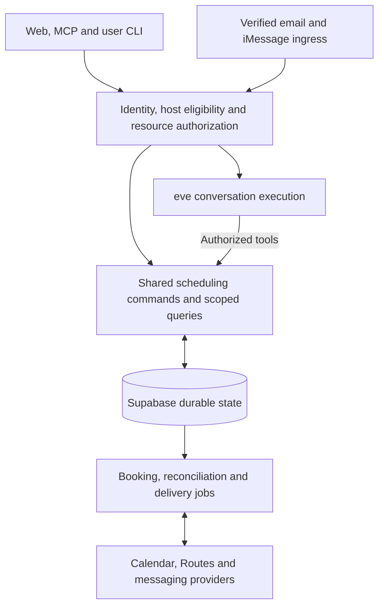

> 한국어 번역본 (검토용). 원본: documentations/04_technical_specification.md

# Find Me a Time — 기술 명세

상태: 제안된 아키텍처. 구현 없음

날짜: 2026-10-19

이 애플리케이션은 웹, 이메일, 개인 에이전트 클라이언트를 가로질러 한 명의 호스트와 한 명의 외부 요청자를 조율하며, 연결된 호스트 iMessage는 선택 사항입니다. 모든 채널은 하나의 인가된 일정 경계(authorized scheduling boundary)를 호출합니다. 범위는 [PRD](02_product_requirements.md)가 정의하고, 합의된 동작은 [기능(capability) 명세](../openspec/specs/)가 유지합니다.

## 범위와 기반

| 관심사 | 방향 | 필요한 결정 또는 근거 |
|---|---|---|
| 웹 | Next.js, React, TypeScript, npm. 대화 우선 UI | 의존성 버전 고정, 분리된 빌드, 모바일/접근성 검증 |
| 대화 런타임 | 애플리케이션이 인가를 소유하는 eve | 영속성, 배포 구성, 보호된 스트림, 재생(replay) 및 종료 상태 복구 스파이크(spike) |
| 인증/데이터 | Supabase Auth와 PostgreSQL. Google 전용 호스트 로그인 | 호스트 자격(eligibility), 현재 권한 부여, 격리된 데이터베이스 기준선과 검토된 마이그레이션 |
| 에이전트 접근 | 원격 MCP와 얇은 사용자 CLI | 리소스 결합형 OAuth, 폐기, 요청자 시작(bootstrap), 각 지정 클라이언트의 수용 검증 |
| 캘린더/이동 | Google Calendar와 Google Routes | 호스트/요청자 별도 동의, 이동 정책, 이벤트 정합(reconciliation), 통제된 공급자 사례 |
| 트랜잭션 이메일 | Cloudflare Email Service, `no-reply@findmeatime.com` | 연락처 증명, 복구, 예약 전달 |
| 대화형 이메일 | AgentMail | 인증된 발신자/스레드 결합, 내구성 있는 답장, 불확실한 전송의 복구 |
| 호스트 iMessage | Photon Spectrum | 검증된 비공개 결합, 네이티브/어댑터 호환성, 귀속, 실제 기기 전달 |
| 호스팅 | 기록된 Vercel 릴리스 오리진 | 런타임 배치, 소비자(consumer) 소유권, 새 배포 확인 |

선택된 Supabase 프로젝트는 연결되어 있으며 애플리케이션 스키마는 비어 있습니다. [공급자 설정](technical_specification/03_provider_setup.md#supabase-project)을 참조하십시오. 릴리스 오리진과 공급자/클라이언트 준비 상태는 검증 대상입니다. 모델 ID, 공급자 사용 권한, 의존성 버전, 런타임 호스팅은 사용하기 전에 새로 기록해야 합니다.

### 백엔드 결정

Supabase는 인증과 내구성 있는 도메인 저장소로 유지합니다. eve는 의도된 대화 엔진으로 사용하되, 확장하기 전에 범위가 한정된 검증(proof)을 거칩니다. 애플리케이션 코드는 행위자/리소스/대상(audience) 결합, 제안 버전, 사람의 결정, 외부 효과의 복구를 소유합니다. 런타임 세션, 도구 승인, OAuth 권한 부여는 미팅 승인을 성립시킬 수 없습니다. 런타임을 교체하려면 명시적인 설계 결정이 필요합니다.

## 아키텍처

이 다이어그램은 논리적 책임을 보여 줍니다. 최종 프로세스/워커 배치는 기반 단계의 종료 결정(foundation exit decision)이며, 지금 추가 서비스를 만들어야 할 이유가 아닙니다.

## 사용자 화면과 신뢰 경계

호스트는 접근, 설정, 요청 선택, 비공개 검토, 설정 관리를 위해 `/app`을 사용합니다. 요청자는 `/{handle}`에서 시작하여 `/booking/[bookingId]`의 요청 범위 접근을 통해 이어 갑니다. 공개 `/SKILL.md`와 `/{handle}/SKILL.md`는 접근 권한을 부여하지 않고 연결 절차만 설명합니다. 공급자 동의는 동일한 인가 맥락으로 돌아옵니다.

호스트 설정, 호스트 비공개 요청 논의, 요청자에게 보이는 기록은 서로 구분하여 유지합니다. 모든 읽기, 스트림, 작업에서 행위자, 리소스, 대상을 서버에서 확정합니다. 공급자 비밀 정보는 서버 측에만 둡니다. [페이지 목록](user_experience/04_page_list.md)을 참조하십시오.

## 일정 조율 보장 사항

결정론적인 캘린더, 규칙, 이동 확인이 AI 순위 지정 전에 후보를 걸러 냅니다. 예약에는 요청자의 동의와 현재 버전에 대한 귀속 가능한 호스트 승인이 필요하며, 그 뒤에 새로운 실행 가능성 확인이 이어집니다. 디스패치 전에 안정적인 이벤트 식별자를 영속화하고, 불확실한 쓰기는 다시 생성하기 전에 정합합니다. 전달 실패는 확정된 예약 상태를 바꾸지 않습니다. 초기 릴리스에서는 예약 후 자동 일정 변경/취소와 비공개 호스트 이메일을 제외합니다.

## 세부 설계 담당 문서

[백엔드 아키텍처](technical_specification/01_backend_architecture.md)는 도메인과 효과(effect) 설계를 담당합니다. [프런트엔드 아키텍처](technical_specification/02_frontend_architecture.md)는 소스 구성, UI 상태, 스트리밍을 담당합니다. [공급자 설정](technical_specification/03_provider_setup.md)은 환경 사전 요건을 담당합니다. [PRD](02_product_requirements.md#9-end-to-end-release-acceptance-scenarios)가 AC-01–AC-28과 이를 닫는 증거 규칙을 담당합니다.
