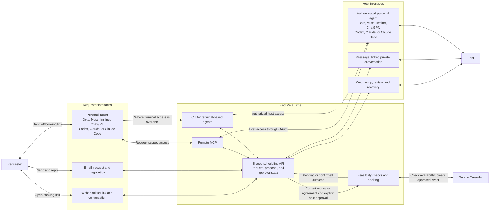
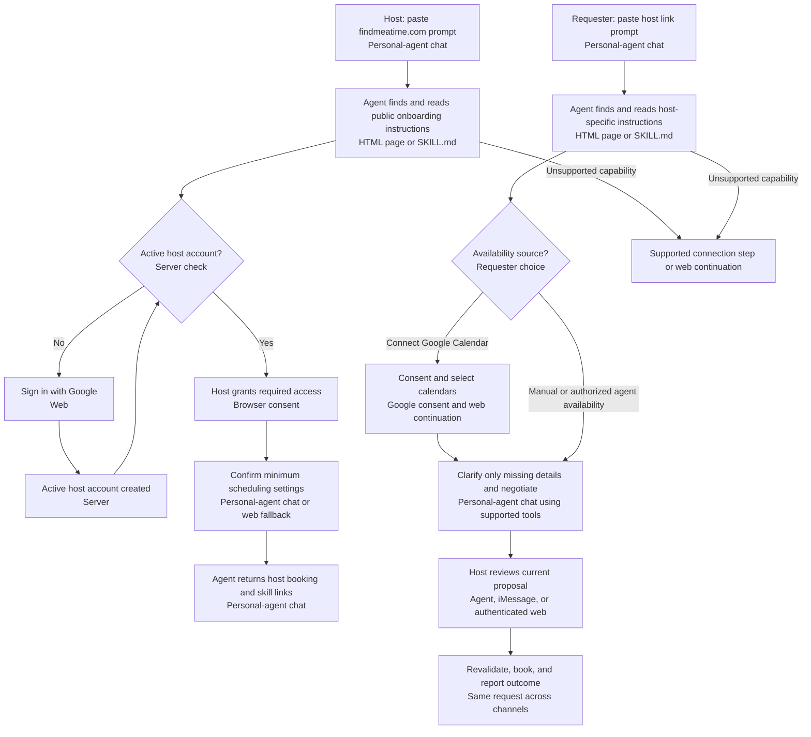
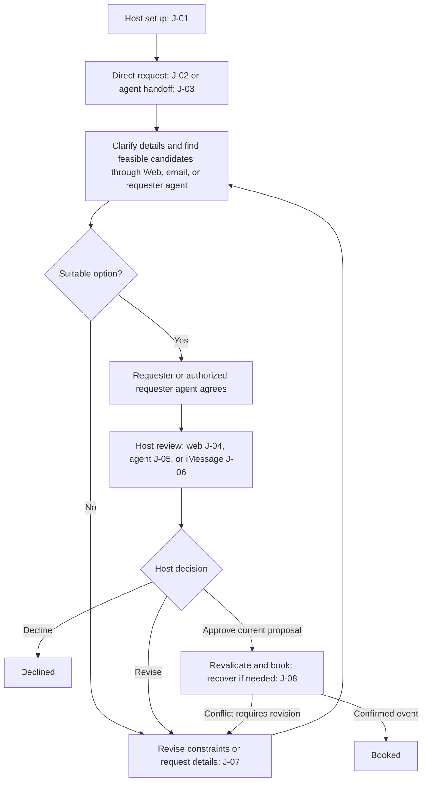
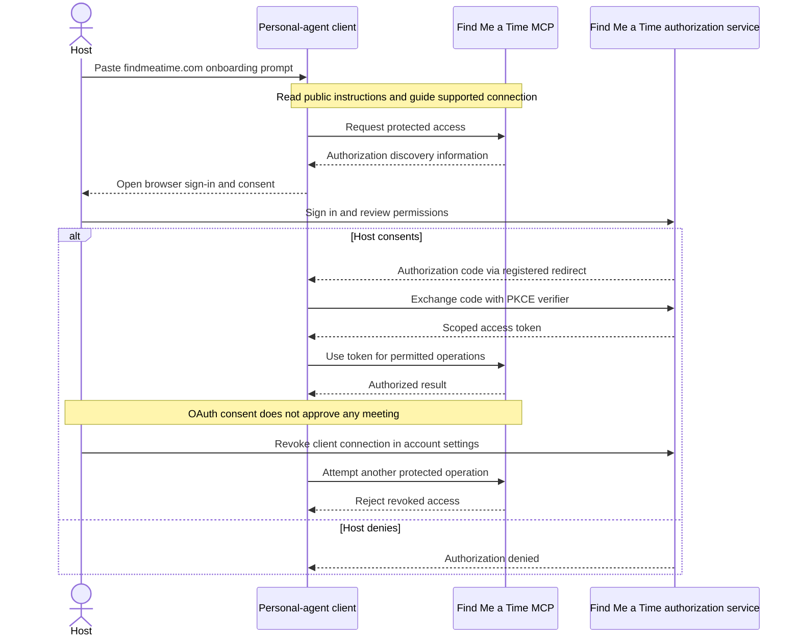

> 한국어 번역본 (검토용). 원본: documentations/user_experience/01_user_journeys.md

# Find Me a Time — 사용자 여정

상태: 팀 검토용 초안\
날짜: 2026-10-19\
근거: [제품 요구사항](../02_product_requirements.md)

여정(journey)은 한 사람의 목표와 여러 채널에 걸친 경험을 설명하고, 흐름(flow)은 그 안의 단계와 결정을 설명합니다. 이 문서는 둘을 함께 다루어 제안하는 경험을 설명합니다. [사용자 스토리](02_user_stories.md)는 이에 대응하는 필요를 표현합니다. 요구사항 ID와 인수 기준 ID는 PRD를 가리키며, 이 여정은 별도의 동작 계약을 도입하거나 기능이 구현되었다고 주장하지 않습니다.

## 여정에서 사용하는 인터페이스

예약 링크는 사람과 지원되는 요청자 에이전트 모두에게 동작합니다. 호스트는 루트 스킬 프롬프트를 자신의 개인 에이전트에 붙여 넣는 것으로 시작할 수 있습니다. 호스팅은 개방되어 있습니다. Google 계정이 있는 사람은 누구나 호스트가 될 수 있으며, Google 로그인을 완료하면 캘린더 설정에 앞서 활성 호스트 계정이 생성됩니다. 호스트는 브라우저에서 Google로 로그인하며, 이메일 로그인은 MVP 범위 밖입니다. 활성 호스트는 필요할 때 별도의 제공자 동의를 거친 뒤 요청을 검토할 위치를 선택합니다. 웹에서 직접 설정하는 방법도 계속 제공됩니다. 여기서 **웹(Web)**은 모바일과 데스크톱 브라우저를 포함하며, 별도의 네이티브 앱은 초기 릴리스 범위 밖입니다.

화살표는 통신을 나타낼 뿐 동일한 권한을 뜻하지 않습니다. 요청자 인터페이스는 호스트 승인을 부여하거나 호스트 전용 정보를 읽을 수 없습니다. 이번 릴리스에서 iMessage는 호스트 채널입니다. 이메일은 요청자 협상 채널로 표시되어 있으며, 이 여정에서 호스트 승인 수단이 아닙니다. MVP는 iPhone/iMessage 호스트를 대상으로 하며, 일상적인 일정 조율에는 iMessage를 권장합니다. 에이전트 연결과 iMessage 연동은 계속 선택 사항이며, 호스트는 두 채널 중 어느 쪽에서든 온보딩을 시작할 수 있고 웹은 전 과정에서 사용할 수 있습니다. iMessage 비공개 진입은 호스트 상태에 접근하기 전에 검증된 브라우저 인계를 거칩니다. Android 전용 흐름은 보류되며, 요청자 링크는 계정 없이 사용할 수 있고 기기 기반 차단은 하지 않습니다. Photon Spectrum은 선택된 iMessage 전송 방향이며, 브리지와 애플리케이션 신원 매핑은 계약에 맞추어 구현하고 검증해야 합니다.

원격 MCP가 주된 에이전트 인터페이스이고, CLI는 터미널 접근이 가능한 클라이언트를 위한 것입니다. 둘 다 공유 스케줄링 API를 사용합니다. 호스트의 MCP 접근은 OAuth를 사용하며, 요청자의 접근은 계정 없이 요청 범위로 제한됩니다. 이 다이어그램은 의도한 경로를 보여 줄 뿐, 이름이 나열된 모든 클라이언트에서 두 인터페이스가 검증되어 지원된다는 뜻은 아닙니다. OAuth 연결과 해지는 J-09에서 다룹니다.

## 복사해서 붙여 넣는 진입 흐름

호스트: `Let me use findmeatime.com for my scheduling`\
요청자: `Let me schedule a meeting with findmeatime.com/dodo`

이는 의도한 제품 진입점이며, 해당 URL이나 연동이 배포되었다는 주장이 아닙니다.

요청자의 동의와 현재 제안에 대한 호스트의 명시적 승인은 예약의 선행 조건으로 유지됩니다. 설정은 J-01, 요청자 위임은 J-03, 접근 동의는 J-09를 참고하십시오.

## 주요 의사결정 흐름

호스트는 자신의 가용 시간과 규칙을 한 번 준비합니다. 이후 요청자는 직접 또는 에이전트를 통해 조율하고, 호스트는 그 결과로 나온 제안을 웹, 개인 에이전트, 또는 iMessage로 검토합니다. 모든 경로는 동일한 요청 상태를 사용합니다.

이 다이어그램은 주된 경로를 보여 줍니다. 철회, 만료, 해결되지 않은 실패는 J-08에서 다룹니다. 제안된 시간은 예약이 아니며, 요청자의 동의만으로는 예약이 승인되지 않습니다.

## J-01 — 호스트 설정

**목표:** 가용 시간과 최종 결정에 대한 통제권을 유지하면서 조율을 위임합니다.\
**진입:** 호스트가 `Let me use findmeatime.com for my scheduling`을 자신의 개인 에이전트에 붙여 넣거나, 웹에서 직접 시작합니다.

아래 단계는 에이전트 경로를 설명합니다. 웹 직접 온보딩은 동일한 계정, 캘린더, 설정 확인을 웹에서 수행하고, 개인 에이전트 연결과 승인 단계는 건너뛰며, 공유 가능한 링크를 웹에 표시합니다. [호스트 온보딩 흐름](05_host_onboarding_flow.md)은 이 여정을 상태, 서버 확인, 기록되는 데이터로 나누어 설명합니다.

1. 에이전트는 루트 스킬 문서를 읽고 활성 호스트 계정과 사용 가능한 연결 기능을 확인합니다. 활성 호스트 계정이 없으면 호스트를 웹 Google 로그인으로 안내하며, 이 로그인은 같은 화면에서 캘린더 접근을 요청하며, 그 부분을 거부하더라도 즉시 계정을 생성합니다. 로그인이 끝나기 전에는 설정이 성공했다고 표시하지 않습니다. 정지된 호스트 계정은 호스팅 설정을 계속할 수 없으며 중립적인 이용 불가 결과를 보게 됩니다. 웹 직접 설정도 동일한 호스트 자격 확인을 따릅니다. 에이전트는 호스트에게 엔드포인트나 명령어를 직접 찾게 하지 않고 필요한 클라이언트 설정을 안내합니다.
2. 호스트는 같은 Google 화면에서 캘린더 동의를 함께 받는 브라우저 로그인과, J-09를 통한 에이전트 승인을 완료합니다. 유효한 기존 연결은 재사용합니다.
3. 에이전트는 호스트가 실제로 승인한 캘린더의 카드와 함께 이어서 진행하며, 캘린더 스코프를 거부했거나 철회한 경우에만 먼저 **Google Calendar 연결(Connect Google Calendar)**을 보여 줍니다. 확인할 캘린더와 쓰기 가능한 예약 대상 캘린더를 짧은 이유와 함께 추천하며, 호스트는 이를 변경할 수 있습니다. **선택한 캘린더 분석(Analyze selected calendars)**은 어떤 캘린더와 어떤 기간을 읽을지 설명합니다. 분석이 끝나면 에이전트는 주간 미리보기로 반복되는 회의 가능 시간대, 관찰된 부하에 따른 주당 미팅 상한(내부 미팅과 외부 미팅을 따로 집계), 그 개수에서 제외할 메모성 이벤트, 가장 빈번한 지역과 장소를 포함한 온라인/대면 장소 선호를 제안하며, 각 제안은 근거, 표본 수, 불확실성과 함께 질문 형태로 표현됩니다(“미팅의 80%가 오후 1시에 시작하네요. 앞으로 그 시간대를 먼저 제안할까요?”). 에이전트는 호스트가 온라인, 대면, 또는 둘 다 중 무엇을 선호하는지 명시적으로 묻고, 대면/둘 다인 경우 선호하는 지역이나 장소, 또는 명시적인 **회의마다 결정(Decide per meeting)** 선택을 묻습니다. 대면 회의를 받는 호스트에게는 평소 이동 수단과 추가로 원하는 이동 여유 시간을 묻고, 지원되는 이동 수단 또는 **이동에 따라 다름(Depends on the trip)**과 수정 가능한 여유 시간 제안을 제시합니다. 최종 검토에는 이 선택들이 포함되며, 온라인 전용이면 이동 수단 설정을 건너뜁니다. 캘린더 기반 제안은 이러한 질문과 함께 제시될 뿐 답변으로 간주되지 않습니다. 이미 밝힌 선호는 재사용하고, 온라인 전용 호스트에게는 물리적 위치 입력을 건너뜁니다. 호스트는 다른 제안을 사용하거나 수정하거나 무시할 수 있으며, 빠진 시간대, 회의 시간 길이, 여유 시간을 직접 입력할 수 있습니다. **직접 설정(Set up manually)**은 계속 사용할 수 있습니다. 이력이 부족하거나 위치가 없거나 읽기에 실패하면 선호를 지어내지 않고 질문을 합니다. 캘린더 선택과 최종 설정은 사용하기 전에 명시적인 확인이 필요합니다.
4. 호스트가 설정을 확인하고 서비스가 설정을 검증하면, 에이전트는 호스트의 예약 링크 `findmeatime.com/{host}`를 돌려줍니다. 이 링크는 요청자가 자신의 에이전트에 붙여 넣는 링크이기도 합니다.
5. 아직 연동하지 않은 호스트에게 어시스턴트는 **iMessage 연결(Connect iMessage)**을 권장하며 **나중에(Maybe later)** 선택지를 함께 제공합니다. iMessage에서 시작한 호스트는 필요한 브라우저 단계를 마친 뒤 검증된 연동 대화를 이어갑니다. 연동은 선택 사항이며 기본 설정을 막지 않고, 이후 일상적인 제안 검토는 iMessage에서 이어갈 수 있습니다. 연동한 뒤에는 남은 설정 질문(캘린더 역할, 제안, 방식, 장소, 이동 수단, 핸들)을 모두 iMessage에서 평범한 답장으로 처리할 수 있으며, 이 답장은 공유 초안을 갱신합니다. 로그인, 동의, 최종 설정 확정은 [호스트 온보딩 흐름](05_host_onboarding_flow.md#setup-over-imessage)에 설명된 대로 브라우저 링크 또는 정확한 사전 작성 확정 명령을 사용합니다.
6. 중단된 흐름은 저장된 진행 상태에서 재개됩니다. 클라이언트가 지원하지 않는 기능은 지원되는 설정 단계나 웹 이어가기로 안내하며, 동의를 거부하면 성공적인 연결이 만들어지지 않습니다.

**결과:** 로그인은 했지만 설정을 마치지 않은 호스트는 활성 계정은 있으나 공개 예약 링크는 없습니다. 설정을 마친 호스트는 에이전트와 브라우저 사이에서 정보를 최소한만 반복하면서 요청을 받을 준비가 됩니다. 온보딩을 다시 실행하면 기존 호스트 계정을 재사용합니다. 캘린더 접근 실패는 제한 없는 가용 상태가 아니라 복구 상태입니다.

에이전트는 여정 전체에서 유용한 다음 행동과 가능한 경우 제안 답변을 제시하며 이끕니다. 이미 알려진 선택은 재사용하고, 캘린더에 기반한 선호나 라벨이 붙은 시작 기본값을 제안하며, 해결되지 않은 세부 사항에 대해서만 초점이 분명한 질문을 하나 합니다. 호스트는 빈 설문지를 채우는 대신 제안을 수락하거나 수정합니다. 로그인, 캘린더 동의, 인라인 iMessage 검증, 재시도, 완료는 모두 대화로 안내하며, 민감한 입력은 여전히 보호된 컨트롤을 사용합니다.

웹 직접 설정은 `/app` 안에서 이루어집니다. 호스트는 에이전트와 대화하고, 설정 초안을 검토하며, 현재 검토 화면에서 **제안된 설정 확인 및 저장(Confirm and save proposed settings)**을 선택합니다. 정확한 캘린더/규칙 수정에는 라벨이 붙은 대화상자를 사용합니다. 동의 화면에서 돌아오거나 새로고침하면 저장된 진행 상태에서 재개되며, 모델이 실패해도 수동 컨트롤과 기존에 저장된 규칙은 계속 사용할 수 있습니다. 이후의 웹 또는 iMessage 턴이 이전 검토를 무효화할 수 있으므로, 호스트는 확인하기 전에 최신 설정을 검토합니다.

선택 사항인 iMessage 연동은 `/app` 채팅에서 **iMessage 연결(Connect iMessage)**을 선택하고, 인라인 카드에 서비스의 iMessage 번호와 일회용 연결 코드가 표시됩니다. **메시지 앱 열기(Open Messages)**는 수신자와 코드가 이미 입력된 상태로 메시지 앱을 열어 주므로 호스트는 전송만 누르면 되고, **코드 복사(Copy)**는 딥링크가 작동하지 않는 기기를 위해 정확한 메시지를 복사하며, 번호와 코드는 직접 입력할 수 있도록 계속 표시됩니다. 메시지가 도착하면 카드가 마스킹된 발신자를 보여 주고 호스트가 **확인 및 연결(Confirm and link)**을 선택합니다. 그 스레드에서 서비스의 답장이 호스트가 받는 첫 메시지이므로 알 수 없는 발신자 배너가 뜨지 않습니다. 호스트가 자신의 기기에서 보낼 수 없다면 **대신 코드 받기(Send me a code instead)**가 E.164 형식의 번호를 요청하고, 해당 iMessage로 6자리 코드를 전달하며, 같은 브라우저의 보호된 입력란에서 이를 받습니다. 카드는 검증된 연결 요약으로 바뀌며, 연동을 위해 채팅을 떠나 설정 페이지나 대화상자로 이동할 필요가 없습니다. 코드는 웹 대화 기록이나 모델 컨텍스트에 나타나지 않으며, 페이지에는 마스킹된 발신자, 전달 상태, 만료 시간만 표시합니다. 잘못되었거나 만료된 코드, 다른 번호에서 보낸 코드, 전달 실패가 있어도 웹 설정은 계속 사용할 수 있습니다. iMessage에서 먼저 시작한 소개는 이 인증된 브라우저 흐름으로 이어질 수 있으나, 그것만으로는 비공개 접근 권한을 부여하지 않습니다. 구현과 실제 Google/iPhone 인수 검증은 아직 진행 전입니다.

**PRD 참조:** FR-01, FR-02, FR-03, FR-04, FR-18, FR-26, FR-31, FR-33, FR-35; AC-09, AC-17, AC-19, AC-23, AC-25, AC-26.

## J-02 — 예약 링크 또는 이메일로 요청

**목표:** 계정을 만들지 않고 외부 회의를 조율합니다.\
**진입:** 요청자가 호스트의 공개 `/{handle}` 링크를 받거나 지원되는 이메일 채널을 사용합니다. 요청이 생성된 후에는 검증된 이어가기를 통해 제품 계정을 만들지 않고 `/booking/[bookingId]`가 열립니다. [게스트 예약 흐름](06_guest_booking_flow.md)은 J-02, J-03, J-07, J-08을 요청 상태, 서버 확인, 복구로 나누어 설명합니다.

1. 요청자가 회의 목적을 설명합니다. 어시스턴트는 이미 알려진 세부 정보를 재사용하고 회의 시간 길이와 방식을 제안하며, 이름과 검증된 이메일을 미리 채우고 한 화면에서 가용 시간을 공유하는 **Google로 계속(Continue with Google)** 또는 인라인 이름/이메일 카드를 사용하는 **Google 없이 계속(Continue without Google)**을 제공합니다. 직접 입력했거나 다른 이메일은 신뢰할 수 있는 복구나 캘린더 초대에 사용하기 전에 연락처 검증을 거치며, 최종 제안 검토에는 수신자가 표시됩니다.
2. 시간은 브라우저가 감지한 IANA 시간대로 표시하고 눈에 보이는 선택기를 제공하며, 별도의 시간대 확인 질문 없이 게스트가 명시적으로 고른 시간대를 유지합니다. 누락되었거나 충돌하는 시간대, 모호한 날짜나 이동만 명확히 합니다. **Google로 계속(Continue with Google)**으로 가용 시간을 공유하지 않았다면, 상호 가용 시간을 위한 선택 사항 **Google Calendar 연결(Connect Google Calendar)**을 제공하거나, 수동 가용 시간을 입력하는 **나중에 하기(Skip for now)**를 제공합니다. 이메일 사용자는 보호된 브라우저 이어가기를 받습니다. 동의 후에는 호스트 설정이 아니라 같은 요청으로 돌아오며, 제품 가입은 필요하지 않습니다.
3. 요청자는 명시적인 날짜, 시간, 시간대로 표현된 실행 가능한 옵션을 받으며, 해당하는 경우 연결된 캘린더의 바쁜 시간대는 제외됩니다. 어느 쪽도 상대방의 비공개 일정 세부 정보를 볼 수 없습니다. 요청자의 접근이 거부되거나 실패하면 캘린더가 비어 있다고 말하는 대신 재연결 또는 명시적인 수동/에이전트 가용 시간 대안을 안내합니다.
4. 요청자는 옵션을 선택하거나 대안을 제안합니다. 적합한 옵션이 없으면 J-07로 이어집니다.
5. 요청자의 동의로 현재 제안이 호스트 검토로 전달됩니다. 요청자는 예약 확정이 아니라 승인이 대기 중이라는 점을 확인하며, 호스트가 변경을 요청하거나 승인하거나 거절하면 이메일로 알림을 받습니다.
6. 호스트가 승인하고 이벤트 생성이 확인되면, 요청자는 일관된 최종 회의 세부 정보, **예약 보기(View booking)**, 해당하는 경우 참여 링크가 담긴 확인 이메일과 캘린더 초대를 받습니다. 예약 문제는 J-08을 따릅니다.

**결과:** 확정된 회의, 또는 정확한 대기/종료 상태입니다. 요청자가 다른 채널로 이어가더라도 검증된 접근을 통해 같은 요청으로 돌아옵니다.

**PRD 참조:** FR-05, FR-06, FR-07, FR-08, FR-09, FR-10, FR-14, FR-15, FR-19, FR-23, FR-36; AC-01, AC-05, AC-11, AC-12, AC-27.

## J-03 — 예약 링크를 개인 에이전트에 전달

**목표:** 페이지를 채우고 메시지를 전달하는 대신 일정 조율 대화를 위임합니다.\
**진입:** 요청자가 `Let me schedule a meeting with findmeatime.com/dodo`를 Dots, Muse, Instinct, ChatGPT, Codex, Claude, 또는 Claude Code에 붙여 넣습니다. 일반 예약 링크를 공유하는 방식도 계속 지원됩니다.

1. 에이전트는 호스트별 스킬 문서를 읽고, 의도한 호스트를 파악하며, 지원되는 연결을 통해 이미 알고 있는 회의 세부 정보를 전달합니다. 문서화된 MCP/CLI 경로를 사용해 도구 선택을 직접 처리합니다. 연동 설정이 없으면 필요한 단계를 설명하거나 웹 이어가기를 제안하며, 링크를 공유하는 것만으로는 클라이언트가 연결되거나 접근 권한이 부여되지 않습니다.
2. 에이전트는 요청자가 접근을 승인한 가용 시간과 선호를 사용하거나, 요청에 연결된 브라우저 동의 흐름을 통해 Google Calendar를 직접 연결하는 선택 사항을 제안합니다. 요청자가 출처를 선택하며, 자격 증명은 에이전트 채팅을 거치지 않습니다. 수동 가용 시간도 계속 지원됩니다.
3. 에이전트는 서비스와 적합한 옵션을 주고받으며, 위임 범위 안에서 후보를 선택하고 요청자의 동의를 표현할 수 있습니다.
4. 누락된 정보나 위임 범위를 넘는 결정은 요청자에게 되돌려 묻습니다.
5. 호스트가 제안을 검토하는 동안 요청을 추적하며, 호스트가 합의된 세부 정보를 바꾸면 다시 협상합니다.
6. 예약이 성공한 뒤에만 확정된 회의를 보고하고, 그렇지 않으면 실제 상태나 필요한 조치를 보고합니다.

**결과:** 에이전트는 요청자의 개입을 최소화하면서 조율을 처리하며, Find Me a Time 계정이나 호스트 OAuth 연결은 필요하지 않습니다. 이어가기 접근은 해당 요청에만 적용됩니다. 요청자를 대신해 동의할 수 있는 권한은 호스트 승인 권한을 부여하지 않습니다. 호환성은 명시된 클라이언트마다 별도로 평가합니다.

**PRD 참조:** FR-05, FR-06, FR-08, FR-19, FR-24, FR-25, FR-29, FR-30, FR-32, FR-34, FR-36; AC-10, AC-14, AC-15, AC-21, AC-22, AC-24, AC-25, AC-27.

## J-04 — 모바일 웹에서 호스트 검토

**목표:** 휴대폰에서 명확하게 일정 결정을 내립니다.\
**진입:** 현재 제안이 호스트 승인을 기다리고 있으며, 호스트가 인증된 검토 화면을 엽니다.

1. 호스트는 요청자, 목적, 참석자, 날짜/시간/시간대, 회의 시간 길이, 방식/장소, 그리고 결정과 관련된 비공개 예외 사항을 확인합니다.
2. 세부 정보를 살펴보고 스케줄링 어시스턴트와 요청에 대해 비공개로 논의할 수 있습니다.
3. 현재 제안을 승인하거나, J-07을 통해 변경을 제안하거나, 거절합니다.
4. 승인하면 최종 실행 가능성 확인과 J-08을 통한 예약으로 이어집니다. 거절하면 이벤트를 만들지 않고 요청을 종료합니다.
5. 호스트는 예약이 확정되었는지, 대기 중인지, 복구가 필요한지 확인합니다.

**결과:** 호스트의 결정은 호스트가 검토한 제안에 대해 기록됩니다. 비공개 논의는 요청자에게 보이는 메시지에 포함되지 않습니다.

**PRD 참조:** FR-01, FR-14, FR-16, FR-17, FR-20, FR-23; AC-04, AC-06, AC-10, AC-13.

## J-05 — 개인 에이전트를 통한 호스트 검토

**목표:** 호스트가 이미 사용하는 에이전트를 통해 요청을 검토합니다.\
**진입:** 호스트가 자신의 요청에 접근할 수 있도록 승인된, 인증된 Dots, Muse, Instinct, ChatGPT, Codex, Claude, 또는 Claude Code 연동을 사용합니다.

1. 에이전트는 J-09에서 수립된 연결을 통해, 부여된 권한 범위 안에서 현재 제안을 조회하고 검토에 필요한 세부 정보를 제시합니다.
2. 호스트는 질문하거나, 수정을 요청하거나, 거절하거나, 해당 제안을 명시적으로 승인합니다.
3. 에이전트는 제안 맥락과 함께 호스트의 결정을 전달합니다. OAuth 동의, CLI 로그인, 상시 일정 지침은 제안 승인으로 간주되지 않으며, 에이전트가 호스트를 대신해 결정하도록 허용하지도 않습니다.
4. 연동이 명시적인 호스트 확인을 확보하지 못하면, 호스트는 인증된 웹 검토에서 직접 결정을 완료합니다.
5. 에이전트는 웹 인터페이스와 동일한 상태와 예약 결과를 보고합니다.

**결과:** 호스트는 개인 에이전트를 상호작용 화면으로 사용하면서도 최종 통제권을 유지합니다.

**PRD 참조:** FR-01, FR-16, FR-17, FR-18, FR-24, FR-29, FR-30, FR-31; AC-06, AC-10, AC-14, AC-20, AC-22.

## J-06 — iMessage를 통한 호스트 검토

**목표:** 비공개 메시지 대화에서 요청을 처리합니다.\
**진입:** 호스트가 메시지 신원을 검증하고 연동했으며 알림 수신에 동의했습니다.

요청을 논의하기 전에 호스트는 요청 목록을 요청하고 정확한 `request <reference>` 명령을 보냅니다. 서비스는 선택을 확인하며, 모호하거나 유효하지 않은 선택은 기존 선택을 그대로 둡니다. `setup`은 온보딩/설정으로 돌아갑니다. 요청에 대한 답신은 새 선택이 이루어진 뒤에 전달되더라도 원래의 요청을 식별합니다. 선택은 제안 승인을 부여하지 않습니다. `review`를 보내면 애플리케이션이 작성한 제안, 그 버전, 현재 요청자의 동의 상태를 가져옵니다. 세부 정보가 한 메시지에 완전히 담기지 않으면 호스트는 브라우저에서 검토하며, 축약된 요약으로는 결정을 승인할 수 없습니다.

1. 호스트는 연동된 비공개 대화에서 현재 제안의 요약을 받습니다.
2. 호스트는 질문하거나 "다음 주로 바꿔 줘"와 같은 변경을 제안합니다. 논의는 호스트에게만 공개됩니다.
3. 호스트는 표시된 제안에 대해 정확히 작성된 명령과 검토 참조를 사용해 명시적으로 승인 또는 거절하거나, 인증된 브라우저 검토를 완료합니다. 제안이나 그 맥락이 바뀌었다면 다시 검토합니다. 승인 확인 응답은 이벤트가 실제로 확정될 때까지 예약이 대기 중이라고 알립니다. 변경은 J-07을 따릅니다. `changes`를 보내 변경 전/후 전체 값을 검토한 뒤, 정확한 적용 또는 취소 명령을 사용합니다. 공유하면 이전의 동의와 승인이 지워지며, 새 제안에는 둘 다 다시 필요합니다.
4. "응" 같은 답신이 모호하면 어시스턴트가 명확히 해 달라고 요청합니다. 오래된 답신은 더 새로운 제안을 승인할 수 없습니다. 신원이나 제안 맥락을 확인할 수 없으면 호스트는 인증된 웹 검토를 사용합니다.
5. 호스트는 예약 결과를 받으며, 전달에 실패하면 `/app`에서 이어갑니다. 호스트는 iMessage 연동을 해제하여 알림과 해당 신원을 통한 이후의 비공개 처리 및 호스트 행동을 중단할 수 있으며, 다시 연동하려면 새로운 증명이 필요합니다.

**결과:** iMessage는 웹 및 에이전트 클라이언트와 동일한 요청에 대해 동작합니다. 전달/읽음 확인은 승인이 아니며, 연동되지 않은 발신자와 그룹 대화는 호스트 전용 정보를 조회하거나 호스트로서 행동할 수 없습니다.

Photon Spectrum은 [PRD 의존성 절](../02_product_requirements.md#10-dependencies-and-open-decisions)에 설명된 선택된 전송 방향입니다. 제품 여정은 에이전트 프레임워크에 의존하지 않으며, 어댑터가 메시지를 렌더링한다는 사실만으로는 호스트 승인이 성립하지 않습니다.

**PRD 참조:** FR-08, FR-16, FR-17, FR-26, FR-27, FR-28; AC-16, AC-17, AC-18.

## J-07 — 제안 수정 또는 적합한 시간이 없는 경우의 해결

**목표:** 호스트의 규칙을 조용히 완화하지 않고 실행 가능한 회의를 찾습니다.\
**진입:** 실행 가능한 후보가 없거나, 한쪽이 다른 세부 정보를 요청하거나, 예약 전 확인에서 충돌이 발견됩니다.

1. 어시스턴트는 요청자에게 누락된 정보나 더 넓은 기간을 요청하거나, 호스트에게 비공개로 선호를 검토해 달라고 요청합니다.
2. 호스트는 해당 요청에 한해 선호를 명시적으로 면제하거나, 적용되는 규칙을 수정하거나, 거절할 수 있습니다. 캘린더의 바쁜 시간 충돌이나 충족되지 않은 필수 제약은 승인만으로 우회할 수 없습니다.
3. 서비스는 대면 회의 전후의 이동 시간을 포함하여 새로운 옵션을 평가하고, 실행 가능한 후보만 제시합니다.
4. 비공개 호스트 논의에서 어시스턴트는 변경된 공유 세부 정보의 초안을 작성할 수 있습니다. 호스트는 웹 워크스페이스에서 **제안된 공유 변경 검토(Review proposed shared changes)**를 열어 현재 값과 제안된 값을 비교한 뒤 **수정된 세부 정보 공유(Share revised details)** 또는 **제안 무시(Dismiss suggestions)**를 선택합니다. 공유하면 이전 제안과 결정이 지워지며, 비공개 사유는 비공개 논의에 남습니다. iMessage가 연동된 호스트는 대신 `changes`를 보내 작성된 변경 전/후 메시지 전체를 비교하고 정확한 적용/취소 명령을 사용할 수 있습니다. 검토 내용이 불완전하거나, 너무 크거나, 오래되었거나, 만료되었다면 브라우저를 사용하거나 새 검토를 요청합니다. 변경된 공유 세부 정보는 새로 확인된 제안으로 요청자 또는 승인된 요청자 에이전트에게 돌아가 동의를 받고, 이어서 새로운 호스트 승인을 받습니다.
5. 요청은 선택된 검토 채널로 돌아가거나, 거절 또는 철회되면 종료됩니다.

**결과:** 양쪽이 동일한 현재 세부 정보에 따라 행동합니다. 요청자는 비공개 규칙이나 예외 사유가 아니라 대안과 공유되는 회의 정보를 봅니다.

**PRD 참조:** FR-04, FR-10, FR-11, FR-12, FR-13, FR-14, FR-17, FR-19, FR-20; AC-02, AC-03, AC-04, AC-07.

## J-08 — 예약, 복구, 종료된 요청

**목표:** 회의가 존재하는지, 어떤 조치가 남았는지 파악합니다.\
**진입:** 요청이 예약 준비가 되었거나, 실패가 발생했거나, 종료되는 중입니다.

| 상황 | 사용자 경험과 다음 단계 |
|---|---|
| 현재 동의와 호스트 승인이 있음 | 서비스는 이벤트를 만들기 전에 실행 가능성을 다시 확인합니다. 생성이 확인되면 예약 완료, 확인 이메일/캘린더 세부 정보, `/booking/[bookingId]`의 보호된 최종 영수증으로 이어집니다. 종료 후에는 기존 자격 증명이 유효한 동안 요청자 접근이 최소한의 상태/영수증만 보여 줍니다. 충돌이 있으면 J-07로 돌아갑니다. |
| 캘린더 접근이 해지되었거나 쓰기가 명확히 거부됨 | 호스트는 재연결 또는 재시도 조치를 봅니다. 생성 재시도는 동의, 승인, 실행 가능성을 다시 확인합니다. |
| 캘린더 쓰기가 시간 초과되어 결과가 불확실함 | 서비스가 이벤트의 존재 여부를 확인하는 동안 양쪽 모두 예약이 대기 중인 것으로 봅니다. 시간 초과가 이벤트가 만들어지지 않았다는 뜻은 아닙니다. |
| 답신이나 승인이 반복됨(채널 간 반복 포함) | 사용자는 현재 결과를 확인하며, 재시도로 이벤트가 추가로 생성되지 않습니다. |
| 이벤트는 존재하지만 확인 전달이 실패함 | 예약은 확정된 상태로 유지됩니다. 전달 복구는 이벤트를 다시 만들지 않으며, iMessage 사용자는 웹에서 이어갈 수 있습니다. |
| 예약이 시작되기 전에 요청자가 철회함 | 요청은 철회됨 상태가 되며 늦은 승인으로는 예약할 수 없습니다. 쓰기가 불확실한 동안에는 생성이 막혔다고 약속하지 않고 대기 중인 결과를 보고합니다. |
| 호스트가 거절하거나 요청이 만료됨 | 현재의 종료 상태를 표시합니다. 오래된 메시지로는 예약을 다시 열 수 없으며, 만료 후에는 갱신된 세부 정보와 결정이 담긴 새 요청이 필요합니다. 처리 가능한 요청은 [요청 계약](../../openspec/specs/meeting-requests/spec.md)에 정의된 대로 7일 후 또는 요청된 기간이 끝나는 시점 중 더 이른 때에 만료됩니다. |
| 예약된 회의를 취소하거나 일정을 변경해야 함 | 초기 릴리스에서는 사용자가 캘린더에서 기존 이벤트를 직접 관리하도록 안내하며, 예약 후 자동 변경은 범위 밖입니다. |

**PRD 참조:** FR-03, FR-09, FR-17, FR-20, FR-21, FR-22, FR-23, FR-28; AC-06, AC-07, AC-08, AC-09, AC-13, AC-18. 만료와 예약 후 경계는 PRD의 3, 7, 10절을 따릅니다.

## J-09 — 에이전트 접근 연결 및 관리

**목표:** 개인 에이전트 클라이언트에 제한된 접근 권한을 주고 언제든 해지할 수 있게 합니다.\
**진입:** 스킬 기반 온보딩 중 에이전트가 호스트를 호환되는 원격 MCP 연결로 안내하며, 호스트가 수동으로 추가할 수도 있습니다.

1. 클라이언트는 서비스의 인증 흐름을 찾아내고 호스트를 브라우저 로그인으로 안내합니다.
2. 호스트는 Find Me a Time에 로그인하고, 요청된 권한을 확인한 뒤 접근을 허용하거나 거부합니다.
3. 동의 후 클라이언트는 OAuth 흐름을 완료하고, 해당 호스트와 허용된 작업으로 범위가 제한된 접근 권한을 받습니다. 동의를 거부하면 새로 승인된 연결이 생기지 않습니다.
4. 호스트는 에이전트로 돌아가 J-05를 통해 요청을 검토합니다. 각 회의에는 여전히 현재 제안에 대한 별도의 명시적 결정이 필요합니다.
5. 호스트는 계정 설정에서 연결을 확인하고 해지할 수 있습니다. 해지되었거나 만료된 자격 증명은 보호된 작업에 접근할 수 없으며, 연결이 실패해도 웹 검토를 직접 사용하는 데에는 지장이 없습니다.

이 다이어그램은 호스트 경험과 인증 경계를 보여 줄 뿐 완전한 프로토콜 교환을 나타내지 않습니다. Google Calendar 인증은 별개입니다. 이는 스케줄링 서비스가 선택된 캘린더에 접근하도록 허용할 뿐 MCP 자격 증명을 제공하지 않습니다. 터미널 기반 에이전트는 대신 동등한 권한과 JSON 결과를 가진 CLI를 사용할 수 있으며, CLI 로그인 방식은 설계 결정으로 남아 있습니다. 요청자 에이전트는 J-03을 따르며 이 호스트 연결이 필요하지 않습니다.

**PRD 참조:** FR-29, FR-30, FR-31, FR-32; AC-19, AC-20, AC-21, AC-22.

## 아직 열려 있는 결정

이 여정은 [PRD의 열린 결정 사항](../02_product_requirements.md#10-dependencies-and-open-decisions)을 그대로 이어받으며, 여기에는 채널 전달 순서, 에이전트 탐색과 확인, iMessage 신원 연동, 규칙 기본값, 회의 링크 생성과 알림이 포함됩니다. 요청 만료와 영어/한국어 접수는 [회의 요청 계약](../../openspec/specs/meeting-requests/spec.md)에서 확정되었으며, 더 넓은 현지화와 혼합 언어 인수 검증은 열려 있습니다. 제안된 호스트 발송 연결 코드 검증은 구현되지 않았으며, 실제 인수 검증은 아직 진행 전입니다. 두 가지 스킬 URL 경로와 복사해서 붙여 넣는 진입 경험은 제품 요구사항입니다. 나머지 예시 문구는 화면, API 형식, 알림 시점, 완성된 연동을 규정하지 않습니다.

### 요청자 연락처 코드 복구

비공개 예약 페이지에서 **이메일 인증(Verify your contact email)**에 표시된 주소를 확인하고 **인증 코드 보내기(Send verification code)**를 선택합니다. 이메일로 받은 6자리 숫자를 해당 카드에 입력하고 **이메일 인증(Verify email)**을 선택합니다. 전달 상태는 이메일 제출 여부를 설명할 뿐이며, 현재 유효한 코드와 일치해야만 증명이 성립합니다. 코드는 만료되며 실패한 시도는 최대 5회까지 허용됩니다. 설정된 대기 시간이 지나면 시간당 요청 한도 내에서 새 코드를 받을 수 있고, 새 코드는 이전 코드를 대체합니다. [`requester-intake-and-feasibility` 제안](../../openspec/changes/requester-intake-and-feasibility/proposal.md#decisions-to-settle)은 10분 만료, 60초 대기 시간, 요청당 최대 5개 및 주소당 시간당 10개의 코드를 권고하며(D3), 팀의 승인을 기다립니다.

결과를 알 수 없으면 **인증 상태 확인(Check verification status)** 또는 **같은 인증 동작 다시 시도(Retry same verification action)**를 사용합니다. 새로고침하면 다른 메시지를 보내지 않고 현재 상태를 복원합니다. 주소가 변경되면 새로운 증명이 필요합니다. 인증은 계정, 대체 비공개 링크, 제안에 대한 동의, 호스트 승인을 만들지 않습니다. 요청자는 여전히 제안에 명시적으로 동의해야 하고 호스트는 별도로 승인합니다.

### 요청자 접수 중 선택적 Google 신원 사용

**Google로 계속(Continue with Google)**을 선택하면 이름과 이메일이 자동으로 입력되고, **Google 없이 계속(Continue without Google)**을 선택하면 직접 입력합니다. 같은 Google 화면에서 가용 시간 전용 캘린더 접근도 요청하며, 이를 해제하더라도 Google 이름과 이메일은 그대로 사용할 수 있습니다. 회의 목적과 선택한 시간대는 동의 후, 취소한 경우에도, 초안과 함께 돌아옵니다. Google 주소는 자동으로 입력되고 인증된 것으로 간주되므로 인증 코드가 필요 없으며, 계속하기 전에 주소를 확인하고 표시 이름을 수정합니다. 주소가 바뀌었거나 Google이 현재 보증할 수 없는 주소라면 이메일 인증 코드가 필요합니다.

기존 비공개 요청에서는 Google 신원이 선택된 계정을 먼저 보여 줍니다. **검증된 Google 이메일 사용(Use verified Google email)**을 선택하여 일치하는 현재 수신자를 검증합니다. 다른 수신자를 원하면 먼저 요청 세부 정보에서 그 변경을 검토합니다. 이 동작은 제안에 동의하거나 회의를 예약하지 않습니다.

시간대 선택기는 이 탭에서 명시적으로 고른 선택을 새로고침이나 Google 복귀 후에도 기억합니다. 회의 검토에서 **표시 시간대(Display timezone)**는 같은 제안 시간을 변환하고 각 날짜의 오프셋을 표시하며, 이를 변경해도 가용 시간이나 동의는 바뀌지 않습니다. 시간을 선택하기 전에 알 수 없는 시간대는 지우거나 바로잡습니다. 일정 제약을 바꾸려면 회의 세부 정보를 수정하고 확인합니다.
