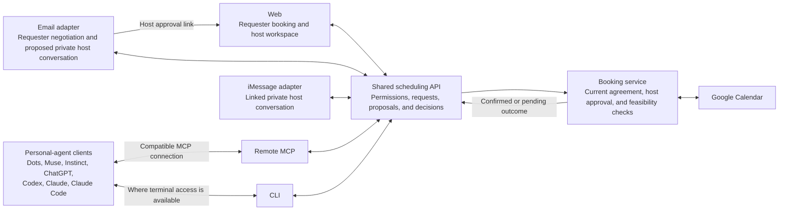

> 한국어 번역본 (검토용). 원본: documentations/user_experience/03_interfaces.md

# Find Me a Time — 인터페이스

상태: 팀 검토를 위한 초안\
날짜: 2026-10-19\
기반: [제품 요구사항](../02_product_requirements.md)\
참고 문서: [사용자 여정과 흐름](01_user_journeys.md)

이 문서는 사람과 개인 에이전트가 어떤 인터페이스를 사용하는지, 각 인터페이스가 무엇을 위한 것인지, 그리고 이들이 어떻게 같은 스케줄링 워크플로에 연결되는지를 설명합니다. 이 문서는 구현된 통합이 아니라 의도한 제품 설계를 기술합니다. 릴리스 요구사항과 인수 기준(acceptance criteria)은 PRD가 관리합니다.

설계 기반: [페이지 목록](04_page_list.md)은 제안된 웹 라우트와 상황별 동작을 정의합니다. [프론트엔드 아키텍처](../technical_specification/02_frontend_architecture.md)는 스케줄링 백엔드 위에 Next.js/eve를 제안합니다. 서비스가 보내는 코드를 대체 경로로 둔 호스트 발송 연결 코드 방식의 iMessage 연동 방향은 여전히 제안된 델타이며, 브라우저 카드, 증명(proof) 백엔드, 실제 전달, 연동된 대화는 구현되고 검증되어야 합니다.

## 채널 방향

에이전트 사용자에게는 개인 에이전트를 기본 진입점으로 삼습니다. 호스트가 되려면 `Let me use findmeatime.com for my scheduling`을 붙여넣고, 미팅을 요청하려면 `Let me schedule a meeting with findmeatime.com/dodo`를 붙여넣습니다. 페이지는 에이전트를 `/SKILL.md` 또는 `/{host}/SKILL.md`로 안내하며, 클라이언트가 페이지에서 지침을 찾지 못할 때는 이 경로를 직접 붙여넣을 수 있습니다. 에이전트가 워크플로를 안내하며 부족한 정보, 필요한 동의, 결정에 대해서만 묻습니다. 애플리케이션은 두 경로를 모두 `https://release.findmeatime.com`에서 제공하며, 루트 도메인 URL은 여전히 의도한 출시 진입점입니다.

Google 계정이 있는 누구나 호스트가 될 수 있습니다. Google 로그인을 완료하면 활성 호스트 계정이 생성되고, 공개 예약 프로필에는 완료된 설정이 필요합니다. 공개 루트 스킬이 이를 설명하고, 계정이 없는 사용자는 웹 Google 로그인으로 안내합니다. 이미 활성 상태인 호스트는 설정을 평소대로 이어서 진행합니다. 활성 호스트의 링크를 사용하는 요청자는 계속 계정 없이 이용합니다. 요청자는 **Google로 계속(Continue with Google)** 화면에서 또는 나중의 브라우저 동의를 통해 Google 캘린더 가용 시간을 선택적으로 공유할 수 있으며, 이것이 요청자를 호스트로 등록하지는 않습니다.

모바일과 데스크톱을 위한 하나의 반응형 웹 애플리케이션을 만듭니다. 웹사이트 채팅과 연동된 비공개 iMessage는 같은 내구성 있는 초안과 명시적인 설정 검토를 통해 호스트 설정을 안내합니다. 인라인 연동 흐름에서는 인증된 웹사이트가 **코드 복사(Copy)**와 **메시지 앱 열기(Open Messages)**(메시지 앱이 코드가 이미 입력된 상태로 열림)와 함께 일회용 연결 코드를 보여 주고, 호스트가 자신의 iMessage에서 그 코드를 보낸 뒤 웹사이트에서 마스킹된 발신자를 확인합니다. 대체 경로에서는 호스트가 E.164 번호를 입력하고, iMessage로 6자리 코드를 받아 다시 입력하며, 웹사이트는 자신이 보낸 코드를 표시하지 않습니다. 연결/나중에(Maybe later), 연결 코드, 전화번호/코드 입력, 만료, 재시도, 번호 변경, 확인된 연동 해제는 모두 `/app` 안에서 이루어지며, 새로고침하면 마스킹된 서버 상태만 복원됩니다. 호스트와 요청자의 웹 워크스페이스는 대화 중심으로 만듭니다. 현재 설정, 후보 시간, 제안, 결정을 검토 가능한 아티팩트로 보여주고, 상황에 맞는 위치에 레이블이 붙은 동작 버튼을 둡니다. 정밀한 편집을 위해 구조화된 설정 컨트롤은 채팅 안의 명확히 레이블된 섹션에 둡니다. 비공개 예약 링크 자체가 자격 증명 붙여넣기 컨트롤 없이 요청 범위의 브라우저 접근을 부여합니다. 링크를 분실했거나 만료되었을 때 공개 호스트 페이지와 예약 화면은 이전에 검증된 현재 연락처로의 레이블이 붙고 키보드로 조작할 수 있는 링크 재전송을 제공하며, 일반화된 피드백만 보여주고 보호된 세부 정보는 노출하지 않습니다. [요청자 예약 화면](04_page_list.md#requester-booking-destination)은 이 재전송 흐름을 설명합니다. 로그인과 Google 동의는 브라우저에서 이어집니다. 웹은 전체 요청 관리와 연결 설정도 처리하고, 공개 예약 페이지에서는 요청자가 계정 없이 조율할 수 있습니다. 네이티브 모바일 앱은 초기 릴리스 범위 밖입니다.

호스트는 `/app`에서 에이전트와 대화합니다. `/app`은 로그인 상태, 설정, 요청 검토, 설정 관리를 위한 단일 호스트 페이지입니다. 간결한 메뉴가 상황별 컨트롤과 로그아웃을 열어 주며, 요청 카드나 선택기가 같은 페이지 안에서 논의 대상을 선택합니다. 게스트의 대화는 공개 호스트 라우트에서 시작해 보호된 예약 라우트에서 같은 스레드로 이어집니다. 이 워크스페이스는 지속되는 사이드바나 대시보드 지표 없이 가운데 정렬된 채팅을 사용합니다. 호스트의 요청 검토는 공유 논의와 비공개 논의를 전환하며 한 번에 하나만 보여줍니다. 상태와 결정은 대화 기록(transcript)에 나타나고, 정확한 설정 값은 펼칠 수 있는 검토/편집 섹션에 둡니다. 휴대폰에서는 대화 기록이 독립적으로 스크롤되어 입력창에 계속 접근할 수 있습니다.

iMessage를 사용하는 호스트에게는 연동된 비공개 대화를 요청 요약, 논의, 결정을 위한 일상의 주 채널로 삼고, 로그인, 동의, 정확한 설정 확정을 제외한 남은 설정 단계와 이후의 설정 변경에도 사용합니다. 호스트는 대신 웹이나 지원되는 개인 에이전트를 사용할 수도 있습니다. 채널을 선택하더라도 대화를 반복하거나 두 번째 요청을 따로 유지할 필요가 없어야 합니다.

호스트와 어시스턴트 사이의 비공개 이메일 대화도 제공하며, 최종 승인은 인증된 웹 검토에서 이루어집니다. 이는 최근 제품 논의에서 나온 제안된 확장입니다. 현재 PRD와 번호가 매겨진 여정은 요청자 이메일을 다루지만 호스트 이메일 요구사항과 인수 시나리오는 아직 명세하지 않습니다. 구현 전에 아래의 이메일 설계를 그쪽에 반영해야 합니다.

활성 호스트는 대화 위에 간결한 워크스페이스 제목 영역을 봅니다. 저장된 캘린더 선택은 개수와 이름이 붙은 예약 대상 캘린더로 접히며, **캘린더 선택 변경(Change calendar choices)**으로 현재 선택을 다시 열 수 있습니다. 저장된 선택이 누락되었거나 유효하지 않으면 수정할 수 있도록 열린 상태로 남습니다. **저장하지 않고 닫기(Close without saving)**와 **캘린더 편집 취소(Cancel calendar edits)**는 제출되지 않은 선택 변경만 버립니다. 저장하면 다음 설정 질문이 자동으로 갱신됩니다. **Google 연결 관리(Manage Google connection)**는 선호 편집과 별도로 재연결/연결 해제를 제공합니다.

캘린더 선택이 저장되면 Thyme가 선택된 충돌 캘린더를 과거와 다음 4주에 걸쳐 자동으로 분석하며, 선호 시간대, 주간 미팅 부하(내부와 외부), 메모성 이벤트, 자주 가는 장소를 근거와 함께 질문 형태로 보고합니다. 정의는 [분석 차원](../02_product_requirements.md#calendar-analysis-dimensions)을 참조하십시오. 제안 대 수동 설정을 묻는 질문이나 반복되는 캘린더 선택기는 없습니다. 제안은 검토 가능한 초안으로 남습니다. 분석에 실패하면 재시도나 수동 선호를 제공하며, 기존/기각/만료된 결과는 새로고침 시 반복 스캔을 일으키지 않습니다.

선호 세부 정보와 완료된 분석 증거는 사용 후 접히되 검토/편집 동작은 계속 사용할 수 있습니다. 정확한 선호 검토는 최종 확인 전에 자동으로 열리며, 주간 시간대와 해당하는 대면 미팅 선택을 포함합니다. 카드를 접어도 설정이 확정되거나 서버 초안이 바뀌지 않습니다. 간결한 진행 표시는 펼치면 완료된 단계를 보여줍니다.

호스트 선호 편집기는 안내나 **편집(Edit)** 동작으로 열릴 때 제목에 포커스를 둡니다. **편집 취소(Cancel edit)**는 포커스를 열었던 컨트롤로 되돌리고, 초안을 저장하면 설정이 확정되었다고 주장하지 않은 채 그 결과에 포커스를 둡니다. 캘린더 동의가 끝나면 포커스는 검증된 연결 결과(또는 복구 오류)로 돌아가며, 현재 서버 초안과 완료된 선호 선택은 보존됩니다. 반환 URL만으로는 동의를 성립시킬 수 없습니다.

## 인터페이스 목록

| 인터페이스 | 사용자 | 주요 책임 | 접근 및 승인 |
|---|---|---|---|
| 로그인 및 호스트 설정 웹 흐름 | 예비 호스트 | Google로 로그인하고, 즉시 활성 호스트 계정을 얻고, 설정을 시작하거나 이어서 진행합니다. | 로그인으로 활성 호스트 계정이 생성되며, 공개 예약 프로필에는 추가로 완료된 설정이 필요합니다. 운영자는 호스트 정지와 복원, 비공개 진단, 감사되는 복구를 위해 관리자 CLI를 사용하며, 남용 방지 수단은 가입 및 핸들 변경 속도 제한, 예약된 핸들, 정지입니다. |
| 공개 스킬 문서 | 개인 에이전트를 통한 호스트 또는 요청자 | 랜딩 페이지와 각 호스트 페이지가 `/SKILL.md`와 `/{host}/SKILL.md`로 연결되는 에이전트 섹션을 제공하며, 이 문서가 온보딩과 해당 호스트에 대한 요청을 안내합니다. | 공개된 지침일 뿐이며, 도구는 여전히 역할별 접근, 동의, 승인을 강제합니다. |
| 공개 예약 진입 | 요청자 | `/{handle}`이 호스트를 소개하고 게스트의 대화를 초안 요청으로 시작하며, 게스트가 이름과 이메일을 밝히면 같은 스레드가 `/booking/[bookingId]`에서 이어집니다. | 계정이 필요 없으며, 공개 진입은 기존 요청 이력을 노출하지 않습니다. |
| 비공개 예약 대화와 영수증 | 요청자 | `/booking/[bookingId]`가 명확화, 선택적 캘린더 가용성, 후보 선택, 합의, 상태를 지원하고, 예약 후에는 허용된 최종 영수증을 보여줍니다. | 무작위 예약 링크가 요청자의 자격 증명이며 그 외에는 아무것도 필요하지 않습니다. 호스트를 대신해 승인할 수 없습니다. |
| 호스트 웹 워크스페이스(`/app`) | 호스트 | 하나의 에이전트 채팅 페이지 안에서 캘린더와 규칙 설정, 상황별 요청 선택, 비공개 논의, 제안 검토, 연결 관리, 복구를 수행합니다. | 인증된 활성 호스트 계정이 필요하며, 표시된 현재 제안에 대한 명시적 승인이 필요합니다. |
| 요청자 이메일 | 요청자 | 세부 정보를 제출하고, 대안을 주고받고, 공유 세부 정보에 합의하고, 상태 알림과 결과를 받습니다. | 검증된 요청 지속 접근이 필요하며, 발신자의 주장으로는 호스트 접근 권한이 생기지 않습니다. |
| 호스트 이메일 — 제안된 확장 | 호스트 | 요약을 받고, 비공개로 논의하고, 수정을 요청하거나 거절하고, 결과를 받습니다. | 검증된 호스트 대화가 필요하며, 최종 미팅 승인은 인증된 웹 링크를 사용합니다. |
| iMessage | 호스트 | 선택 가입(opt-in) 방식의 비공개 요약, 질문, 수정, 승인, 거절, 결과를 다룹니다. | 연동된 호스트 신원과 정확한 제안 컨텍스트가 필요하며, 이를 성립시킬 수 없으면 웹을 사용합니다. |
| 개인 에이전트 클라이언트 | 요청자 또는 호스트 | 사용자가 이미 쓰고 있는 에이전트를 통해 조율할 수 있게 합니다. | 역할별 MCP 또는 CLI 접근이 필요하며, 호스트의 결정에는 사람의 명시적 확인이 필요합니다. |
| 원격 MCP 서버 | 호환되는 개인 에이전트 클라이언트 | 스케줄링 작업을 발견하고 호출합니다. | 보호된 호스트 접근에는 OAuth를 사용하고, 요청자 접근은 계정이 필요 없는 요청 범위입니다. |
| CLI | 터미널 기반 에이전트와 스크립트 | 구조화된 JSON 결과로 동일한 스케줄링 작업을 수행합니다. | 동등한 역할 권한이 적용되며, CLI 로그인 설계는 아직 열려 있습니다. |
| 공유 스케줄링 API | 우리의 웹 애플리케이션, 채널 어댑터, MCP 서버, CLI | 권한, 제안 버전, 워크플로 전이, 예약 규칙을 강제합니다. | 인터페이스 전반에 걸쳐 하나의 권한 경계와 하나의 요청 상태를 유지합니다. 범용 공개 REST API는 추가적인 릴리스 약속이 아닙니다. |

MCP와 CLI는 개인 에이전트 클라이언트를 위한 연결 옵션이며, 우리가 만들어야 하는 추가 채팅 애플리케이션이 아닙니다. CLI와 MCP 서버는 모두 공유 스케줄링 API를 사용하며, CLI가 MCP를 거칠 필요는 없습니다.

요청자의 캘린더 동의는 **Google로 계속(Continue with Google)**과 함께 요청되거나, 나중에 웹, 이메일 지속 접근, 개인 에이전트 응답에서 브라우저로 열리고 같은 보호된 요청으로 돌아갑니다. 이를 위해 제품 계정을 만들 필요는 없습니다. 대안으로 눈에 보이는 건너뛰기/연결 해제 경로와, 수동 또는 승인된 에이전트 가용성을 제공합니다. 호스트와 개인 에이전트는 요청자의 비공개 일정이나 토큰이 아니라 적절한 제안 시간만 받습니다.

## 온보딩 메시지 표시

저작된 온보딩 메시지는 인사, 연결 안내 또는 검증된 축하 메시지, 캘린더 선택 순으로 한 번에 하나씩 점진적으로 나타납니다. 동작 버튼은 앞선 메시지가 끝난 뒤에 나타납니다. “Google 연결이 저장되었습니다”라는 상태 메시지를 중복해서 표시하지 않으며, 동의 후 돌아왔을 때의 포커스는 검증된 축하 메시지로 이동합니다. 모션 감소를 설정한 사용자는 완성된 메시지를 즉시 받습니다. 실제 어시스턴트 응답은 계속 서버 스트림에서 렌더링됩니다.

저작된 메시지가 한 번 끝나면, 다시 방문하거나 새로고침해도 즉시 표시됩니다. 완료 지문(fingerprint)은 메시지 텍스트를 저장하지 않고 승인된 대화별로 이 브라우저에 보관되며, 온보딩 초기화 이후의 새 대화는 처음부터 시작합니다. 끝나지 않은 메시지는 다시 스트리밍될 수 있습니다.

## 예약 확인 이메일과 캘린더 초대

2026-10-19에 검토한 Cal.com 게스트 확인 이메일(호스트와 게스트 사이에 확정된 커피 미팅)을 표현 참고 자료로 사용합니다. 읽기 쉬운 확인 이메일과 캘린더 고유의 이벤트는 같은 확정 예약에 대한 서로 보완적인 뷰입니다. 샘플의 개인 세부 정보, 미팅 자격 증명, 관리 토큰이 아니라 패턴만 재사용합니다. 이는 확정된 예약에 대해 보내는 미팅 초대입니다.

| 요소 | 참고 패턴 | Find Me a Time |
|---|---|---|
| 발신자와 답장 | From에는 제품의 발신 주소 위에 호스트의 표시 이름이 나타나고, Reply-To는 호스트 본인의 이메일이어서 답장이 호스트에게 직접 전달됩니다. | From은 `{host display name} <no-reply@findmeatime.com>`입니다. Reply-To는 상대방의 이메일로, 요청자의 사본에서는 호스트의 검증된 Google 이메일, 호스트의 사본에서는 요청자의 검증된 이메일입니다. 공용 사서함이나 공급자 사서함은 절대 사용하지 않습니다. |
| 제목 | `{title} between {host} and {guest}`를 수신자의 언어로 표시합니다(한국어 샘플은 `{host} 와 {guest} 사이의 {title}`). | 같은 패턴입니다. HTML `<title>`과 프리헤더는 `Confirmed: {start}–{end}, {weekday}, {date}, {title} with {other party}`로 표시됩니다. |
| 본문 | **Confirmed** 배지와 한 문장(“Your event has been scheduled. Emails with this info were sent to all attendees.”) 뒤에 네 개의 라벨 블록이 이어집니다. **What**(제목), **When**(요일, 날짜, 시간대 이름이 포함된 시작–종료), **Who**(각 사람과 Organizer 또는 Guest 같은 역할 라벨 및 이메일), **Where**(장소 또는 참여 링크). | 확정된 이벤트 세부 정보로부터 생성한 같은 네 개의 블록이며, 소요 시간과 시간대 이름을 명시합니다. |
| 동작 | 블록 아래에 Reschedule, Cancel, Report booking, Support 링크가 있습니다. | **View booking**, 온라인 미팅이면 **Join meeting**, 그리고 지원 연락처 한 줄. 첫 릴리스에서는 제품 내 Reschedule이나 Cancel이 없습니다. |
| 현지화 | 제목, 라벨, 요일과 시간 형식은 수신자의 언어를 따르며, 시간은 초대받는 사람의 시간대를 쓰고 텍스트에도 그 이름을 밝힙니다. | 각 수신자의 사본을 그 수신자의 언어(영어 또는 한국어)와 시간대로 표시합니다. |
| 일반 텍스트 | `text/plain` 대체본이 블록과 예약 링크를 반복합니다. | 필수입니다. |
| 캘린더 파트 | 인라인 `text/calendar; method=REQUEST` 파트와 하나의 `VEVENT`를 담은 `application/ics` 첨부: `UID`, `SUMMARY`, UTC `DTSTART`/`DTEND`, `LOCATION`, `STATUS:CONFIRMED`, 호스트의 이메일을 가진 `ORGANIZER;CN=` 호스트, 게스트를 위한 `ATTENDEE;RSVP=TRUE;PARTSTAT=ACCEPTED`, 블록과 예약 링크를 반복하는 `DESCRIPTION`. | `UID`가 생성된 Google Calendar 이벤트의 `iCalUID`와 같을 때만 같은 파트를 첨부하여, 게스트의 캘린더가 초대를 이벤트와 병합하고 두 개로 표시하지 않게 합니다. 구현 중에 이를 검증하며, UID를 일치시킬 수 없으면 캘린더 파트를 보내지 않고 캘린더 고유의 초대에 의존합니다. |

| 표면 | 내용 | 동작 |
|---|---|---|
| 확인 이메일 | 확정 상태, 미팅 제목/목적, 날짜, 시작/종료 시간, 소요 시간, 명시적 시간대, 주최자와 참석자, 대면 장소 또는 온라인 미팅 링크. 읽기 쉬운 HTML과 동등한 일반 텍스트를 제공합니다. | 온라인 URL이 있으면 **미팅 참여(Join meeting)**, **예약 보기(View booking)**는 `/booking/[bookingId]`의 요청자 영수증을 열고, 호스트는 `/app?request=[requestId]`에서 선택된 요청을 열며, 이 링크에는 요청자의 예약 링크가 절대 포함되지 않습니다([`host-review-and-booking`](../../openspec/changes/host-review-and-booking/proposal.md#decisions) D12). |
| 캘린더 초대 | 구조화된 제목, 시작/종료 시각(instant), 시간대, 주최자, 참석자, 장소/참여 URL. 간결한 설명에는 공유된 목적, 실용적인 참여 세부 정보, 예약 페이지 링크가 들어갑니다. | 캘린더 고유의 응답 컨트롤, 설명 안의 **예약 보기(View booking)**. |
| 예약 페이지 | 현재의 권위 있는 상태, 그리고 확정 후에는 해당 열람자에게 허용된 최종 이벤트 세부 정보와 참여 정보. | 활성 상태에서는 협상을 계속하고, 종료 후에는 자격 증명의 수명 안에서 종료 영수증을 봅니다. |

서비스가 확인 이메일을 보내는 동안, 호스트가 선택한 캘린더가 이벤트의 주최자 신원을 제공할 수 있습니다. 주최자를 이메일 전달 공급자로 바꾸지 말고, 선택된 모든 캘린더가 호스트의 기본 이메일을 가지고 있다고 가정하지 않습니다. 캘린더 RSVP/수락 플래그, 전달 영수증, 이메일 열람은 우리의 요청자 합의나 호스트 승인을 성립시키지 않으며, 이는 기록된 애플리케이션 결정으로 남습니다.

모든 뷰는 같은 확정 이벤트 세부 정보로부터 생성합니다. 불확실한 쓰기가 “확정(Confirmed)” 이메일이나 영수증을 만들어서는 안 됩니다. 전달 결과는 별도로 유지하며, 실패나 재시도가 캘린더 이벤트를 다시 만들지 않습니다. 캘린더 설명의 링크에는 호스트 비공개 메모, 규칙, 예외 사유, 대화 기록 접근을 허용하는 자격 증명이 들어 있지 않으며, 링크를 열더라도 적절한 인가가 필요합니다. 요청자의 확인 이메일은 예약 링크를 담고 있으며, 예약 후에는 그 링크가 이 영수증만 보여 주고 대화 기록, 스케줄링 변경, 캘린더 접근 권한을 주지 않습니다. 만료된 예약 링크는 접근이 거부됩니다. 호스트는 인증된 워크스페이스 세션을 사용합니다.

첫 릴리스는 제품 내 **일정 변경(Reschedule)**이나 **취소(Cancel)** 동작이 아니라 **예약 보기(View booking)**를 제공합니다. 사용자는 예약 후의 변경을 기존 캘린더를 통해 관리하며, 예약 전 철회는 별도로 허용된 동작으로 남습니다. 새로운 렌더링과 전달 동작의 정확한 내용은 구현 전에 소유 OpenSpec 변경에서 정의하고 테스트해야 하며, 이 설계가 초대 전달이 이미 구축되었다고 주장하는 것은 아닙니다.

## 인터페이스가 연결되는 방식

이 다이어그램은 논리적 책임을 보여줄 뿐 배포 계획이나 검증된 호환성을 나타내지 않습니다. 캘린더 접근과 이벤트 생성은 스케줄링 서비스의 몫입니다. 요청자와 그들의 에이전트는 호스트의 Google 캘린더 자격 증명이나 비공개 캘린더 데이터를 받지 않습니다.

## 호스트 이메일 경험 — 제안된 확장

호스트는 요청을 관리하는 과정에서 스케줄링 어시스턴트에게 이메일을 보낼 수 있어야 합니다. 이 대화는 같은 요청을 다루더라도 요청자 대면 스레드와 분리해서 유지합니다.

1. 호스트가 인증된 계정으로 이메일 주소를 연결하고 검증한 뒤 이메일 알림을 선택합니다.
2. 어시스턴트가 비공개 요청 요약을 보냅니다. 호스트는 질문하거나 “목요일로 해보고 45분으로 해주세요” 같은 변경을 요청할 수 있습니다.
3. 발신자의 권한과 요청 컨텍스트를 검증한 뒤 어시스턴트가 변경을 평가합니다. 공유 세부 정보가 바뀌면 요청자에게 돌아가 합의를 받으며, 호스트의 비공개 논의는 그 협상에 복사되지 않습니다.
4. 어시스턴트가 결과 제안과 인증된 웹 검토 링크를 보냅니다. 호스트는 현재 세부 정보를 보고 그곳에서 명시적으로 승인합니다. 링크를 여는 것만으로는 승인이 아니며, 오래된 링크로 대체된 제안을 승인할 수 없습니다.
5. 호스트는 확정된 예약 또는 정확한 보류/실패 상태를 받습니다. 이메일 전달이 실패해도 웹 워크스페이스에서 계속 진행할 수 있습니다.

제안된 초기 이메일 경험에서는 “승인(Approve)” 같은 답장이 승인을 기록하지 않고 호스트를 웹 검토로 안내합니다. 인라인 이메일 승인은 신원과 제안 바인딩이 설계되고 테스트된 이후에 검토할 수 있습니다. 직접 입력한 발신자 주소, 전달된 스레드, 인용된 승인, 새로 추가된 수신자는 비공개 접근이나 호스트 동작에 대한 충분한 권한이 아닙니다. 검증이나 컨텍스트가 불확실하면 그 동작을 인증된 웹 검토로 옮깁니다.

AgentMail은 관리형 대화 인박스, 스레드, 답장을 위한 공급자입니다. Cloudflare Email Service는 별도로 고정된 트랜잭션 인증, 복구, 예약 메시지를 보내며, 커스텀 SMTP를 통한 Supabase Auth 메일도 포함합니다. 대화용 주소 체계, 답장 검증, 스레드 연결, 연동 해제 동작, 복구는 아직 설계가 필요합니다. 이는 요청 단위의 스케줄링 지원이며, 호스트의 받은편지함 전반에 대한 접근을 요구하지 않습니다.

## 개인 에이전트와 인가

Dots, Muse, Instinct, ChatGPT, Codex, Claude, Claude Code는 PRD의 필수 호환 대상입니다. 각각에 대해 발견, 연결, 역할 권한, 요청 지속 접근, 사람의 확인, 복구를 따로 테스트합니다. ChatGPT를 지원한다고 해서 Codex 지원이 성립하지 않으며, 마찬가지로 Claude와 Claude Code도 별도로 검증해야 합니다. 모든 클라이언트가 MCP와 터미널 접근을 모두 제공한다고 가정하지 않습니다.

요청자는 보통 호스트별 스킬 프롬프트를 붙여넣으며, 일반 공개 예약 링크도 지원됩니다. 에이전트는 세부 정보를 제출하고, 협상하고, 위임된 권한 범위 안에서 요청자의 합의를 표현하고, 결과를 추적합니다. 부족한 정보나 그 권한을 벗어나는 결정은 요청자에게 돌아갑니다. 링크를 공유한다고 해서 MCP 연결이 자동으로 구성되거나 CLI가 설치되지는 않으며, 부족한 설정에는 명확한 다음 단계나 웹에서의 이어하기가 필요합니다.

루트 스킬 문서는 호스트 온보딩과 지원되는 도구 연결을 안내합니다. 보호된 호스트 MCP 접근을 위해 호스트는 브라우저로 로그인하고, OAuth 권한을 검토하고, 접근을 허용하거나 거부합니다. 에이전트는 동의 후 설정을 재개하며, 호스트 자격, 캘린더 연결, 최소 설정이 준비된 경우에만 공유 가능한 링크를 돌려줍니다. 유효한 OAuth 연결이 정지된 호스트를 복원하지는 않습니다. 호스트는 웹 설정에서 연결을 확인하고 철회할 수 있습니다. CLI도 같은 권한 경계를 따르며, 로그인 방식은 아직 열려 있습니다. 제품 요구사항은 [에이전트 연결과 인가](../02_product_requirements.md#agent-connection-and-authorization)를 참고하십시오.

세 가지 권한은 서로 구별됩니다. Google 캘린더 인가는 우리 서비스가 동의한 호스트의 캘린더 또는 요청자가 선택한 가용성을 사용할 수 있게 하고, MCP OAuth 권한 부여는 클라이언트가 허용된 서비스 작업을 수행할 수 있게 하며, 호스트의 명시적 승인은 요청자의 합의와 재검증을 전제로 하나의 현재 제안을 예약하도록 승인합니다. 에이전트 자격 증명이나 스케줄링을 관리하라는 상시 지시는 이 마지막 결정을 대체하지 못합니다.

## 통합 선택과 범위

- **이메일:** 트랜잭션 인증, 복구, 예약, Supabase Auth 커스텀 SMTP에는 Cloudflare Email Service를 사용합니다. 관리형 인박스와 다중 턴 대화에는 AgentMail을 사용하며, 그 인박스/스레드/메시지 ID를 애플리케이션이 소유한 대화에 매핑합니다. 호스트 비공개 스레드는 요청자 스레드와 분리해서 유지합니다. [이메일 공급자 설계](../technical_specification/01_backend_architecture.md#email-provider-direction)를 참고하십시오.
- **iMessage:** Photon Spectrum을 전송 수단 방향으로 사용합니다. 네이티브 eve Photon 어댑터가 Spectrum 자격 증명과 호환된다고 검증 없이 가정하지 않습니다. 전송 수단이나 런타임의 승인 메커니즘도 제품의 명시적 호스트 확인 규칙을 계속 강제해야 합니다.
- **모바일:** 초기 릴리스에는 반응형 웹을 사용합니다. 출시 후 증거가 기존 채널로 충족할 수 없는 반복적인 필요를 보여줄 경우 네이티브 앱을 나중에 검토합니다.
- **에이전트 간 조율:** 애플리케이션은 공유 스케줄링 상태를 통해 요청자 에이전트와 호스트 에이전트를 조율합니다. 별도의 에이전트 간 프로토콜 엔드포인트는 현재 릴리스 요구사항이 아닙니다.
- **전달 순서:** 웹은 설정과 복구의 기반이고, MCP는 주된 개인 에이전트 인터페이스이며 CLI가 이를 보완합니다. 채널 전달 순서와 클라이언트 지원 세부 사항은 PRD의 필수 통합을 조용히 빼지 않는 범위에서 여전히 합의가 필요합니다. 호스트 이메일은 위에서 식별한 범위 확장으로 남습니다.

모든 채널은 PRD의 프라이버시 및 수명주기 규칙을 상속합니다. 변경된 제안에는 새로운 승인이 필요하며, 오래된 메시지와 재시도가 예약을 중복 생성해서는 안 됩니다. 전달된 메시지, 읽음 확인, 요청자 합의, 확인되지 않은 캘린더 쓰기를 확정된 미팅으로 보고해서는 안 됩니다.

## 검증 범위

[채팅 워크스페이스 명세](../../openspec/specs/chat-workspaces/spec.md)가 합의된 상황별 아티팩트 및 명시적 결정 동작을 관리합니다. [페이지 목록](04_page_list.md)은 제안된 호스트 및 요청자 워크스페이스를 설명합니다.

구현에서는 웹사이트 설정, 요청자 대화, 이메일, MCP, CLI, 전체 iMessage 여정을 각각 독립적으로 검증해야 합니다. 확인되지 않은 웹 채팅 텍스트에는 합의나 승인의 권한이 없으며, 채널에서의 결정에는 위에서 설명한 검증된 현재 제안 확인 메커니즘이 필요합니다.

### 제안된 웹 확정 영수증

공급자 증거로 예약이 확정되면 호스트의 선택된 요청과 요청자의 보호된 예약 페이지는 동일한 고정 제목/목적, 시작/종료, 소요 시간, 시간대, 참여자 이메일, 장소를 표시합니다. 온라인 HTTPS 장소에는 **미팅 참여(Join meeting)**를, 허용 목록에 있는 저장된 캘린더 URL에는 **Google 캘린더에서 열기(Open in Google Calendar)**를 제공합니다. **예약 상태 확인(Check booking status)**은 확정 상태와 열람자 본인의 이메일 상태를 새로고침합니다. 이메일이 보류 중이거나 실패하더라도 확정된 미팅은 바뀌지 않습니다. 불확실한 캘린더 쓰기는 참여 동작이나 확정 영수증 없이 “예약 진행 중(Booking in progress)”으로 남습니다. 만료되었거나 교체된 요청자 접근은 새로고침 시 영수증을 제거하며 이전 대화를 드러내지 않습니다. 영수증은 공급자 증거에 따른 실제 캘린더 주최자를 표시합니다. 확인 이메일, 영수증 전용 접근, 로컬 오류/브라우저 검사, 통제된 받은편지함 수락은 함께 구현되고 검증되어야 합니다.

### 캘린더 디스패치 전의 철회

승인된 요청이라도 저장된 캘린더 시도가 준비된 상태이고 디스패치 증거가 없는 동안에는 요청자에게 **요청 철회(Withdraw request)**를, 호스트에게 **요청 거절(Decline request)**을 계속 보여줄 수 있습니다. 카드에는 캘린더 생성이 시작되지 않았으며 서버가 확인 시점에 다시 점검한다고 설명합니다. 기존의 명시적 확인과 같은 결정의 재시도는 이 상태에서도 사용할 수 있습니다. 디스패치가 시작되었을 가능성이 생기면 두 동작은 모두 사라지고, 카드는 결과가 보류 중이라고 설명하며 기존 이벤트를 취소한다고 주장하지 않습니다.

## 보호된 요청자 이메일 연동

비공개 예약 대화는 연락처 인증 아래에 **이메일로 계속하기(Continue by email)**를 제공합니다. 검증된 현재 연락처가 있는 요청자는 비공개 연동 메시지를 만들 수 있으며, 그 주소에서 표시된 인박스로 새 스레드에 정확히 표시된 그대로 보낼 수 있습니다. 인증된 메시지가 성공적으로 바인딩될 때까지 페이지는 보류 상태로 남습니다. 연동 텍스트는 채팅과 브라우저 저장소 밖에 두고, 바인딩, 연동 해제, 만료 후에는 사라지며, 아직 보류 중이면 보호된 페이지를 새로고침한 뒤에도 복구할 수 있습니다.

**이메일 연동 확인(Check email link)**은 상태를 새로고침하고, **이메일 연동 해제(Unlink email)**는 수신 측 장애 중에도 이전 스레드를 철회합니다. 불확실한 명령에는 **같은 연동 동작 재시도(Retry same linking action)**를 제공하여 작업 식별자를 보존합니다. 이메일을 사용할 수 없을 때는 항상 비공개 웹 대화에서 이어갈 수 있게 합니다. 컨트롤만으로는 실제 채널이 준비되었음을 성립시키지 못합니다. 워커 라우팅과 통제된 종단 간 인수 검증은 아직 열려 있습니다.

## 선택적 iMessage 연락처 카드

연동이 검증된 후 **연락처에 추가(Add to contacts)**는 연결된 카드의 선택적 동작이며, 호스트가 연결 메시지를 보냈기 때문에 대화는 이미 존재하고 카드는 답장으로 도착합니다. 이 동작 전에, 이것이 연동된 대화에서 카드를 요청하는 것이며 수신자가 저장할지 선택한다는 점을 설명합니다. 이 선택을 하지 않아도 설정과 웹 채팅은 계속 사용할 수 있습니다.

대기 중(queued), 공급자 수락(provider-accepted), 실패(failed), 철회(revoked), 불확실(uncertain) 상태를 표시합니다. 수락된 경우에는 호스트에게 iMessage를 확인하고 저장할지 선택하도록 안내하며, 전달이나 저장이 확인되었다고 보고하지 않습니다. 불확실한 경우에는 기존 대화를 확인하도록 안내하고 재전송 버튼 없이 **연락처 상태 확인(Check contact status)**을 제공합니다. 상태 읽기에 실패하면 상태를 확인할 수 있을 때까지 **연락처에 추가(Add to contacts)**를 숨깁니다. 새로고침하면 영속화된 요청이 복원되고, 새로 검증된 연동은 자체 상태로 시작합니다. 연동을 해제해도 이미 보낸 카드가 회수되지는 않습니다. 실제 디바이스에서의 표시와 프로필 이름 동작은 [공급자 인수 검증](../technical_specification/03_provider_setup.md#display-name-contact-cards-and-profile-sync)의 대상으로 남습니다.
