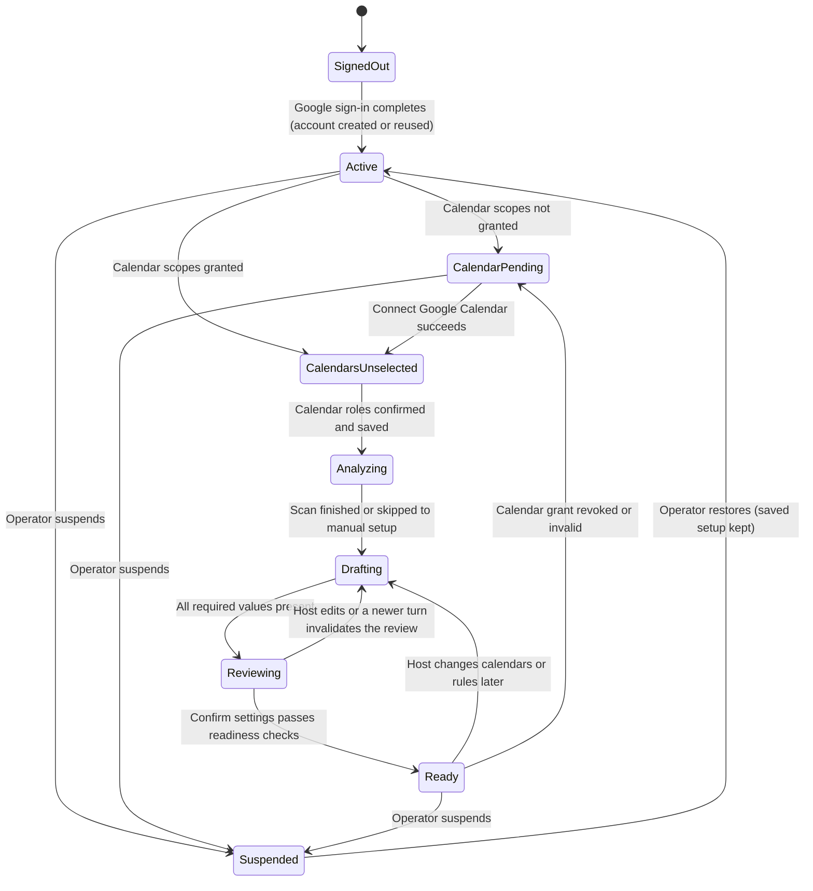
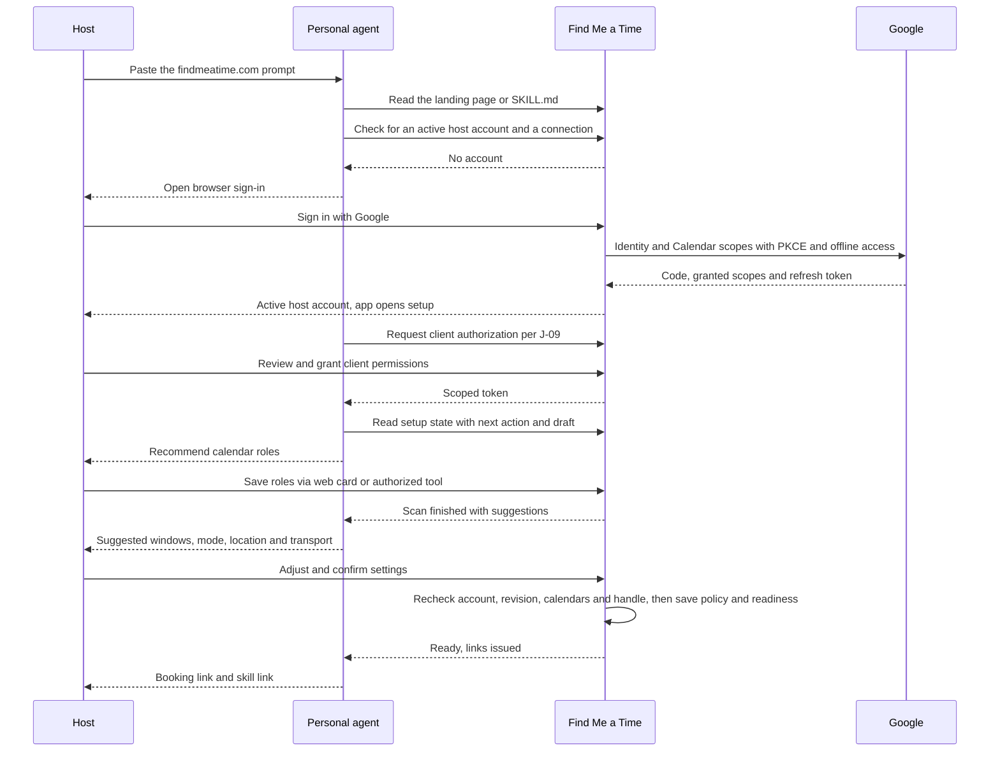

> 한국어 번역본 (검토용). 원본: documentations/user_experience/05_host_onboarding_flow.md

# 호스트 온보딩 흐름

상태: 제안된 흐름 설계, 구현 대기 중\
날짜: 2026-10-19\
근거: [J-01 호스트 설정](01_user_journeys.md#j-01--host-setup), [PRD 5절](../02_product_requirements.md#5-main-user-journey), [호스트 계정 계약](../../openspec/specs/host-admission/spec.md), [채팅 작업 공간 계약](../../openspec/specs/chat-workspaces/spec.md), [분석 보존 계약](../../openspec/specs/calendar-analysis-retention/spec.md)\
관련 문서: [게스트 예약 흐름](06_guest_booking_flow.md), [에이전트 구성](../technical_specification/04_agent_configuration.md)

이 문서는 호스트 온보딩을 상태, 단계, 서버 확인, 기록되는 데이터로 나누어 설명합니다. 여정 문서가 경험을 설명한다면, 이 흐름 문서는 각 전환 시점에 무엇이 참이어야 하는지를 설명합니다. 새로운 동작을 도입하지 않으며, 어떤 단계가 계약에 의존하는 경우 계약이 우선합니다.

## 범위

다루는 범위: 첫 방문 또는 붙여넣은 프롬프트에서 시작하여 공개 예약 링크를 가진 **준비 완료(ready)** 호스트가 되기까지이며, 선택 사항인 개인 에이전트 연결과 선택 사항인 iMessage 연결을 포함합니다. 다루지 않는 범위: 요청자가 도착한 이후의 요청 처리([게스트 예약 흐름](06_guest_booking_flow.md) 참조), 제안 검토(J-04~J-06), 운영자의 정지 처리(관리자 CLI).

두 가지 진입 경로가 모든 서버 확인을 공유합니다.

| 경로 | 진입 | 주도하는 쪽 | 차이점 |
|---|---|---|---|
| 에이전트 주도 | 호스트가 `Let me use findmeatime.com for my scheduling`을 개인 에이전트에 붙여넣음 | 에이전트가 `/SKILL.md`를 읽고, 기능을 확인하고, 브라우저 단계를 열고, 이어서 진행함 | 개인 에이전트 승인(J-09)이 추가되며, 링크를 에이전트 채팅으로 돌려줌 |
| 웹 직접 | 호스트가 `/`를 열고 **Google로 로그인(Sign in with Google)**을 선택 | `/app`의 앱 내 에이전트 대화 | 클라이언트 승인을 건너뛰며, 공유 링크는 작업 공간에 표시됨 |

## 설정 상태

서버는 로드할 때마다 지속되는 기록에서 상태를 도출하며, 브라우저는 상태를 보관하지 않습니다. **Ready**는 공개 프로필과 `/{handle}/SKILL.md`가 존재하는 유일한 상태입니다. 그 이전의 모든 상태는 [작업 공간 계약](../../openspec/specs/chat-workspaces/spec.md#requirement-conversation-first-entry)이 요구하는 대로 다음 동작을 먼저 보여 주며 `/app`에서 재개됩니다.

## 단계

| 단계 | 화면 | 호스트가 보고 하는 일 | 서버 확인과 기록 | 단계를 벗어나는 조건 | 실패하거나 중단될 때 |
|---|---|---|---|---|---|
| H0 진입 | 에이전트 채팅 또는 `/` | 프롬프트를 붙여넣거나 **Google로 로그인(Sign in with Google)**을 선택 | 에이전트 경로: 공개 페이지 또는 `/SKILL.md`가 진입점을 알려 주며, 에이전트는 활성 호스트 계정과 연결이 있는지 서비스에 묻습니다. 로그인 전에는 비공개 상태가 없음 | 호스트가 브라우저 로그인으로 이동하거나, 기존 활성 호스트가 이어서 진행함 | 문서를 읽거나 연결할 수 없는 클라이언트에는 지원되는 가장 작은 단계 또는 웹 URL을 안내하며, 완료되었다고 주장하지 않음 |
| H1 로그인과 캘린더 동의 | Google 동의 화면, `/auth/callback` | 한 번의 Google 화면에서 신원과 캘린더 접근(선택한 캘린더 읽기, 이벤트 생성)을 요청합니다. 호스트는 캘린더 부분의 체크를 해제할 수 있음 | 이 브라우저에 묶인 PKCE, 오프라인 접근 요청. 콜백은 Google 신원, 실제로 부여된 스코프, 리프레시 토큰을 기록한 뒤, Google 신원당 활성 호스트 계정 하나를 만들거나 기존 계정을 반환합니다. 허용 목록에 있는 상대 경로 목적지로만 리디렉션 | `/app`이 **Active** 상태로 열림 | 취소되었거나, 재생되었거나, 다른 브라우저에서 돌아온 경우 세션이 만들어지지 않으며, 호스트는 `/app`에서 다시 시작함. 캘린더 스코프를 해제해도 계정은 만들어지며 **CalendarPending**으로 이어짐 |
| H2 에이전트 승인(에이전트 경로) | `/connect/authorize` | 클라이언트가 요청한 애플리케이션 권한을 검토하고 허용하거나 거부 | PKCE를 사용하는 리소스 바인딩 OAuth와 정확히 등록된 콜백. 승인은 이 호스트와 나열된 작업에 묶임. 캘린더 접근이나 회의 승인은 부여하지 않음 | 클라이언트가 범위가 제한된 토큰을 보유하거나, 호스트가 거부함 | 거부해도 웹 직접 설정은 계속 사용할 수 있으며, 에이전트는 연결되었다고 주장하면 안 됨 |
| H3 작업 공간 재개 | `/app` | 설정 대화가 서버가 도출한 다음 동작과 함께 열리며, 작성된 메시지는 한 번에 하나씩 나타남(인사, 연결 안내 또는 검증된 축하 메시지, 이어서 캘린더 선택) | 비공개 상태에는 활성 호스트 계정이 필요함. 저장된 초안이 있으면 복원됨 | 아직 끝나지 않은 다음 단계가 표시됨 | 정지된 호스트에게는 로그아웃과 승인 철회만 있는 중립적인 이용 불가 상태가 표시됨 |
| H4 캘린더 역할 | 캘린더 선택 카드 | 계정과 접근 라벨, 짧은 이유와 함께 호스트의 실제 캘린더를 확인합니다. 에이전트가 충돌 확인 캘린더와 쓰기 가능한 예약 대상 캘린더 하나를 추천하면, 호스트가 편집하고 저장 | 부여된 캘린더 스코프가 필요하며, 없으면 **Google Calendar 연결(Connect Google Calendar)**이 먼저 나타남. 대상 캘린더가 쓰기를 받는지 검증함. 저장하면 확정된 역할이 보관되고 공개된 첫 스캔이 시작됨 | 역할이 저장됨 | 읽을 수 없는 캘린더는 가정이 아니라 질문이나 복구 동작을 만들어 냄. 승인이 없으면 **CalendarPending**이 여기로 돌아옴 |
| H5 분석 | 분석 카드 | 어떤 캘린더와 어떤 기간(과거와 다음 4주)을 읽는지 확인한 뒤, 네 가지 차원(선호 시간대, 내부/외부로 나눈 주간 미팅 부하, 메모성 이벤트, 자주 가는 지역과 장소)의 근거 또는 제한된 실패를 확인 | 저장된 충돌 확인 캘린더만 읽으며 참석자 이메일 도메인만 집계하고 메시지 본문이나 연락처는 읽지 않음. 임시 증거에는 [보존 계약](../../openspec/specs/calendar-analysis-retention/spec.md)에 따른 만료가 있으며, 정책이 되지 않음 | 제안을 사용할 수 있거나, 호스트가 **직접 설정(Set up manually)**를 선택함 | **다시 분석(Analyze again)**이 명시적인 새로고침이며, 새로 로드하거나 닫거나 만료되어도 새 스캔이 시작되지 않음 |
| H6 선호 제안 | 제안 카드와 주간 미리보기 | 시간대, 관찰된 빈도 순으로 정렬한 주간 회의 가능 시간대, 주당 미팅 상한, 제외할 메모성 이벤트, 기본 소요 시간, 버퍼를 각각 명시됨, 추론됨, 시작용 기본값으로 표시하고 표본 수를 함께 보여 주며, **이대로 사용(Use this)**, **Adjust(조정)**, **직접 선택(Choose my own)** 제공 | 리비전과 함께 초안 값을 기록함. 직접 입력한 수정은 초안을 갱신하고 이전 검토를 무효화함. 아직 확정된 정책은 없음 | 필수 값이 모두 있음 | 모델이 실패해도 구조화된 편집기와 기존에 저장된 규칙은 계속 사용할 수 있음 |
| H7 방식, 장소, 이동 수단 | 명시적 질문 카드 | **Online(온라인)**, **대면(In person)**, **Either(둘 다)** 중 하나로 답합니다. 대면이나 둘 다인 경우 선호 지역이나 장소(관찰된 가장 빈번한 지역과 장소를 먼저 제시), **장소 입력(Enter a place)** 또는 **회의마다 결정(Decide per meeting)**을 고르고, 이어서 평소 이동 수단 또는 **이동에 따라 다름(Depends on the trip)**과 추가 이동 버퍼를 선택 | 명시적인 답이 필요하며, 제안이나 미리 선택된 값은 답이 아님. 온라인 전용이면 장소와 이동 수단을 건너뜀. 집이나 직장 주소는 절대 추론하지 않음 | 방식이 기록되고, 해당하는 경우 장소와 이동 수단 정책이 기록됨 | 지원되지 않는 지역의 경로 계산은 미해결로 남거나 명시적인 수동 허용치를 사용함 |
| H8 핸들 | 검토 화면의 핸들 입력란 | 제안된 핸들을 확인하고 변경할 수 있음 | 고유해야 하고, 예약어가 아니어야 하며, 변경 횟수에 제한이 있고, 다른 호스트에게 재할당되지 않음 | 핸들이 수락됨 | 충돌하거나 예약된 이름은 어느 쪽 신원도 바꾸지 않고 거부됨 |
| H9 최종 검토와 확정 | 설정 검토 카드 | 시간대, 방식, 장소, 이동 수단을 포함해 제안된 설정을 정확히 읽은 뒤 **제안된 설정 확인 및 저장(Confirm and save proposed settings)**를 선택 | 하나의 트랜잭션 안에서 다시 확인함: 활성 계정, 현재 초안 리비전, 유효한 캘린더 메타데이터, 쓰기 가능한 대상 캘린더, 고유한 핸들, 필수 값. 확정된 정책을 저장하고 준비 완료를 설정함 | **Ready**: 공개 프로필, `/{handle}`, `/{handle}/SKILL.md`가 존재함 | 더 새로운 웹 또는 iMessage 턴이 검토를 무효화하며, 호스트는 최신 초안을 다시 검토함 |
| H10 링크 | 에이전트 채팅 또는 공유 링크 카드 | `findmeatime.com/{handle}`과 스킬 문서 링크를 받음 | 링크는 서버가 확인한 준비 완료 상태에서만 발급됨 | 완료 | 준비 완료 전에는 예약 링크가 표시되거나 반환되지 않음 |
| H11 선택 사항: iMessage 연결 | 인라인 채널 카드 | **iMessage 연결(Connect iMessage)** 또는 **나중에(Maybe later)**를 선택하고, 회선 번호와 **코드 복사(Copy)**가 붙은 일회용 연결 코드를 보고, **메시지 앱 열기(Open Messages)**를 눌러 코드가 이미 입력된 메시지 앱에서 자신의 iMessage로 보낸(또는 복사한 문구를 붙여 넣은) 뒤 마스킹된 발신자에서 **확인 및 연결(Confirm and link)**을 선택. 또는 **대신 코드 받기(Send me a code instead)**로 6자리 코드를 받아 같은 브라우저에 입력 | 채널은 모델 턴 이전에 수신 연결 메시지를 소비해 이 세션에 바인딩된 대기 중 연결 요청과 대조하며, 대체 경로의 코드 입력란은 서버로 직접 전송됨. 어느 코드도 대화 기록이나 모델 컨텍스트에 들어가지 않음. 연결은 브라우저 확인 후에만 생성되며 나중에 해제할 수 있음 | 연결됨, 건너뜀 또는 미룸 | 잘못되었거나 만료되었거나 다른 발신자에게서 온 코드와 전송 실패가 있어도 웹 설정은 계속 사용할 수 있음. 대체 경로는 회선의 하루 신규 대화 한도 중 하나를 소모함. 이 델타는 제안 단계이며 실제 기기에서 검증되지 않음 |

H4~H9 단계는 하나의 대화 안에서 한 번에 작은 카드 하나씩 진행됩니다. 현재 단계의 카드만 최신 메시지 뒤에 열려 있고, 답변이 끝난 카드는 값과 **편집**이 담긴 한 줄 영수증으로 대화에 남으며(**편집**은 맨 아래에서 그 질문을 다시 합니다), 검토 단계에서 모든 답변을 마지막에 모아 보여 줍니다([한 번에 하나만 생각하게 한다](../03_design_principles.md#4-one-thing-to-think-about-at-once)). 에이전트는 안전하게 가능한 경우 제안된 답을 먼저 제시하고, 해결되지 않은 세부 사항에 대해서만 집중된 질문 하나를 던집니다. 세밀한 편집은 라벨이 붙은 채팅 내 편집기를 열며, 편집기를 닫으면 포커스가 복원됩니다.

## 기록되는 내용

| 기록 | 생성 시점 | 권위 있는 정보 | 비고 |
|---|---|---|---|
| 호스트 계정 | H1 | 신원, 상태(활성 또는 정지됨), 생성 시각 | Google 신원당 하나이며, 반복 로그인은 이를 반환함 |
| Google 승인 | H1 또는 H4 | 부여된 스코프와 암호화된 리프레시 토큰 | 한 화면에서 둘을 함께 요청했더라도 신원과 별도로 기록됨. 철회되면 호스트는 **CalendarPending**으로 돌아감 |
| 에이전트 승인 | H2 | 어떤 클라이언트가 어떤 호스트 작업을 호출할 수 있는지 | 설정에서 철회할 수 있으며, Google 및 회의 승인과 별개임 |
| 캘린더 역할 | H4 | 충돌 확인 캘린더와 쓰기 가능한 예약 대상 캘린더 | 메타데이터는 H9에서 다시 확인함 |
| 분석 증거 | H5 | 제안과 공개된 범위 | 임시이며 만료됨. 정책이 되지 않음 |
| 설정 초안 | H6~H8 | 리비전이 있는 진행 중인 값 | 편집으로 대체되며, 일정 계산에는 사용되지 않음 |
| 확정된 정책 | H9 | 규칙, 시간대, 가능 시간대, 소요 시간, 버퍼, 주당 미팅 상한, 메모성 이벤트 제외, 방식, 선호 지역과 기본 장소, 이동 수단 정책 | 실행 가능성 확인의 유일한 출처 |
| 핸들 | H8, H9에서 고정 | 공개 신원 | 안정적이며, 변경에는 횟수 제한이 있음 |
| 준비 완료 | H9 | 공개 프로필이 존재하는지 여부 | 공유된 자격 및 준비 완료 가드에서 도출되며, 클라이언트가 설정하지 않음 |
| 채널 연결 | H11 | 이 호스트의 검증된 iMessage 발신자 | 선택 사항이며, 연결을 해제하면 이후 접근이 철회됨 |

대화 런타임이 유지하는 메모리 슬롯은 권위 없는 컨텍스트만 담으며, 일정 정책은 확정된 설정 명령으로만 기록됩니다([에이전트 구성](../technical_specification/04_agent_configuration.md) 참조).

## 에이전트 주도 시퀀스

이 다이어그램은 전송 세부 사항이 아니라 권한을 보여 줍니다. 브라우저 단계(로그인, 클라이언트 동의, iMessage 코드)는 에이전트 채팅을 거치지 않습니다.

## iMessage에서의 설정 진행(Setup over iMessage)

iMessage를 연결한 호스트(H11)는 대화형 단계를 모두 그곳에서 진행하거나 재개할 수 있습니다. 채널은 검증된 발신자를 호스트 주체와, `/app`이 사용하는 것과 같은 설정 세션에 매핑하므로 진행 상황, 초안, 다음 동작이 공유됩니다. iMessage에서 답한 질문은 웹에서 다시 묻지 않으며, 그 반대도 마찬가지입니다. `setup` 명령은 온보딩에 들어가거나 돌아오고, `review`는 현재 설정 검토를 보여 줍니다.

| 단계 | iMessage에서 | 이유 |
|---|---|---|
| H1 로그인, H2 클라이언트 동의, H4 캘린더 권한 부여 | 링크가 브라우저를 열고, 대화는 검증된 결과와 함께 재개됨 | Google 동의와 OAuth는 브라우저에서 하는 동작이며, 토큰은 채팅을 거치지 않음 |
| H4 캘린더 역할 | 에이전트가 호스트의 캘린더를 추천 역할과 함께 나열하고, 호스트가 텍스트로 답함(“개인이랑 수업 캘린더로 충돌 확인하고, 예약은 개인 캘린더에”). 에이전트가 파악한 선택을 되읽어 주고, 호스트가 확인하면 저장함 | 웹 카드와 같은 캘린더 메타데이터 확인 |
| H5 분석, H6 제안, H7 방식·장소·이동 수단 | 각 질문은 근거와 제안 답변이 담긴 메시지 하나로 도착하며, 평범한 답장(“네”, “오후 1시 괜찮아요”, “대면으로, 역삼에서”)은 에이전트가 파악한 내용을 되읽어 준 뒤 초안을 갱신함 | 초안 변경은 되돌릴 수 있으며, 모호한 답장에는 확인 질문을 한 번 함 |
| H8 핸들 | 제안으로 제시되며, 답장은 웹 입력란과 같은 방식으로 검증됨 | 예약되었거나 이미 사용 중이거나 요청 한도에 걸린 핸들은 답장에서 설명함 |
| H9 최종 검토와 확정 | 에이전트가 검토 참조와 함께 작성된 전체 검토를 보내고, 호스트는 그 참조에 대한 정확한 사전 작성 명령으로 확정하거나 웹 검토 링크를 엶 | 확정은 정확한 검토를 지정해야 하며, 줄인 요약이나 “ok”로는 정책을 저장할 수 없고, 메시지 하나에 담기지 않는 검토는 브라우저로 넘어감 |
| H10 링크 | 서버가 준비 완료를 확인하면 대화에서 돌려줌 | 동일한 준비 상태 확인 |

iMessage에서 한 답은 H9 확정 전까지 초안 변경일 뿐 확정된 정책이 아닙니다. 이후의 변경도 같은 방식으로 이루어집니다. 호스트가 바꿀 내용을 쓰면 에이전트가 결과 초안을 되읽어 주고, 정확한 명령이 이를 확정합니다. iMessage 설정 확정은 제안된 iMessage 델타에 속하며, 구현 전에 별도의 검토된 변경이 필요합니다.

## 중단, 재개, 실패

| 상황 | 동작 |
|---|---|
| 호스트가 설정 도중 브라우저나 에이전트 세션을 닫음 | 다음에 `/app`을 방문하거나 다음 에이전트 턴이 오면, 이미 답한 질문을 반복하지 않고 저장된 초안과 서버가 도출한 다음 동작에서 재개됨 |
| 호스트가 온보딩 프롬프트를 다시 실행함 | 기존 계정과 초안을 재사용하며, 두 번째 호스트는 만들어지지 않음 |
| 로그인 시 캘린더 스코프를 해제함 | 계정은 존재하며, 설정에서 캘린더 역할 전에 **Google Calendar 연결(Connect Google Calendar)**이 표시되고 관련 없는 설정은 계속 편집할 수 있음 |
| 설정 이후 Google 승인이 철회되거나 만료됨 | 캘린더에 의존하는 동작에 대해 호스트는 **CalendarPending**으로 돌아감. 공개 프로필은 대상 캘린더가 여전히 쓰기 가능한 동안에만 유지되며, 그렇지 않으면 다시 연결될 때까지 새 요청을 받을 수 없음 |
| 분석 중 캘린더 읽기가 실패함 | 실패를 공개하고, 호스트는 다시 시도하거나 선호를 직접 설정함. 가용 시간을 가정하지 않음 |
| 모델을 사용할 수 없음 | 보내지 않은 텍스트는 계속 보임. 구조화된 편집기, 저장된 역할, 확정된 규칙은 계속 사용할 수 있으며, 중단된 대화의 복구는 명시적인 동작임 |
| 오래된 검토가 확정됨 | 확정이 거부되고 현재 초안이 표시되며, 아무것도 저장되지 않음 |
| 운영자가 계정을 정지함 | 호스팅 작업과 공개 프로필이 중단됨. 로그아웃과 승인 철회는 남아 있으며, 복원하면 저장된 설정이 돌아옴 |
| 클라이언트 동의가 거부되거나 클라이언트에 기능이 없음 | 에이전트는 가장 작은 다음 단계를 설명하거나 웹 URL로 넘기며, 설정이 완료되었다고 보고하지 않음 |

## 흐름 완료 전 확인 사항

- 첫 로그인은 활성 계정을 정확히 하나 만들며, 반복 로그인과 두 번째 온보딩 실행은 아무것도 만들지 않습니다(AC-26).
- 설정은 중단 후에도 호스트가 중복 생성되지 않고 이미 제공한 정보를 반복하지 않은 채 재개됩니다(AC-25).
- 캘린더 추천은 이유와 함께 실제 캘린더에서 나오며, 호스트가 바꿀 수 있고, 읽기 실패는 질문이 됩니다(AC-28).
- 링크는 서버가 확인한 준비 완료 이후에만 반환되며, 정지된 호스트는 중립적인 이용 불가 결과를 봅니다(FR-35, AC-26).
- 방식, 장소, 이동 수단 답은 명시적이며, 온라인 전용이면 이동 수단을 건너뛰고, 기본값을 관찰된 패턴으로 설명하지 않습니다(FR-04).
- iMessage 코드는 대화 기록이나 모델 컨텍스트에 나타나지 않습니다(AC-17, 제안된 델타).

PRD 참조: FR-01~FR-04, FR-18, FR-26, FR-31, FR-33, FR-35; AC-09, AC-17, AC-19, AC-23, AC-25, AC-26, AC-28.

## 열린 결정 사항

2026-10-19에 [`host-onboarding` 설계](../../openspec/changes/host-onboarding/design.md)에서 확정됨: 핸들 할당 규칙, 예약 목록, 가입 및 핸들 변경의 수치 제한; 가능 시간대, 소요 시간, 버퍼의 시작용 기본값; 지원하는 이동 수단; 분석 증거의 24시간 보존 기간.

아직 열려 있음: 서비스가 보내는 코드를 대체 경로로 둔 호스트 발송 연결 코드 델타와 기기 검증(6단계); 터미널 기반 에이전트를 위한 CLI 로그인(5단계).
