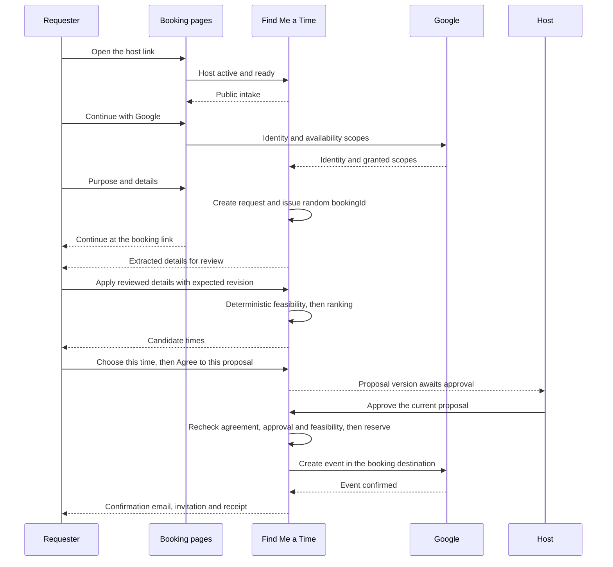

> 한국어 번역본 (검토용). 원본: documentations/user_experience/06_guest_booking_flow.md

# 요청자 예약 흐름

상태: 제안된 흐름 설계이며 구현은 보류 중\
날짜: 2026-10-19\
근거: [J-02](01_user_journeys.md#j-02--request-through-a-booking-link-or-email), [J-03](01_user_journeys.md#j-03--hand-the-booking-link-to-a-personal-agent), [J-07](01_user_journeys.md#j-07--revise-a-proposal-or-resolve-a-lack-of-suitable-times), [J-08](01_user_journeys.md#j-08--booking-recovery-and-closed-requests), [회의 요청 계약](../../openspec/specs/meeting-requests/spec.md), [실현 가능성 계약](../../openspec/specs/meeting-feasibility/spec.md), [공개 진입 계약](../../openspec/specs/public-agent-entry/spec.md), [이메일 전달 계약](../../openspec/specs/email-delivery/spec.md)\
관련 문서: [호스트 온보딩 흐름](05_host_onboarding_flow.md), [페이지 목록](04_page_list.md), [확인 이메일 설계](03_interfaces.md#booking-confirmation-email-and-calendar-invitation)

이 문서는 한 명의 요청자(게스트)가 호스트의 링크에서 출발해 확정된 회의 또는 종료된 요청에 이르기까지의 과정을 따라갑니다. 요청 상태, 각 단계, 서버가 확인하고 저장하는 내용, 그리고 흐름이 복구되는 방식을 기록합니다. 호스트 검토는 대기 상태로만 등장하며, 호스트 자신의 단계는 J-04부터 J-06에 있습니다.

## 범위

다루는 범위: 공개 진입, 신원과 시간대, 요청 생성과 예약 링크, 접수, 가용 시간, 후보 시간, 동의(요청자), 호스트 승인 대기, 예약, 확인, 그리고 그 과정에서 발생할 수 있는 모든 문제. 세 가지 진입 경로는 동일한 요청 레코드를 공유합니다.

| 경로 | 진입 | 주도하는 쪽 | 차이점 |
|---|---|---|---|
| 웹 | `findmeatime.com/{handle}`를 엽니다 | `/{handle}`의 접수 대화, 이후 `/booking/[bookingId]` | 없음; 기준이 되는 경로입니다 |
| 에이전트 주도 | `Let me schedule a meeting with findmeatime.com/dodo`를 개인 에이전트에 붙여 넣습니다 | 위임된 권한 범위 안에서 MCP 또는 CLI를 통한 요청자의 에이전트 | 계정이 필요 없고 요청 범위로 한정됩니다. 에이전트는 빠진 세부 정보나 위임 범위를 넘는 결정에 대해서만 요청자에게 묻습니다 |
| 이메일 | 호스트의 대화형 받은 편지함으로 메일을 보냅니다 | AgentMail을 통한 어시스턴트 | 검증된 이어가기는 예약 링크로 돌아오며, 발신자의 주장만으로는 아무 권한도 생기지 않습니다 |

## 요청 상태

```mermaid
stateDiagram-v2
    [*] --> Gathering: Request created (bookingId issued)
    Gathering --> Negotiating: Required details present; candidates evaluated
    Negotiating --> Gathering: Details change or a candidate needs clarification
    Negotiating --> AwaitingHostApproval: Requester agrees to the exact current proposal
    AwaitingHostApproval --> Negotiating: Host requests changes (new proposal version)
    AwaitingHostApproval --> Booking: Host approves the current version
    Booking --> Booked: Event creation confirmed
    Booking --> Negotiating: Final feasibility check fails
    Booking --> Booking: Uncertain write; reconciliation pending
    AwaitingHostApproval --> Declined: Host declines
    Gathering --> Withdrawn: Requester withdraws
    Negotiating --> Withdrawn: Requester withdraws
    AwaitingHostApproval --> Withdrawn: Requester withdraws
    Gathering --> Expired: Seven days or requested-window end
    Negotiating --> Expired: Seven days or requested-window end
    AwaitingHostApproval --> Expired: Seven days or requested-window end
    Booked --> [*]
    Declined --> [*]
    Withdrawn --> [*]
    Expired --> [*]
```

상태는 [수명 주기 계약](../../openspec/specs/meeting-requests/spec.md#requirement-persisted-lifecycle-and-closure-guards)을 따릅니다. 불확실한 쓰기가 있는 **Booking(예약 진행 중)**은 정합성 확인이 끝날 때까지 보류 상태로 남으며, 시간 초과가 이벤트가 생성되지 않았다는 뜻은 아닙니다. 종료 상태는 재전송으로 다시 열리지 않습니다.

## 단계

| 단계 | 화면 | 요청자가 보고 하는 것 | 서버의 확인과 기록 | 단계를 벗어나는 조건 | 실패하거나 중단될 때 |
|---|---|---|---|---|---|
| G0 진입 | `/{handle}`, 또는 에이전트가 `/{handle}/SKILL.md`를 읽음 | 호스트의 공개 신원과 대화형 접수([`requester-intake-and-feasibility` 제안](../../openspec/changes/requester-intake-and-feasibility/proposal.md#decisions-to-settle)은 목적, 신원, 시간대를 받는 정적 접수와 예약 링크에서 시작하는 대화를 권고, D11); 에이전트 섹션이 지침 문서로 연결됨 | 호스트는 활성 상태이고 준비되어 있어야 하며, 그렇지 않으면 이유 없이 중립적인 이용 불가 페이지를 보여 줍니다. 공개 페이지는 기존 요청을 노출하지 않습니다 | 접수가 시작됨 | 알 수 없거나 정지된 핸들은 존재하지 않는 핸들과 구별되지 않습니다. 연결할 수 없는 클라이언트에는 웹 URL을 안내합니다 |
| G1 신원과 시간대 | 게스트 신원 및 시간대 카드 | **Google로 계속(Continue with Google)**은 신원과 가용 시간 전용 캘린더 접근을 한 화면에서 요청하며, 또는 이름과 이메일로 **Google 없이 계속(Continue without Google)**; 감지된 시간대가 선택기와 함께 시간 옆에 표시됨 | 캘린더 부분을 선택하지 않아도 Google 신원이 이름과 이메일을 자동으로 채우며, Google이 인증한 주소는 인증된 연락처로 간주되므로 요청자가 주소를 바꾸지 않는 한 G5는 건너뜁니다. 캘린더 권한 부여는 별도로 기록되며 이 요청에 묶입니다. 명시적인 시간대 선택은 새로고침 후에도 유지됩니다 | 이름, 이메일, 시간대가 확인됨 | 동의를 취소하면 초안이 그대로 돌아옵니다. 변경되었거나 보증되지 않은 주소는 나중에 연락처 검증이 필요합니다 |
| G2 요청 생성 | 접수 대화 | 시작에 충분한 목적과 세부 정보를 제공함 | 서버가 생성한 무작위 UUID를 `bookingId`로 하여 요청을 만들고 해시로 저장합니다. 이 링크가 요청자의 유일한 자격 증명입니다. 이어가기는 `/booking/[bookingId]`로 이동합니다 | 안정적인 예약 링크가 있는 **Gathering(수집 중)** | 이용할 수 없는 호스트에는 아무것도 생성되지 않습니다. 에이전트 주도 생성은 재시도 시 두 번째 요청을 만들 수 없는 1회성 미래 요청 권한 부여를 사용합니다(제안된 변경분) |
| G3 접수 세부 정보 | 예약 대화와 검토 카드 | 영어 또는 한국어로 날짜, 시간 길이, 방식, 장소 또는 회의 링크를 설명하고, 추출된 변경 사항을 적용하기 전에 검토함 | 추출은 참고용입니다. 세부 정보, 가용 시간, 질문, 알 수 없는 의도를 선언하고 작성된 확인 질문을 사용하며 스스로 적용하지 않습니다. 적용하려면 예상 리비전이 필요합니다. 시간 범위는 미래에 시작해야 하며 알려진 시간 길이에 맞아야 합니다. 생략된 시간 길이는 임의로 만들어 내지 않습니다 | 목적, 신원과 연락처, 시간 범위, 시간대, 시간 길이, 방식, 장소 또는 링크가 갖춰짐 | 모호한 날짜나 오프셋은 실행 가능한 시간 범위 없이 확인 질문으로 이어집니다. 오래된 검토는 더 새로운 세부 정보를 덮어쓰지 않고 거부됩니다 |
| G4 가용 시간 | 캘린더 연결 카드, 또는 수동 시간 범위 | G1에서 이미 공유한 가용 시간을 사용하며, 그렇지 않으면 **Google 캘린더 연결(Connect Google Calendar)**(가용 시간 전용), 수동 시간 범위로 **지금은 건너뛰기(Skip for now)**, 또는 에이전트가 승인된 가용 시간을 제공함 | 바쁜 시간대는 선택한 캘린더에서만 읽으며, 비공개 일정 세부 정보와 토큰은 호스트나 어떤 에이전트에도 전달되지 않습니다. 거부, 해지 또는 실패한 접근은 그에 의존하는 평가를 일시 중지시킵니다 | 사용 가능한 가용 시간 출처가 있음 | 캘린더 데이터를 사용할 수 없을 때 그 시간을 비어 있는 것으로 취급하지 않으며, 요청자에게 다시 연결하거나 가용 시간을 제공하도록 요청합니다 |
| G5 연락처 검증 | 연락처 검증 카드 | **인증 코드 보내기**, 여섯 자리 입력, **이메일 인증**; 대기 시간 이후 **새 코드 요청** | 직접 입력했거나 변경한 주소를 참석자로 신뢰하거나 링크 재전송에 쓰기 전에 필요하며, Google이 인증한 주소에는 코드가 필요하지 않습니다. 코드는 만료되고, 실패한 시도는 다섯 번까지 허용되며, 새 코드, 연락처 변경 또는 종료 시 무효화됩니다. 전달 증거는 증명과 별개입니다 | 연락처가 검증됨 | 불확실한 전달은 자동 재전송 없이 증명되지 않은 상태로 유지됩니다. 검증은 로그인, 동의(요청자), 예약을 부여하지 않습니다 |
| G6 후보 시간 | 후보 시간 카드 | 날짜, 시간, 명명된 시간대, 시간 길이, 방식이 포함된 실현 가능한 선택지를 받으며, 대안을 요청할 수 있음 | 결정론적 확인이 먼저 실행됩니다. 호스트 규칙, 버퍼, 선호 규칙으로서의 호스트 주당 미팅 상한, 양측의 바쁜 시간대, 날짜별 오프셋, 자정을 넘는 시간 범위, 대면 회의의 양방향 이동 구간이 포함되며, 알 수 없는 경로를 이동 시간 0으로 계산하지 않습니다. 모델 순위 매기기는 유효한 후보 시간의 순서만 정하며 필수 제약을 완화할 수 없습니다. 평가에는 공유 마감 시간이 있습니다 | 후보 시간이 하나 이상 있는 **Negotiating(조율 중)**, 또는 일치하는 시간이 없다는 결과 | 일치하는 시간이 없으면 J-07로 이동합니다. 요청자가 시간 범위를 넓히거나, 호스트가 비공개로 선호를 수정하거나 거절합니다. 요청자는 비공개 규칙이나 예외 사유를 보지 못합니다 |
| G7 선택과 동의(요청자) | 후보 시간 및 제안 검토 카드 | **이 시간 선택(Choose this time)**, 정확한 제안을 읽은 뒤 **이 제안에 동의(Agree to this proposal)** | 선택하면 변경할 수 없는 제안 버전이 만들어지며, 동의(요청자)는 그 버전에 대해서만 기록됩니다. “yes”나 “book it” 같은 메시지는 아무것도 기록하지 않습니다. 에이전트는 위임 범위 안에서 선택하고 동의할 수 있습니다 | **AwaitingHostApproval(호스트 승인 대기)** | 대체된 버전은 해당 동작을 거부하고 현재 제안을 보여 줍니다 |
| G8 호스트 검토 | 결정 및 예약 상태 카드 | 승인이 대기 중이며 아직 예약이 아님을 확인하고, 철회할 수 있음; 호스트가 변경을 요청하거나 승인하거나 거절하면 이메일로 알림을 받음 | 호스트는 웹, 에이전트 또는 iMessage를 통해 승인하거나 변경을 요청하거나 거절합니다(J-04부터 J-06). 세부 정보가 바뀌면 새 동의가 필요한 새 버전이 만들어집니다 | 호스트 승인, 새 버전, 또는 거절 | 변경된 제안의 승인은 불가능하며, 오래된 결정은 예약을 승인할 수 없습니다 |
| G9 예약 | 예약 상태 카드 | 예약이 진행 중이며 이벤트가 이미 존재할 수 있음을 확인함 | 전송 직전에 동의(요청자), 승인(호스트), 실현 가능성을 다시 확인하고, 예약 식별자, 대상, 고정된 페이로드, 예약 점유를 먼저 저장한 뒤 요청자를 참석자로 하여 호스트의 예약 대상에 이벤트를 생성합니다 | 생성이 확인되면 **Booked(예약 완료)** | 충돌은 J-07로 돌아가며, 명확히 거부된 쓰기는 호스트에게 모든 것을 다시 검증하는 재시도를 제공합니다. 불확실한 쓰기는 정합성 확인이 끝날 때까지 보류 상태로 남습니다 |
| G10 확인 | 확인 이메일, 캘린더 초대, 예약 링크의 영수증 | 자신의 언어와 시간대로 이메일을 받습니다(보낸 사람: 제품 발신 주소의 호스트 이름, 회신 주소: 호스트, “{title} between {host} and {guest}”, 무엇/언제/누구/어디, **예약 보기**, 온라인일 때 **회의 참여(Join meeting)**)와 캘린더 초대 | 모든 화면은 동일한 확정 이벤트 데이터에서 나옵니다. 캘린더 부분은 그 `UID`가 이벤트의 `iCalUID`와 일치할 때만 첨부되며, 캘린더 설명에는 예약 링크가 들어 있지 않습니다 | 완료 | 전달 실패는 이벤트를 다시 생성하지 않으며, 예약 상태와 별도로 보고됩니다 |
| G11 예약 이후 | `/booking/[bookingId]` | 나중에 링크를 열면 영수증만 보임 | 종료 후에는 링크로 생성일로부터 30일까지 최소한의 영수증을 읽을 수 있으며, 변경과 새 OAuth는 거부됩니다 | — | 예약 이후의 변경은 캘린더에서 이루어집니다. 자동 일정 재조정과 취소는 초기 릴리스 범위 밖입니다 |

## 에이전트 주도 방식의 차이

- **발견**: 에이전트는 일반 URL을 가져와 페이지 내 에이전트 섹션, 대체 링크 헤더, `llms.txt` 또는 `Accept: text/markdown`을 통해 지침 문서를 찾습니다. 명시적인 `/{handle}/SKILL.md` 경로는 대비책입니다. 문서를 읽는다고 아무것도 설치되거나 부여되지 않습니다.
- **연결**: MCP가 주 인터페이스이고 CLI는 터미널 기반 에이전트를 위한 것입니다. 둘 다 요청 범위로 한정된 계정 불필요 접근으로 공유 일정 API를 호출합니다. 설정이 빠져 있으면 연결이 존재한다고 주장하지 않고, 가장 작은 다음 단계나 웹 URL을 안내합니다.
- **생성**: 요청자는 표시된 호스트에 대해 클라이언트에 미래 요청 1건을 부여합니다. 정확히 동일한 재시도는 해당 요청을 복구할 뿐 다른 요청을 만들 수 없습니다(제안된 변경분이며 구현과 명명된 클라이언트 인수 검증은 보류 중).
- **위임**: 에이전트는 위임된 권한 범위 안에서 세부 정보를 제공하고, 후보 시간을 선택하며, 동의할 수 있습니다. 빠진 정보나 그 범위를 넘는 결정은 요청자에게 묻습니다. 호스트 승인은 절대 대신 제공하지 않습니다.
- **보고**: 에이전트는 예약이 성공한 뒤에만 확정된 회의를 보고하며, 그렇지 않으면 실제 상태나 필요한 조치를 보고합니다.

## 이메일 방식의 차이

호스트의 대화형 받은 편지함으로 메일을 보낸 요청자는 AgentMail 기반 어시스턴트의 답장을 받습니다. 인증된 수신 내역은 처리 전에 영구적으로 기록되고 중복이 제거되며, 검증된 연락처나 요청 권한으로 취급되지 않습니다. 브라우저 단계(캘린더 동의, 후보 시간 선택, 동의(요청자))는 연락처 검증 후 어시스턴트가 보내는 예약 링크에서 이어집니다. 호스트 자신의 이메일 채널은 제안된 확장이며 이 흐름에 포함되지 않습니다.

## 요청자가 볼 수 있는 것과 볼 수 없는 것

| 요청자에게 보이는 것 | 호스트 전용 |
|---|---|
| 제출한 세부 정보, 공유된 제안 버전, 후보 시간, 허용된 대화와 현재 상태 | 호스트 메모, 규칙, 선호 예외와 그 사유, 비공개 논의, 캘린더 내용과 이동 시간 추정치 |
| 확정된 영수증: 제목, 시간대가 포함된 시간, 참석자, 장소 또는 참여 링크 | 제공자 식별자, 예약 시도와 정합성 확인 상태 |

대상별 필터링은 직렬화 이전, 그리고 모델 컨텍스트를 만들기 이전에 서버에서 이루어집니다. 구조화된 연락처 필드는 값이 아니라 존재 여부 표시로 모델에 전달되며, 인식된 자격 증명은 저장되기 전에 대화 입력에서 제거됩니다. 요청자 세션에는 호스트 도구가 아예 등록되어 있지 않으며, 어떤 경계가 하드하고 어떤 것이 지침에 불과한지는 [권한 계층](../technical_specification/04_agent_configuration.md#permission-layers)에서 설명합니다.

## 요청자 알림(Requester notifications)

첫 릴리스에서 요청자의 알림 채널은 이메일입니다. 요청자에게는 계정도 등록된 전화번호도 없지만, 연락 이메일은 인증되어 있기 때문입니다. 모든 알림에는 현재 상태와 예약 링크가 담기며, 도메인 레코드에서 생성되고 확인 메일과 동일한 내구성 있는 Cloudflare 전달 방식을 사용합니다. 알림은 결정이 아니며 요청 상태를 바꾸지 않습니다. 요청자에 대한 iMessage나 SMS는 보류되어 있습니다(미결 결정 참조).

| 이벤트 | 이메일 | 다른 곳에서 확인 |
|---|---|---|
| 호스트가 변경을 요청하여 새 제안 버전이 요청자의 동의를 기다리는 경우 | 변경된 세부 정보와 예약 링크가 담긴 “조치 필요(Action needed)” 메일 | 예약 페이지, MCP 또는 CLI를 통한 요청자의 에이전트 |
| 호스트가 승인하여 이벤트가 확정된 경우 | 확인 메일과 캘린더 초대장(G10) | 예약 링크의 영수증, 확정된 미팅을 알려 주는 에이전트 |
| 호스트가 거절했거나 요청이 만료된 경우 | 종료된 상태를 알리며 추가 조치가 없는 상태 메일 | 예약 페이지에 종료 상태가 표시됨 |
| 예약이 정합성 확인 기간(reconciliation window)을 넘어 대기 중이거나 불확실한 상태로 남는 경우 | 결과를 확인하는 중임을 알리는 상태 메일 | 예약 페이지 |
| 어떤 알림이든 전달에 실패한 경우 | 전달 작업이 재시도하며, 예약 상태에는 영향이 없음 | 예약 페이지가 계속 기준이 됨 |

이메일로 진입한 요청자는 기존 AgentMail 대화 스레드에서 동일한 알림을 받습니다. 미팅 전 알림(reminder)은 미결 결정으로 남아 있습니다.

## 복구와 종료

| 상황 | 동작 |
|---|---|
| 예약 링크를 잃어버림 | 공개 호스트 페이지나 이용 불가 화면의 **내 예약 링크 다시 받기(Resend my booking link)**가 현재 링크를 검증된 연락처로만 보내며, 일반적인 피드백과 제한된 발급 횟수를 적용합니다. 새 자격 증명은 만들어지지 않습니다 |
| 링크를 알 수 없거나, 형식이 잘못되었거나, 만료됨 | 재전송 컨트롤이 있는 일반적인 이용 불가 화면. 요청의 존재 여부는 어디에서도 드러나지 않습니다 |
| 요청자가 예약 전에 철회함 | **철회됨(Withdrawn)**; 늦은 동의(요청자)나 승인(호스트)으로는 이벤트를 만들 수 없습니다. 불확실한 쓰기 중에는 보류 중인 결과를 대신 보고합니다 |
| 요청이 7일에 도달하거나 요청된 시간 범위가 끝남 | **만료됨(Expired)**; 이후의 결정은 거부되며 새 요청 또는 명시적으로 갱신된 요청이 필요합니다 |
| 호스트가 거절함 | **거절됨(Declined)**; 이전 메시지로는 예약을 다시 열 수 없습니다 |
| 결정이 여러 채널에서 반복됨 | 현재 결과를 보여 주며, 재시도는 하나의 식별자를 재사용하고 다른 이벤트를 만들지 않습니다 |
| 캘린더 쓰기가 불확실함 | 정합성 확인으로 이벤트의 존재 여부가 확정될 때까지 양쪽 모두 예약 보류 상태를 봅니다 |
| 이벤트가 확정된 뒤 확인 전달이 실패함 | 예약은 확정 상태로 유지되며, 이벤트를 다시 만들지 않고 전달을 재시도합니다 |
| 대화 제한(스로틀링) | 재시도 가능한 오류가 보내지 않은 메시지와 구조화된 컨트롤을 유지하며, 메시징 영수증은 순서대로 대기합니다 |
| 모델 장애 | 보내지 않은 텍스트와 커밋된 메시지는 유지되고 구조화된 컨트롤은 작동하며, 중단된 대화의 복구는 명시적으로 이루어집니다 |

## 웹 시퀀스

## 흐름 완료 전 확인 사항

- 요청자는 계정 없이 접수부터 확정된 이벤트까지 요청을 완료할 수 있으며, 빠진 필드를 가정으로 채우지 않습니다(AC-01).
- 대면 후보 시간을 제안하기 전에 양방향 이동 구간, 실패한 경로, 수동 허용치를 모두 지킵니다(AC-02).
- 호스트의 비공개 규칙과 예외 사유는 요청자 화면이나 요청자를 위한 모델 컨텍스트에 나타나지 않습니다(AC-03, AC-10).
- 제안이 변경되면 이전 결정이 무효화되고, 오래된 동의(요청자)는 거부됩니다(AC-04).
- 반복된 결정과 불확실한 쓰기는 하나의 일관된 결과와 최대 하나의 이벤트를 만듭니다(AC-06, AC-08).
- 확인은 이메일, 초대, 영수증에서 일관된 세부 정보를 보여 주며, 전달 실패는 예약 실패와 구별됩니다(AC-09, FR-23).
- 철회, 거절, 만료는 요청을 종료하고 되살아나는 것을 막습니다(AC-13).
- 캘린더 동의는 가용 시간 전용이며 선택 사항입니다. 거부되거나 실패한 접근은 비어 있는 시간을 가정하지 않고 평가를 일시 중지합니다(AC-27).
- 명명된 각 에이전트 클라이언트는 붙여 넣은 프롬프트 경로를 완료하거나 정직한 다음 단계를 받습니다(AC-24, AC-25).

PRD 참조: FR-05 to FR-15, FR-19 to FR-25, FR-29, FR-30, FR-32, FR-34, FR-36; AC-01 to AC-08, AC-10 to AC-15, AC-21, AC-22, AC-24, AC-25, AC-27.

## 미결 결정

에이전트 주도 생성을 위한 미래 요청 1건 권한 부여; 요청자에 대한 iMessage 또는 SMS 알림; 동의(요청자) 이후의 알림 및 후속 조치 정책; 링크 유출이 의심될 때의 링크 교체; 영어와 한국어 접수를 넘어서는 혼합 언어 허용.

[`requester-intake-and-feasibility` 제안](../../openspec/changes/requester-intake-and-feasibility/proposal.md#decisions-to-settle)은 3단계의 다음 결정을 각각의 권고와 함께 팀에 제시합니다: 온라인 회의 링크를 누가 만드는가, 지원 지역과 경로 최신성, 수동 이동 허용 시간, 검증 코드 값, 요청 생성 한도, 요청자 Google 동의. 이동 수단은 2단계에서 확정되었습니다.
